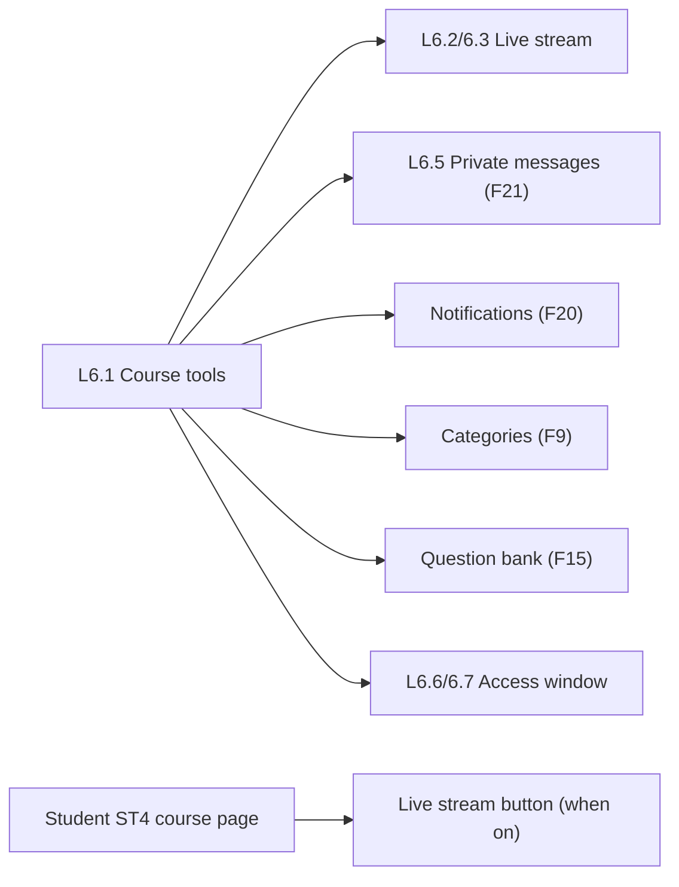

# Feature 22 — Course tools & access window · Mobile integration guide

> For: mobile developers · API `v1` · technical reference: [feature-22-course-tools-access.md](../features/feature-22-course-tools-access.md) · QA guide: [feature-22-course-tools-access-qa.md](feature-22-course-tools-access-qa.md) · related: [20](feature-20-notifications-mobile.md) notifications, [21](feature-21-private-messages-mobile.md) messages, [09](feature-09-categories-mobile.md) categories, [15](feature-15-question-bank-mobile.md) question bank

The «أدوات الكورس» page (L6.1) shows every tool of a course with its state line in **one** request. This feature owns two tools: the **live stream** link and the **access window** («مواعيد الوصول»: before / after it students get no content). It also adds the **student course page** (ST4).

---

## 1. Common rules

* Base URL `{{host}}/api/v1`; teacher calls send **`X-Teacher-Id`**.
* Envelope `{code, message, errors, data}`; **branch on `error_code`**.
* Dates are ISO 8601 with an offset; `null` = no bound («بدون وقت»).

---

## 2. Screens



---

## 3. Teacher API

Base `/teacher/courses/{courseId}`:

| Action | Request | Success |
|---|---|---|
| Tools summary | `GET /tools` | 200 |
| **Save all tools at once** | `PATCH /tools` (§3.4) | 200 |
| Live stream | `GET /live-stream` · `PATCH /live-stream` | 200 |
| Access window | `GET /access-window` · `PATCH /access-window` | 200 |

### 3.1 Tools summary (L6.1)

```json
{
  "live_stream": { "enabled": false, "provider": "youtube", "title": "مراجعة الوحدة الأولى", "started_at": "…", "last_ended_at": "2026-10-24T21:00:00+00:00" },
  "private_messages": { "private_messages_enabled": true, "allow_non_subscribed": false, "allow_images": true, "allow_voice": true, "enabled": true, "unread": 3 },
  "notifications": { "count": 12, "last_sent_at": "2026-10-25T10:00:00+00:00" },
  "categories": { "count": 7, "preview": ["Supply", "Production", "أخرى"] },
  "question_bank": { "count": 128, "by_type": { "true_false": 41, "single_choice": 62, "multiple_choice": 25 } },
  "access_window": { "opens_at": "2026-10-10T14:00:00+00:00", "closes_at": null, "state": "open" },
  "meeting": null,
  "discussion_board": null
}
```

`meeting` («اللقاء المباشر») and `discussion_board` («ساحة النقاش») are `null`: not built yet — show them as "soon" or hide them.

### 3.2 Live stream

```json
PATCH /teacher/courses/{courseId}/live-stream
{ "enabled": true, "url": "https://us02web.zoom.us/j/123456789", "title": "مراجعة ليلة الامتحان" }
```

| Field | Rule |
|---|---|
| `enabled` | turning it on needs a link (`422 LIVE_STREAM_URL_REQUIRED`) |
| `url` | an **https** link, ≤ 500 (`422 INVALID_LIVE_STREAM_URL`); `null` removes it (not while on) |
| `title` | ≤ 150, optional |

Response: `{enabled, url, title, provider, started_at, last_ended_at}`. `provider` (for the icon): `youtube`, `facebook`, `zoom`, `google_meet`, `other`. Turning on stamps `started_at`; off stamps `last_ended_at` («آخر بث كان امبارح»).

### 3.3 Access window

```json
PATCH /teacher/courses/{courseId}/access-window
{ "opens_at": "2026-11-01T17:00:00+02:00", "closes_at": "2027-06-30T23:59:00+03:00" }
```

* Send only what changes; `null` clears a bound.
* `closes_at` must be after `opens_at` (`422 INVALID_ACCESS_WINDOW`).
* Response: `{opens_at, closes_at, state}` with `state`: `not_yet_open`, `open`, `closed`.
* Outside the window **students** get no content (lectures, videos, files, exams, live stream). Teachers and secretaries are never affected. An exam attempt in progress is submitted when the window closes.

### 3.4 Save all tools in one request

```json
PATCH /teacher/courses/{courseId}/tools
{
  "live_stream": { "enabled": true, "url": "https://us02web.zoom.us/j/123456789", "title": "مراجعة الباب الأول - التفاضل" },
  "access_window": { "opens_at": "2026-10-10T17:00:00+03:00", "closes_at": "2027-06-30T23:59:00+03:00" },
  "private_messages": { "private_messages_enabled": true, "allow_non_subscribed": false, "allow_images": true, "allow_voice": true }
}
```

* Every block is optional (send at least one), and inside a block send only what changes: the same fields and rules as the single endpoints (§3.2, §3.3, Feature 21 settings).
* **All or nothing**: one error saves nothing. `errors[].key` is the nested field, e.g. `live_stream.url`, `access_window.closes_at`.
* Response: the tools summary (§3.1), so the screen refreshes from it.

---

## 4. Student course page (ST4)

`GET /student/courses/{courseId}`:

```json
{
  "id": "019a…", "code": "MATH-3S-01", "name": "مراجعة الرياضيات - الصف الثالث الثانوي", "image": "https://…", "term": "first",
  "teacher": { "name": "منى محمود" },
  "enrollment": { "id": "0199…", "status": "active", "has_access": true, "subscription_ends_at": "2027-01-31T00:00:00+00:00" },
  "access": { "opens_at": "2026-11-01T15:00:00+00:00", "closes_at": null, "state": "not_yet_open" },
  "live_stream": null
}
```

* `access.state: not_yet_open` → «الكورس هيفتح يوم …» from `opens_at`; `closed` → «انتهت مدة الوصول».
* `live_stream` is `{url, title, provider}` only when it is on, the subscription gives access and the window is open; otherwise `null` (hide the button).
* Content endpoints outside the window answer `403 COURSE_NOT_OPEN_YET` / `COURSE_ACCESS_CLOSED` with `details {opens_at, closes_at}`.

---

## 5. Errors to handle

| `error_code` | HTTP | Show |
|---|---|---|
| `LIVE_STREAM_URL_REQUIRED` | 422 | add the link first |
| `INVALID_LIVE_STREAM_URL` | 422 | must be an https link |
| `INVALID_ACCESS_WINDOW` | 422 | closing must be after opening |
| `COURSE_NOT_OPEN_YET` | 403 | student: course opens on `details.opens_at` |
| `COURSE_ACCESS_CLOSED` | 403 | student: access ended on `details.closes_at` |
| `COURSE_NOT_FOUND` | 404 | student not enrolled |
| `COURSE_NOT_ACCESSIBLE` | 403 | another teacher's course |

---

## 6. Checklist

- [ ] Tools page renders from one `GET /tools`; null tools hidden / "soon".
- [ ] Live stream switch disabled until a valid https link is entered; provider icon from `provider`.
- [ ] Access window pickers allow "no time" (`null`).
- [ ] Student course page shows the window state and the live button only when `live_stream` is present.
- [ ] Every student content screen handles `COURSE_NOT_OPEN_YET` / `COURSE_ACCESS_CLOSED`.
