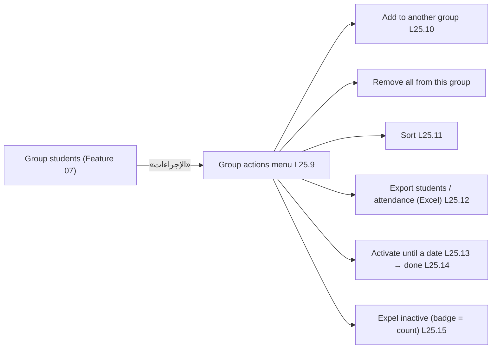

# Feature 25 — Group-wide actions · Mobile integration guide

> For: mobile developers · API `v1` · technical reference: [feature-25-group-actions.md](../features/feature-25-group-actions.md) · QA guide: [feature-25-group-actions-qa.md](feature-25-group-actions-qa.md) · prerequisites: [Feature 07 — group students](feature-07-group-student-management-mobile.md), [Feature 06 — payments](feature-06-enrollment-transactions-mobile.md)

Inside a group, one **«الإجراءات»** button (L25.1) opens the group actions menu (L25.9). Every item works on the **whole group**: the app never sends a list of students. Actions on students the teacher **selected** stay the Feature 07 bulk actions (L25.6–L25.7).

---

## 1. Common rules

* Paths: `/teacher/courses/{courseId}/groups/{groupId}/…` + `X-Teacher-Id` (a linked secretary sends the teacher's role id).
* **Never send student ids.** Any extra key (`enrollment_ids`, `course_enrollment_ids`, …) is a 422.
* Every write is **preview → confirm**:
  1. call the action's preview (or the inactive list) and build the confirm text from `data.count` («فعّل 38 طالب»);
  2. send that number back as `expected_count`;
  3. on **409 `GROUP_CHANGED`** the group changed meanwhile: nothing was done; show the fresh numbers from `details` and ask again.
* A group with more than `limit` students (500, in every preview) → 422 `GROUP_ACTION_LIMIT_EXCEEDED`.
* Responses are counts only (`{added, skipped}` …): refresh the roster afterwards.

---

## 2. Screens



Load `GET …/actions/inactive` when the menu opens: `data.count` is the badge on «طرد الطلاب غير المفعّلين» (hide the item at 0).

---

## 3. API

| Item | Preview | Confirm | Result `data` |
|---|---|---|---|
| Add to another group | `GET …/actions/add-to-group/preview?target_group_id=` | `POST …/actions/add-to-group` `{target_group_id, expected_count}` | `{added, skipped}` |
| Remove all from this group | `GET …/actions/remove-all/preview` | `POST …/actions/remove-all` `{expected_count}` | `{removed, suspended}` |
| Activate until a date | `GET …/actions/activate/preview?scope=` | `POST …/actions/activate` `{ends_at, scope, expected_count}` | `{updated, unchanged, skipped_expelled}` |
| Expel inactive | `GET …/actions/inactive` | `POST …/actions/expel-inactive` `{expected_count}` | `{expelled}` |
| Sort | — | `GET …/students?sort=` | roster |
| Export students | — | `GET …/students/export.xlsx` | file |
| Export attendance | — | `GET …/students/attendance.xlsx` | file |

### 3.1 Add to another group (L25.10)

Show the course's **active** groups except this one (`GET /teacher/courses/{courseId}/groups`). After a pick, call the preview:

```json
{ "count": 41, "to_add": 38, "skipped": 3, "skipped_expelled": 1, "available_seats": 29, "limit": 500 }
```

* Text: «هيتضاف 38 طالب · 3 موجودين بالفعل».
* `available_seats < to_add` (not `null`) → disable the button and show «المجموعة مفيهاش أماكن كفاية».
* Send `expected_count = count`. 422 `GROUP_CAPACITY_EXCEEDED` → `details {available, requested}`; 422 `INVALID_TARGET_GROUP` → the group became inactive / was deleted: reload the list.

### 3.2 Remove all from this group only

Preview `{count, will_be_suspended}` → «هيخرج {count} طالب من المجموعة دي بس. {will_be_suspended} هيتوقفوا لأن مالهمش مجموعة تانية.» Payments and other groups are kept.

### 3.3 Sort (L25.11)

| Option | `sort` |
|---|---|
| الاسم | `name` |
| الكود | `code` |
| أقرب انتهاء | `ends_at` (no end date last) |
| الأحدث انضمامًا | `joined_at` |
| آخر ظهور (الأقدم أولًا) | `last_seen_at` (never seen first) |

Keep the chosen sort with the other roster filters (`status`, `search`, `expiry`).

### 3.4 Export (L25.12)

Both endpoints return the **file** (not JSON) for the bearer request: download with the same headers, save with the name from `Content-Disposition` (`group-…-students-2026-10-28.xlsx`, `group-…-attendance-2026-10-28.xlsx`), then open the share sheet. Both are Excel files in the app language (send `Accept-Language`). The Excel export accepts the current roster filters and sort. Errors before the file starts are normal JSON (`ATTENDANCE_NOT_AVAILABLE` 409 → «الحضور مش متاح لسه»).

### 3.5 Activate until a date (L25.13 → L25.14)

* Date picker (future only) + a choice: «المفعّلين بس» (`active_only`) / «المفعّلين والموقوفين» (`active_and_suspended`).
* Preview with the chosen scope: `{count, active_only, active_and_suspended, skipped_expelled}` → button «فعّل {count} طالب»; note «{skipped_expelled} مطرود مش هيتغيروا».
* Send `ends_at` as ISO 8601 (`2026-12-31T00:00:00`).
* Done screen (L25.14): `updated` changed, `unchanged` already had that date.
* 422 with `details.enrollment_id` (`INVALID_SUBSCRIPTION_DATES`: that student starts after the date) → nothing changed; offer to open that student.

### 3.6 Expel inactive (L25.15)

`GET …/actions/inactive`:

```json
{
  "count": 2,
  "items": [
    { "id": "0199…", "student": { "code": "48213", "name": "سارة محمود", "image": null }, "status": "suspended", "reason": "suspended", "subscription_ends_at": null },
    { "id": "0199…", "student": { "code": "55102", "name": "كريم مصطفى", "image": null }, "status": "active", "reason": "expired", "subscription_ends_at": "2026-10-01T00:00:00+00:00" }
  ]
}
```

Row subtitle: `suspended` → «موقوف»; `expired` → «اشتراكه خلص {date}». Button «اطرد {count} طالب» sends `expected_count = count`.

---

## 4. Errors to handle

| `error_code` | HTTP | Show |
|---|---|---|
| `GROUP_CHANGED` | 409 | «المجموعة اتغيرت» + the new counts from `details`, then confirm again |
| `GROUP_ACTION_LIMIT_EXCEEDED` | 422 | the group is too big for one action (`details.limit`) |
| `GROUP_CAPACITY_EXCEEDED` | 422 | target group full: `details.available` / `details.requested` |
| `INVALID_TARGET_GROUP` | 422 | choose another active group of the course |
| `VALIDATION_ERROR` | 422 | past date, bad sort / scope (or a bug: an extra key was sent) |
| `ATTENDANCE_NOT_AVAILABLE` | 409 | attendance not available yet |
| `COURSE_NOT_ACCESSIBLE` / `GROUP_NOT_FOUND` | 403 / 404 | leave the screen |

---

## 5. Checklist

- [ ] One «الإجراءات» button; the menu shows the inactive badge from `GET …/actions/inactive`.
- [ ] No request sends student ids.
- [ ] Every write: preview → confirm text from `count` → `expected_count` → handle 409 by re-confirming.
- [ ] Sort options mapped to `sort`, kept with the other filters and passed to the Excel export.
- [ ] Exports downloaded as files and shared; JSON errors handled.
- [ ] Activate: future date only, scope choice, done screen with `updated` / `unchanged`.
