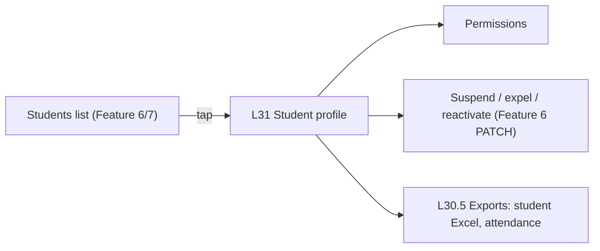

# Feature 08 — Student profile & controls · Mobile integration guide

> For: mobile developers · API `v1` · technical reference: [feature-08-student-profile-controls.md](../features/feature-08-student-profile-controls.md) · QA guide: [feature-08-student-profile-controls-qa.md](feature-08-student-profile-controls-qa.md) · prerequisites: [Feature 02](feature-02-teacher-secretary-mobile.md) (teacher context), [Feature 06](feature-06-enrollment-transactions-mobile.md) (enrollments)

The teacher (or a secretary working for them) opens a student **through one of the student's enrollments**: personal info, activity and devices, the enrollment, per-student permissions, and two exports. Suspend / expel / reactivate reuse the Feature 6 enrollment edit.

---

## 1. Common rules

* Base URL `{{host}}/api/v1`; headers `Authorization`, `Accept: application/json`, `Accept-Language: ar|en`, **`X-Teacher-Id`**.
* Envelope `{code, message, errors, data}`; **branch on `error_code`**.
* **Send the device headers on every authenticated call** (every feature, not only this one): the server builds "last seen" and the current device from them.

  ```
  X-Device-Id: 4f9c2a1e-7b7d-4c55-9a0c-1e2f3a4b5c6d    ← stable per install, 8–128 chars [A-Za-z0-9._:-]
  X-Device-Platform: android | ios | web
  X-Device-Model: Samsung Galaxy A54
  X-OS-Version: 14
  X-App-Version: 3.1.78
  ```

  Bad values are ignored, never an error. Generate the id once per install and keep it.

---

## 2. Screens



---

## 3. API

| Action | Request | Success |
|---|---|---|
| Profile | `GET /teacher/course-enrollments/{enrollmentId}/profile` | 200 |
| Permissions | `GET /teacher/course-enrollments/{enrollmentId}/permissions` | 200 |
| Change permissions | `PATCH /teacher/course-enrollments/{enrollmentId}/permissions` | 200 |
| Student Excel | `GET /teacher/course-enrollments/{enrollmentId}/export/student.xlsx` | 200 temporary link |
| Attendance | `GET /teacher/course-enrollments/{enrollmentId}/export/attendance.csv` | 200 temporary link |
| Download | `GET /exports/{token}` (no headers needed) | the file |
| Suspend / expel / reactivate | `PATCH /teacher/course-enrollments/{enrollmentId}` `{status}` (Feature 6) | 200 |

### 3.1 Profile

```json
{
  "data": {
    "enrollment_id": "0199a1b2-…",
    "student": {
      "role_id": "0199…", "code": "70954", "name": "عمر خالد", "email": "omar@darsly.test",
      "phone": "+20 1012345678", "image": null, "parent_phone": null, "governorate": "القاهرة",
      "joined_darsly_at": "2026-10-03T10:00:00+00:00"
    },
    "activity": {
      "last_login_at": "2026-10-21T09:00:00+00:00",
      "last_seen_at": "2026-10-21T13:20:00+00:00",
      "no_recorded_login": false,
      "current_device": { "platform": "android", "model": "Samsung Galaxy A54", "os_version": "14", "app_version": "3.1.78", "last_seen_at": "2026-10-21T13:20:00+00:00" },
      "previous_device": { "platform": "ios", "model": "iPhone 13", "os_version": "17.5", "app_version": "3.1.70", "last_seen_at": "2026-10-20T11:02:00+00:00" },
      "device_changed_at": "2026-10-20T12:30:00+00:00"
    },
    "enrollment": { "id": "0199a1b2-…", "status": "active", "groups": [ { "id": "…", "name": "المجموعة A", "is_active": true } ], "subscription_ends_at": "2027-01-31T00:00:00+00:00", "has_access": true, "access_reason": null, "total_paid": "600.00", "currency": "EGP" },
    "permissions": {
      "can_post_in_board": { "stored": null, "effective": true, "inherited": true },
      "can_send_private_messages": { "stored": false, "effective": false, "inherited": false }
    },
    "counts": { "transactions": 6, "groups": 1 }
  }
}
```

| Field | Display |
|---|---|
| `no_recorded_login: true` | "No recorded login" (not "never logged in": older logins weren't tracked) |
| `device_changed_at` | "Changed device on …" only when not null (a first device is not a change) |
| `previous_device` | null = only one device seen |
| `enrollment` | the Feature 6 enrollment object (status, groups, dates, access, payments summary) |

The profile is **read-only** (personal data belongs to the student). Suspended and expelled students stay viewable.

### 3.2 Permissions

Each permission has three states: **inherit the course default**, **allowed**, **not allowed**.

```json
PATCH /teacher/course-enrollments/{enrollmentId}/permissions
{ "can_post_in_board": null, "can_send_private_messages": false }
```

| Value | Meaning |
|---|---|
| `true` / `false` | explicit for this student |
| `null` | back to the course default (`inherited: true`) |
| omitted | unchanged |

* Strict JSON booleans: `"true"`, `1` → 422. At least one key; unknown keys → 422.
* Show `effective` as the switch state and `inherited` as a "course default" hint.
* The course default of `can_send_private_messages` is the course messaging setting ([Feature 21](feature-21-private-messages-mobile.md)).

### 3.3 Exports

```json
{ "data": { "type": "student_xlsx", "url": "https://…/api/v1/exports/Q7fK2…", "expires_at": "2026-10-22T09:10:00+00:00" } }
```

Open `url` in the browser / download manager / share sheet: **no** `Authorization` header is needed. The link works for 10 minutes and can be opened again until then. `410 EXPORT_LINK_EXPIRED` → ask for a new link.

* Student Excel: three Arabic sheets (student, subscription, payments).
* Attendance CSV: one row per assigned lecture and exam ([Feature 19](feature-19-progress-attendance-mobile.md)): `date,item,type,group,status,views,score,percentage`.

### 3.4 Suspend / expel / reactivate

Feature 6, unchanged: `PATCH /teacher/course-enrollments/{enrollmentId}` with `{"status": "suspended"}`, `{"status": "expelled"}` or `{"status": "active"}`. Shortcuts such as "+30 days" are computed by the app and sent as `subscription_ends_at` in the same PATCH.

---

## 4. Errors to handle

| `error_code` | HTTP | Show |
|---|---|---|
| `ENROLLMENT_NOT_FOUND` | 404 | the enrollment was deleted, or isn't in this teacher's courses; refresh |
| `ENROLLMENT_NOT_ACCESSIBLE` | 403 | not allowed (reserved for future granular permissions) |
| `VALIDATION_ERROR` | 422 | invalid permissions body |
| `EXPORT_LINK_EXPIRED` | 410 | the download link expired: request a new one |
| `ATTENDANCE_NOT_AVAILABLE` | 409 | attendance isn't available on this server |
| teacher-context errors | 403 / 422 | handled globally (Feature 2) |

---

## 5. Checklist

- [ ] Every authenticated call sends `X-Device-Id` (stable per install) and the other device headers.
- [ ] "No recorded login" wording for `no_recorded_login: true`.
- [ ] `device_changed_at` / `previous_device` shown only when present.
- [ ] Permission switches have three states (inherit / allow / deny); "reset to default" sends `null`.
- [ ] Booleans are real JSON booleans.
- [ ] Export links are opened without the bearer token; 410 asks for a new link.
- [ ] Suspend / expel / reactivate use the Feature 6 PATCH.
- [ ] Works the same in secretary mode.
