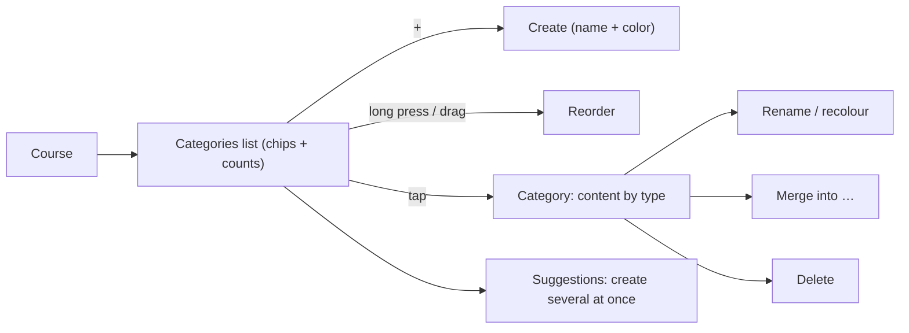

# Feature 09 — Course categories · Mobile integration guide

> For: mobile developers · API `v1` · technical reference: [feature-09-categories.md](../features/feature-09-categories.md) · QA guide: [feature-09-categories-qa.md](feature-09-categories-qa.md) · prerequisites: [Feature 02](feature-02-teacher-secretary-mobile.md) (teacher context), [Feature 03](feature-03-courses-mobile.md) (courses)

A **category** groups the content of one course: lectures, questions, exams and files («الوحدة الأولى», «مراجعة نهائية» …). The teacher creates, renames, recolours, orders, merges and deletes them; students see them as filter chips.

---

## 1. Common rules

* Base URL `{{host}}/api/v1`; headers `Authorization`, `Accept: application/json`, `Accept-Language: ar|en`, **`X-Teacher-Id`** (teacher screens).
* Envelope `{code, message, errors, data}`; **branch on `error_code`**.
* Categories live **inside a course**: every teacher URL has the course id (or `?course_id=` on `/teacher/categories`).
* Writes: 120 / minute per user (`429` + `Retry-After`).

---

## 2. Screens



---

## 3. API

| Action | Request | Success |
|---|---|---|
| List (one course) | `GET /teacher/courses/{courseId}/categories` | 200 |
| List (query parameter) | `GET /teacher/categories?course_id=` (no `course_id` = every course of the teacher, grouped) | 200 |
| Details | `GET /teacher/courses/{courseId}/categories/{categoryId}` | 200 |
| Content of one type | `GET …/categories/{categoryId}/items?type=lecture&page=1` | 200 |
| Create | `POST /teacher/courses/{courseId}/categories` | **201** |
| Create several | `POST …/categories/suggestions` | **201** |
| Edit | `PATCH …/categories/{categoryId}` | 200 |
| Reorder | `PUT …/categories/order` | 200 |
| Merge | `POST …/categories/{categoryId}/merge` | 200 |
| Delete | `DELETE …/categories/{categoryId}` | 200 |
| Student chips | `GET /student/courses/{courseId}/categories` | 200 |

### 3.1 Category object

```json
{
  "id": "019a…",
  "course_id": "019a…",
  "name": "الوحدة الأولى",
  "color": "#1F6FEB",
  "sort_order": 1,
  "counts": { "lecture": 3, "question": 41, "exam": 2, "file": 1, "total": 47 },
  "created_at": "2026-10-20T10:00:00+00:00",
  "updated_at": "2026-10-20T10:00:00+00:00"
}
```

Content objects (lectures, questions, exams, files) embed the short form `"category": {"id", "name", "color"}` or `null`.

### 3.2 Create

```json
POST /teacher/courses/{courseId}/categories
{ "name": "الوحدة الأولى", "color": "#1F6FEB" }
```

| Field | Rule |
|---|---|
| `name` | required, 1–60 characters; trimmed, inner spaces collapsed; unique in the course ignoring case and spaces |
| `color` | required, a colour string (hex such as `#1F6FEB`, or a palette key such as `cobalt`); returned as sent |

The new category goes to the **end** of the order. At most 50 per course.

### 3.3 Create several (suggestions)

```json
POST /teacher/courses/{courseId}/categories/suggestions
{ "names": ["الوحدة الأولى", "الوحدة الثانية", "مراجعة نهائية"], "color": "#16A34A" }
```

1–10 names; **all or nothing** (one taken name → 422 on `names.N`, nothing created).

### 3.4 Edit

```json
PATCH /teacher/courses/{courseId}/categories/{categoryId}
{ "name": "الوحدة الأولى - العرض والطلب", "color": "#F59E0B" }
```

Both optional; send only what changes.

### 3.5 Reorder

Send the moved category and its destination (positions start at **1**):

```http
PUT /teacher/courses/{courseId}/categories/order
```
```json
{ "category_id": "{categoryId}", "position": 1 }
```

The server moves this category to the requested position and shifts the others automatically, preserving their relative order. For example, moving C to position 1 changes A, B, C into C, A, B. The response contains all categories in their new order.

`category_id` must be a UUID of a non-deleted category in this course. `position` must be an integer from 1 to the current category count. Invalid inputs return 422 with `category_id` or `position`; nothing changes.

The legacy `{ "category_ids": [...] }` full-list format remains supported. Send one format per request; do not combine them. The legacy list must contain every category exactly once.

### 3.6 Merge A into B

```json
POST /teacher/courses/{courseId}/categories/{A}/merge
{ "target_category_id": "{B}" }
```

```json
{ "data": { "target": { "id": "{B}", "name": "…", "counts": { "…": 0 } }, "moved": { "lecture": 3, "question": 12, "exam": 1, "file": 0 } } }
```

Everything in A moves to B, then A is deleted. Merging into itself → 422 `CATEGORY_MERGE_SAME`.

### 3.7 Delete

`DELETE …/categories/{categoryId}` → `{ "released": { "lecture": 3, "question": 12, "exam": 1, "file": 0 } }`. The content is **kept** and becomes "uncategorized". Ask for confirmation showing these numbers (from `counts`).

### 3.8 Content of a category

`GET …/categories/{categoryId}/items?type=lecture|question|exam|file&page=1&per_page=15` → a page of that content type.

### 3.9 Student

`GET /student/courses/{courseId}/categories` → `[{id, name, color}]` in the teacher's order. The student must be enrolled with access (else `404 COURSE_NOT_FOUND`). Use them as filter chips on the lectures / exams / files screens.

---

## 4. Errors to handle

| `error_code` | HTTP | Show |
|---|---|---|
| `VALIDATION_ERROR` | 422 | field errors (`name`, `color`, `category_id`, `position`, `category_ids`, `names.N`) |
| `CATEGORY_NAME_TAKEN` | 422 | "A category with this name already exists" |
| `CATEGORY_LIMIT_REACHED` | 422 | "Maximum 50 categories" |
| `CATEGORY_MERGE_SAME` | 422 | pick another target |
| `CATEGORY_NOT_FOUND` | 404 | deleted meanwhile; refresh |
| `INVALID_CATEGORY` | 422 | (content screens) the chosen category was deleted; refresh the picker |
| `COURSE_NOT_FOUND` / `COURSE_NOT_ACCESSIBLE` | 404 / 403 | back to courses |

---

## 5. Checklist

- [ ] Colours are rendered from `color` exactly as returned.
- [ ] Reorder sends the full list.
- [ ] Delete / merge confirmations show the counts; delete says the content is kept.
- [ ] Content pickers (lecture, question, exam, file forms) offer "no category" (`category_id: null`).
- [ ] Student chips follow the teacher's order.
- [ ] Works the same in secretary mode.
