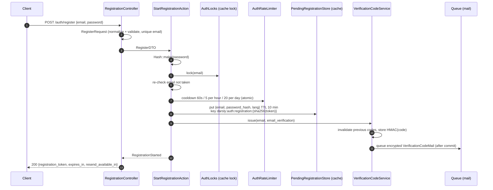
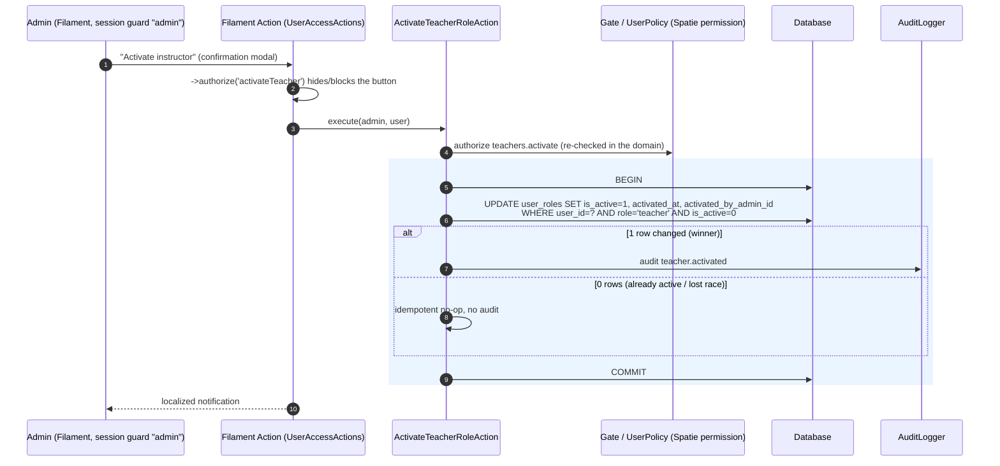

# Feature 01 — Authentication & Account Setup

> Status: implemented · API version: `v1` · Stack: Laravel 13, PHP 8.4, Sanctum 4, Socialite 5, Filament 5, Spatie Permission 8, Spatie Translatable 6

---

## 1. Business rules

| # | Rule | Where it is enforced |
|---|------|----------------------|
| 1 | There is **one** registration flow (email/password or Google). | `StartRegistrationAction`, `GoogleLoginAction` |
| 2 | Every account always gets **all three** roles: `student`, `teacher`, `secretary`. | `CreateUserAccountAction` (the only place accounts are created) |
| 3 | Every role has its **own globally unique code** (server generated). | `RoleCodeGenerator` + `user_roles.code` UNIQUE |
| 4 | Defaults: student **active**, teacher **inactive**, secretary **active**. | `UserRoleType::isActiveByDefault()` |
| 5 | Teacher activation happens only from Filament by an Admin. | `ActivateTeacherRoleAction` |
| 6 | Admin is **not** a Darsly role. Admins live in `admins` with Spatie permissions. | `Admin` model, `admin` guard |
| 7 | Normal registration does **not** create a `users` row before OTP verification. | Pending registration in cache |
| 8 | Google sign-up needs **no** OTP (Google verified the email). | `GoogleLoginAction` |
| 9 | Profile completion is tracked by `users.profile_completed_at` only. | `CompleteProfileAction`, `EnsureProfileIsCompleted` |
| 10 | **Single active session**: every login revokes all previous Sanctum tokens. | `SessionTokenService` |
| 11 | `users.is_login_allowed = false` blocks the whole platform; `teacher.is_active = false` only blocks instructor APIs. | `EnsureLoginIsAllowed`, `EnsureRoleIsActive` |
| 12 | Multilingual DB content uses Spatie Translatable (no translation tables). | `Government::$translatable` |

---

## 2. Module boundaries

```
app/Modules/
├── Shared/      ErrorCode enum, BusinessException (extends App\Exceptions\ApiException),
│                locale middleware, CacheKey/Locales helpers, AuditLogger (contract + DB impl),
│                SecurityLogger, default "api" rate limiter
├── Government/  Government model (translatable), cached repository, observer, GET /governments
├── User/        User + UserRole models, UserRoleType, repositories, RoleCodeGenerator,
│                CreateUserAccountAction, CompleteProfileAction, UpdatePreferredLanguageAction,
│                GET/PUT /me, middleware: login.allowed, role.active:{role}, profile.completed
├── Auth/        Registration/OTP/login/Google/password reset/logout actions, SocialAccount +
│                VerificationCode models, VerificationCodeService, AuthRateLimiter, AuthLocks,
│                PendingRegistrationStore, PasswordResetTokenStore, SessionTokenService,
│                Google ID-token verifier, queued mail + job, /auth/* routes, named limiters
└── Admin/       Admin model, AdminPermission/AdminRole/AuditAction enums, UserPolicy,
                 domain actions (activate/deactivate teacher, block/allow login, revoke sessions),
                 Filament panel + UserResource (presentation only)
```

Shared project infrastructure reused by every module:

| Concern | Project class | How Feature 1 uses it |
|---------|---------------|-----------------------|
| API responses | `App\Support\ApiResponse` | every controller: `(new ApiResponse)->isOk(___('...'))->setData($resource)->build()` (201 via `setStatus`) |
| API exceptions | `App\Support\ApiExceptions::apiException()` | registered in `bootstrap/app.php` for every `/api/*` exception |
| Translations | `___()` (`app/Helpers/Helper.php`, autoloaded via composer `files`) | every user-facing string; keys live in `lang/{ar,en}/lang.php` |
| File storage | `App\Support\StorageSupport` + `getImageUrl()` | profile image upload / delete and the `image_url` field |

Conventions kept from the project: migrations/factories/seeders stay in `database/`, the `App\` PSR-4 root is reused (no composer autoload change), Laravel 13 model attributes (`#[Fillable]`, `#[Hidden]`, `#[UseFactory]`) are used.

Layering (no pass-through layers):

```
Controller ─► FormRequest ─► DTO ─► Action (business rules, transaction) ─► Repository / Service ─► Eloquent
                                                                     └──► JsonResource ─► App\Support\ApiResponse
Filament Action ─► Admin Action (authorize + transaction + audit) ─► Eloquent / SessionTokenService
```

Repositories exist only where they add value (reusable lookups, lock reads, atomic counters, cached master data): `UserRepository`, `UserRoleRepository`, `VerificationCodeRepository`, `GovernmentRepository`.

---

## 3. Database schema

| Table | Key columns | Constraints / indexes |
|-------|-------------|------------------------|
| `governments` | `name` JSON (`{"ar","en"}`), soft deletes | — |
| `users` | `name`, `country_code`, `phone` (string), `image`, `government_id`, `email`, `email_verified_at`, `password` (nullable for Google), `preferred_language` (default `ar`), `is_login_allowed` (default `true`), `profile_completed_at`, soft deletes | `email` UNIQUE, `government_id` FK (null on delete) |
| `user_roles` | `id` (**UUID since Feature 2**, see [feature-02](feature-02-teacher-secretary.md)), `user_id`, `role`, `code`, `is_active`, `activated_at`, `activated_by_admin_id`, soft deletes | `(user_id, role)` UNIQUE, `code` UNIQUE, `(role, is_active)` INDEX, FKs |
| `social_accounts` | `user_id`, `provider`, `provider_user_id`, soft deletes | `(provider, provider_user_id)` UNIQUE, `(user_id, provider)` UNIQUE |
| `verification_codes` | `user_email`, `type`, `code_hash`, `expires_at`, `verified_at`, `attempts_count` | `(user_email, type)` INDEX, `expires_at` INDEX |
| `admins` | `name`, `email`, `password`, soft deletes | `email` UNIQUE |
| `audit_logs` | `actor_type/id`, `action`, `subject_type/id`, `metadata` JSON, `ip_address`, `user_agent`, `created_at` | morph indexes, `(action, created_at)` |
| `personal_access_tokens` | Sanctum | Sanctum defaults |
| `admin_roles`, `admin_permissions`, `admin_model_has_*`, `admin_role_has_permissions` | Spatie Permission (renamed so they can never be confused with Darsly `user_roles`) | Spatie defaults |

Index decisions: `(role, is_active)` covers "role only" lookups through its left prefix, so separate `role` / `is_active` indexes (low-cardinality boolean) were deliberately **not** added. Likewise `(user_email, type)` covers `user_email`.

Polymorphic columns store stable aliases via `Relation::enforceMorphMap()` (`user`, `admin`, `user_role`, …), never PHP class names.

---

## 4. Enums

| Enum | Values | DB column |
|------|--------|-----------|
| `UserRoleType` | `student`, `teacher`, `secretary` | `user_roles.role` (string, cast) |
| `SocialProviderType` | `google` | `social_accounts.provider` |
| `VerificationCodeType` | `email_verification`, `password_reset` | `verification_codes.type` |
| `ErrorCode` | language-independent API codes (+ HTTP status mapping) | — |
| `AdminPermission` | `users.view`, `users.block_login`, `users.allow_login`, `users.revoke_sessions`, `teachers.activate`, `teachers.deactivate` | Spatie (guard `admin`) |
| `AdminRole` | `super_admin` (all), `support` (`users.view`) | Spatie (guard `admin`) |
| `AuditAction` | `teacher.activated`, `teacher.deactivated`, `user.login_blocked`, `user.login_allowed`, `user.sessions_revoked` | `audit_logs.action` |

---

## 5. Normal registration flow

1. `POST /auth/register` → validate, normalize email (trim + lowercase), reject taken emails (soft-deleted included).
2. Hash the password (bcrypt) **before** caching it.
3. Under a per-email lock: re-check uniqueness, consume OTP send limits, store the pending registration, issue the OTP.
4. Respond with an opaque 64-char `registration_token`. **No `users` row exists.**



### Cache flow

| Key | Value | TTL |
|-----|-------|-----|
| `darsly:auth:registration:{sha256(token)}` | `{email, password_hash, preferred_language, created_at}` | `registration.cache_ttl` (600 s) |
| `darsly:auth:registration-email:{sha256(email)}` | `sha256(token)` of the **newest** pending registration | 600 s |
| `darsly:auth:registration-completed:{sha256(token)}` | completion marker (idempotent retries) | 900 s |
| `darsly:auth:password-reset:{sha256(token)}` | email | `password_reset.token_ttl` (600 s) |
| `darsly:auth:lock:*` | atomic locks | 10 s |
| `darsly:auth:rl:*` | rate-limiter counters (email hashed) | window |
| `darsly:auth:google:jwks` | Google signing keys used by the Socialite Google driver | Google `max-age` (5 min – 24 h) |
| `darsly:governments:all` | plain `[id, name JSON]` array | 24 h, flushed by observer |

Never cached: plaintext passwords, OTPs, Sanctum tokens, Google tokens. Raw tokens/emails never appear in keys. A new registration for the same email supersedes (and deletes) the previous pending payload, so the mailed OTP always belongs to the registration presented with it.

---

## 6. OTP / email verification flow

- 6 digits from `random_int` (CSPRNG).
- Stored as `HMAC-SHA256(APP_KEY, purpose|email|code)`: a leaked table cannot be brute-forced offline without the key, and a hash cannot be replayed for another email or purpose.
- Issuing a new code expires earlier unused codes for the same email + purpose.
- Max **5 wrong attempts per record**: `UPDATE … SET attempts_count = attempts_count + 1 WHERE attempts_count < 5` (atomic). The 5th wrong attempt invalidates the record (`429 TOO_MANY_VERIFICATION_ATTEMPTS`).
- Consumption is `UPDATE … SET verified_at = now() WHERE verified_at IS NULL AND expires_at > now()`, so a code is usable exactly once even under concurrency.

```mermaid
sequenceDiagram
    autonumber
    participant C as Client
    participant A as VerifyEmailAction
    participant S as PendingRegistrationStore
    participant L as AuthLocks
    participant V as VerificationCodeService
    participant U as CreateUserAccountAction
    participant DB as Database
    participant T as SessionTokenService
    C->>A: POST /auth/verify-email {registration_token, code}
    A->>S: completed marker? → 409 REGISTRATION_ALREADY_COMPLETED
    A->>S: find(token) → 422 REGISTRATION_EXPIRED if missing/superseded
    A->>L: lock(email)
    A->>S: re-check marker + payload (lost race → 409)
    A->>V: verify(email, code)
    V->>DB: latest code; attempts cap; expiry; hash_equals
    V->>DB: conditional UPDATE verified_at (single use)
    A->>U: NewAccountDTO(email, password_hash, lang)
    rect rgb(235, 245, 255)
    U->>DB: BEGIN
    U->>DB: INSERT users (email_verified_at = now, profile_completed_at = null)
    U->>DB: INSERT 3 user_roles (student ✔, teacher ✘, secretary ✔, unique codes)
    U->>DB: COMMIT (any failure → ROLLBACK everything)
    end
    A->>S: mark completed, delete pending payload + email pointer
    A->>T: issueSingleSession(user)
    A-->>C: 201 {access_token, token_type, is_new_user: true, user}
```

---

## 7. Google registration / login

The client authenticates with Google and sends **only** the ID token. Email, name and subject are read from the **verified** token; anything else in the body is ignored.

Verification uses **Laravel Socialite** (`laravel/socialite`), stateless: `Socialite::driver('google')->stateless()->userFromToken($idToken)`. Socialite checks the RS256 signature against Google's JWKS, `iss = https://accounts.google.com`, `aud = services.google.client_id` (`GOOGLE_CLIENT_ID`) and `exp`. `SocialiteGoogleIdTokenVerifier` adds what Socialite does not do:

- **ID tokens only.** Socialite treats any non-JWT string as an OAuth *access token* and calls Google's userinfo endpoint, which never checks which app the token was issued for — a token from any third-party app would sign the user in. Such tokens are rejected before Socialite is called.
- `email_verified` must be `true`.
- Google's keys are cached (`App\Modules\Auth\Socialite\GoogleProvider`, registered with `Socialite::extend('google', …)`); an unknown `kid` refreshes them once (key rotation).
- Missing `GOOGLE_CLIENT_ID` or an unreachable Google fails closed (`503 SERVICE_UNAVAILABLE`); expired tokens map to `SOCIAL_TOKEN_EXPIRED`, everything else to `INVALID_SOCIAL_TOKEN`.

Client requirement: request the ID token for the **server (web) client id** — on Flutter `GoogleSignIn(serverClientId: '<GOOGLE_CLIENT_ID>')`, on iOS/Android the equivalent "server client id" — so its `aud` matches `GOOGLE_CLIENT_ID`.

```mermaid
sequenceDiagram
    autonumber
    participant C as Client (Flutter/Web)
    participant G as Google
    participant A as GoogleLoginAction
    participant Ver as SocialiteGoogleIdTokenVerifier (Laravel Socialite)
    participant L as AuthLocks
    participant DB as Database
    participant U as CreateUserAccountAction
    participant T as SessionTokenService
    C->>G: Google Sign-In
    G-->>C: ID token (JWT)
    C->>A: POST /auth/google {id_token}
    A->>Ver: verify(id_token)
    Ver->>Ver: reject non-JWT (access tokens)
    Ver->>G: GET signing keys (cached)
    Ver->>Ver: Socialite userFromToken: signature, iss, aud, exp + email_verified
    Ver-->>A: GoogleIdentity(sub, email, name) or 401/422
    A->>L: lock(google sub)
    alt (google, sub) already linked
        A->>DB: load user (soft-deleted → 403)
    else email belongs to an existing account
        A->>DB: INSERT social_accounts (link; other Google id → 409)
    else new identity
        A->>U: create user + social_account + 3 roles (one transaction)
        Note over U: email_verified_at = now, profile_completed_at = null, no OTP
    end
    A->>A: is_login_allowed? (else 403 LOGIN_NOT_ALLOWED)
    A->>T: issueSingleSession(user)
    A-->>C: 201 (new) / 200 (existing) {access_token, is_new_user, user}
```

---

## 8. Login flow & single-session policy

```mermaid
sequenceDiagram
    autonumber
    participant C as Client
    participant A as LoginAction
    participant RL as AuthRateLimiter
    participant DB as Database
    participant T as SessionTokenService
    C->>A: POST /auth/login {email, password}
    A->>RL: ≥5 failures/min for email+IP? → 429 TOO_MANY_LOGIN_ATTEMPTS
    A->>DB: find active user by email (soft-deleted invisible)
    A->>A: Hash::check (dummy hash when unknown → same timing)
    alt invalid
        A->>RL: record failure
        A-->>C: 401 INVALID_CREDENTIALS (same for unknown email / Google-only / wrong password)
    end
    A->>RL: clear failures
    A->>A: is_login_allowed? → 403 LOGIN_NOT_ALLOWED
    rect rgb(235, 245, 255)
    A->>T: issueSingleSession(user, expectedPasswordHash)
    T->>DB: BEGIN; SELECT … FOR UPDATE users
    T->>T: re-check is_login_allowed and password hash unchanged
    T->>DB: DELETE all personal_access_tokens of user
    T->>DB: INSERT one new token; COMMIT
    end
    A-->>C: 200 {access_token, user}
```

Single-session guarantees: concurrent logins serialize on the user row lock, so exactly one token survives. The same `issueSingleSession` is used by verify-email and Google. Password reset, Admin block and Admin revoke delete all tokens. Logout deletes the current token; logout-all deletes every token. There is no `user_devices` table.

---

## 9. Profile completion

`PUT|PATCH /me/profile` requires `name`, `country_code` (`+20`), `phone` (6–15 digits, **stored as string**), `government_id` (existing, not soft-deleted), `preferred_language` (`ar|en`). `image` is optional (jpg/png/webp ≤ 2 MB; send multipart via `POST` + `_method=PUT`). It is stored with `StorageSupport::uploadFile()` on `filesystems.default` (`FILESYSTEM_DISK=public`); the previous image is removed with `StorageSupport::deleteFile()` only after the row is saved, and the new upload is deleted if the save fails. `image_url` is built with `getImageUrl()`. The first successful save sets `profile_completed_at = now()`; later edits keep the original timestamp. `GET /me` exposes `profile_completed` derived **only** from `profile_completed_at`.

Instructor routes (later features) must use:

```php
Route::middleware(['auth:sanctum', 'login.allowed', 'role.active:teacher', 'profile.completed'])->group(...);
```

---

## 10. Password reset

```mermaid
sequenceDiagram
    autonumber
    participant C as Client
    participant F as RequestPasswordResetAction
    participant J as SendPasswordResetCode (queued job)
    participant V as VerificationCodeService
    participant P as PasswordResetTokenStore
    participant R as ResetPasswordAction
    participant DB as Database
    C->>F: POST /auth/forgot-password {email}
    F->>F: rate limit per email (3 / 15 min, 10 / day) — same for unknown emails
    F->>J: dispatch (same work whether or not the email exists)
    F-->>C: 200 "If this email is registered, a verification code will be sent."
    J->>DB: active user with email?
    J->>V: issue(email, password_reset) (only if user exists)
    C->>V: POST /auth/verify-password-reset-code {email, code}
    V-->>P: code consumed → issue single-use reset_token (10 min)
    P-->>C: 200 {reset_token}
    C->>R: POST /auth/reset-password {reset_token, password}
    R->>P: atomically consume token (lock + pull)
    rect rgb(235, 245, 255)
    R->>DB: BEGIN; lock user; set new password + new remember_token
    R->>DB: DELETE all personal_access_tokens; COMMIT
    end
    R->>V: invalidate outstanding reset codes
    R-->>C: 200 (user logs in again)
```

---

## 11. Teacher activation (Filament)



Deactivation is symmetrical (`is_active=1 → 0`), never deletes the row, never touches student/secretary. Instructor APIs reject on the very next request because `role.active:teacher` reads the state from the database on every request (one indexed lookup; never cached).

---

## 12. Login blocking & session revocation (Filament)

```mermaid
sequenceDiagram
    autonumber
    participant Ad as Admin
    participant BA as BlockUserLoginAction
    participant DB as Database
    participant T as SessionTokenService
    participant AU as AuditLogger
    Ad->>BA: Block login (single or bulk)
    BA->>BA: authorize users.block_login
    rect rgb(235, 245, 255)
    BA->>DB: BEGIN; SELECT ids WHERE is_login_allowed=1 FOR UPDATE
    BA->>DB: UPDATE users SET is_login_allowed=0 WHERE id IN (...)
    BA->>T: DELETE personal_access_tokens WHERE tokenable_id IN (...) (always)
    BA->>AU: one INSERT audit row per changed user
    BA->>DB: COMMIT
    end
    Note over DB: Next API call with an old token → 401.<br/>Login → 403 LOGIN_NOT_ALLOWED.<br/>EnsureLoginIsAllowed also rejects any leftover token.
```

```mermaid
sequenceDiagram
    autonumber
    participant Ad as Admin
    participant RA as RevokeUserSessionsAction
    participant T as SessionTokenService
    participant AU as AuditLogger
    Ad->>RA: Revoke all sessions (single or bulk)
    RA->>RA: authorize users.revoke_sessions
    RA->>T: revokeAllForUserIds(ids) — one DELETE per 500 ids
    RA->>AU: audit user.sessions_revoked {tokens_revoked}
    Note over RA: Login stays allowed; the user simply signs in again.
```

**Allow login** sets `is_login_allowed = true` only — revoked tokens are never restored.

### Filament screens

- **Users list** (`/admin/users`): name, email, phone, government, preferred language, profile completed, login allowed, instructor active, registered at. Search: name, email, phone, **exact role code** (UNIQUE index). Filters: profile completed/incomplete, login allowed/blocked, instructor active/inactive (pending activation). Record actions: view, activate/deactivate instructor, block/allow login, revoke sessions. Bulk actions: block login, allow login, revoke sessions (IDs only, constant queries).
- **User details** (`/admin/users/{id}`): account data, email verification, profile completion, login state, and Student / Instructor / Secretary sections with code, active state and — for the instructor — activated at / activated by.
- All labels, filters, modals and notifications use `___()` (keys in `lang/{ar,en}/lang.php`).

### Admin permissions

| Permission | super_admin | support |
|------------|:-:|:-:|
| `users.view` | ✔ | ✔ |
| `users.block_login` | ✔ | |
| `users.allow_login` | ✔ | |
| `users.revoke_sessions` | ✔ | |
| `teachers.activate` | ✔ | |
| `teachers.deactivate` | ✔ | |

Panel entry requires an admin role; every action is gated twice (Filament `authorize()` and the domain action's `Gate::forUser($admin)->authorize()`), so a forged Livewire call still fails.

---

## 13. Rate limits

| Endpoint / purpose | Limit | Key | Error |
|--------------------|-------|-----|-------|
| Register | 5 / min | IP | `TOO_MANY_REQUESTS` |
| Send/resend email verification | 1 / 60 s, 5 / hour, 20 / day | email | `VERIFICATION_CODE_COOLDOWN`, `VERIFICATION_CODE_LIMIT_REACHED` |
| Verify OTP | 5 wrong attempts per record (+10 / min / IP) | record (+IP) | `TOO_MANY_VERIFICATION_ATTEMPTS` |
| Login | 5 failures / min | email + IP (+30 / min / IP ceiling) | `TOO_MANY_LOGIN_ATTEMPTS` |
| Forgot password | 3 / 15 min, 10 / day | email (+10 / min / IP) | `PASSWORD_RESET_LIMIT_REACHED` |
| Google | 10 / min | IP | `TOO_MANY_REQUESTS` |
| Authenticated API | 60 / min | user id or IP | `TOO_MANY_REQUESTS` |

All limits are in `config/darsly_auth.php`. Email-scoped counters use the atomic `RateLimiter::increment()` (hit, then compare), so simultaneous requests cannot share a slot. Every 429 carries `Retry-After`.

---

## 14. Localization

- `Accept-Language` (`ar`, `en`, region subtags and q-values honored; default `ar`) sets the response locale (`SetRequestLocale`, also applied to 404/405 responses). Responses carry `Content-Language`.
- All app text goes through the project helper `___('English text')`. The key is `Str::slug(text, '_')` in `lang/{ar,en}/lang.php` (e.g. `the_role_account_is_not_active`). Arabic and English files contain every key; `ErrorCode::message()` holds the English source text for each code.
- `___()` appends any **missing** key to every `lang.php` at runtime, so `tests/Feature/TranslationCoverageTest.php` fails the build if a key used in code is missing in a locale, untranslated in Arabic, or has mismatched `:placeholders`.
- Laravel validation messages stay in `lang/{ar,en}/validation.php` (the validator reads them directly).
- Error **codes never change** with the language; clients branch on `code`.
- `users.preferred_language` is stored at registration (body value or request locale) and drives email language.
- Government names are Spatie Translatable JSON; the API returns the current-locale name.

```json
{ "code": 403, "message": "حساب المحاضر غير مفعل", "errors": [], "data": null, "error_code": "ROLE_NOT_ACTIVE" }
{ "code": 403, "message": "The instructor account is not active.", "errors": [], "data": null, "error_code": "ROLE_NOT_ACTIVE" }
```

---

## 15. API reference

Base URL: `/api/v1`. Every response is built by `App\Support\ApiResponse`:

```json
{ "code": 200, "message": "Logged in successfully.", "errors": [], "data": { "access_token": "…", "user": { … } } }
```

- `code` is the HTTP status.
- Errors add `error_code`, the language-independent business code (clients branch on it):

```json
{ "code": 429, "message": "Please wait before requesting another verification code.", "errors": [], "data": null, "error_code": "VERIFICATION_CODE_COOLDOWN" }
```

- Validation errors (422, `error_code: VALIDATION_ERROR`) use ApiResponse's list format:

```json
{ "code": 422, "message": "Missing data", "errors": [ { "key": "email", "value": ["The email field is required."] } ], "data": null, "error_code": "VALIDATION_ERROR" }
```

- 429 responses also send `Retry-After`.

| Method | Path | Auth | Success |
|--------|------|------|---------|
| POST | `/auth/register` | — | 200 `registration_token` |
| POST | `/auth/verify-email` | — | 201 token + user |
| POST | `/auth/resend-verification-code` | — | 200 |
| POST | `/auth/login` | — | 200 token + user |
| POST | `/auth/google` | — | 201 new / 200 existing |
| POST | `/auth/forgot-password` | — | 200 (generic) |
| POST | `/auth/verify-password-reset-code` | — | 200 `reset_token` |
| POST | `/auth/reset-password` | — | 200 |
| POST | `/auth/logout` | Bearer | 200 |
| POST | `/auth/logout-all` | Bearer | 200 |
| GET | `/me` | Bearer | 200 |
| PUT/PATCH | `/me/profile` | Bearer | 200 |
| PUT/PATCH | `/me/language` | Bearer | 200 |
| GET | `/governments` | — | 200 |

HTTP codes: 200, 201, 401 (unauthenticated / invalid credentials / invalid Google token), 403 (blocked, role inactive, profile incomplete), 404, 409 (email registered, registration completed, social conflict), 422 (validation, invalid/expired code), 429 (all limits), 503 (Google unavailable).

---

## 16. Security decisions

| Threat | Mitigation |
|--------|-----------|
| Credential leakage | bcrypt (`hashed` cast); passwords > 72 bytes rejected (bcrypt truncation); only hashes in cache; `#[\SensitiveParameter]` on DTO secrets; `password`/`remember_token`/`code_hash` hidden; resources whitelist fields. |
| OTP brute force | 6-digit CSPRNG code, 10-min TTL, 5 attempts per record (atomic), per-email send limits, per-IP verify limit. |
| OTP leakage | HMAC-SHA256 with APP_KEY bound to purpose+email; mail queued with `ShouldBeEncrypted` (no plaintext in `jobs`/`failed_jobs`); never logged. |
| User enumeration | Generic forgot-password response with the work deferred to a queued job; identical limits for unknown emails; login returns one error for unknown/wrong/Google-only and checks a dummy hash; block revealed only after a correct password. *Registration necessarily reports a taken email (422) — mitigated by 5/min/IP.* |
| Token replay / leakage | Sanctum stores SHA-256 of tokens; single active session; API is bearer-only (`sanctum.guard = []`, so a web session cookie cannot authenticate the API); tokens never logged; revoked on reset/block/revoke. |
| Mass assignment | `User` fillable is profile fields only; `UserRole`, `SocialAccount`, `VerificationCode`, `AuditLog` have empty fillable; privileged fields change only via `forceFill` in Actions; strict mode throws on discarded attributes outside production. |
| IDOR | No user id in any user route; everything is scoped to `$request->user()`. |
| Google token forgery | Laravel Socialite verifies the ID token (signature, `iss`, `aud` = our client id, `exp`); access tokens are refused (no audience binding); `email_verified` required; client-sent identity ignored; fails closed. |
| Cache poisoning | Only well-formed JWKS are cached; cache keys are namespaced and built from SHA-256 digests; government cache holds plain arrays, not serialized objects. |
| Blocked / deleted users | `EnsureLoginIsAllowed` on every protected route; Sanctum resolves tokenables through the SoftDeletes scope, so soft-deleted users' tokens are rejected. |
| Admin misuse | Separate `admins` table and session guard, CSRF via Filament middleware, explicit Spatie permissions, double authorization, append-only audit log. |
| SQL injection | Query builder only; no raw SQL with interpolation. |

### Observability

`storage/logs/security-YYYY-MM-DD.log` (`security` channel, daily, 90 days) receives structured events: `account.created`, `session.issued`, `login.failed`, `login.throttled`, `login.blocked_account`, `otp.issued`, `otp.max_attempts_reached`, `rate_limit.reached`, `password_reset.completed`, `password_reset.unknown_email`, `social.linked`, `google.token_rejected`, `google.jwks_unavailable`, `admin.*`. Emails are logged as a keyed 16-char digest only. A test asserts no password, OTP, registration/reset/Sanctum token or raw email ever reaches any log channel.

> Local note: with `MAIL_MAILER=log` the **mail transport** writes rendered emails (including OTPs) to `laravel.log`. Use Mailpit/Mailtrap locally and a real SMTP/API mailer in every shared environment.

---

## 17. Performance decisions

- `GET /me`: the user comes from the Sanctum token lookup; government `(id, name)` and roles `(id, user_id, role, code, is_active)` are eager loaded — ≤ 5 queries, asserted by a test.
- Filament list: explicit column `select`, `with('government:id,name')`, teacher state via one `withExists` subquery on the `(user_id, role)` unique index, role-code search as an exact `whereHas` on the UNIQUE `code` index, teacher filter on `(role, is_active)`, server-side pagination.
- Bulk admin actions receive IDs only (`fetchSelectedRecords(false)`) and run a constant number of queries (asserted: 25 users < 15 queries).
- Governments cached 24 h (plain arrays), invalidated by an observer.
- Role middleware: one indexed `SELECT is_active` per instructor request — deliberately not cached so deactivation is immediate.
- Emails and the password-reset lookup are queued; HTTP never waits for SMTP.
- `Model::shouldBeStrict()` outside production makes N+1 and missing-column bugs fail tests.
- `verification_codes` is pruned hourly (`model:prune`) for records expired more than 24 h ago.

## 18. Concurrency / race-condition protections

| Scenario | Protection |
|----------|-----------|
| Two register requests, same email | per-email cache lock, atomic cooldown, newest registration supersedes older |
| Two verify requests at once | per-email lock + completion marker re-read under the lock; `users.email` UNIQUE |
| Verify retried after a timeout | completion marker → deterministic `409 REGISTRATION_ALREADY_COMPLETED` |
| Email taken by Google meanwhile | unique violation mapped to `409 EMAIL_ALREADY_REGISTERED`, transaction rolled back |
| Role code collision | pre-check + regenerate; concurrent collision → UNIQUE violation → whole transaction retried (max 5) |
| Duplicate roles | `(user_id, role)` UNIQUE |
| Two admins activate at once | conditional `UPDATE … WHERE is_active = 0`; only the winner audits |
| Two logins at once | `SELECT … FOR UPDATE` on the user + delete-then-create in one transaction |
| Password reset vs login | login re-checks the password hash under the same row lock |
| Block vs login | token issue re-checks `is_login_allowed` under the lock |
| Simultaneous resend | atomic `RateLimiter::increment` cooldown (only one wins) |
| Same first Google sign-in twice | lock on Google `sub` + `(provider, provider_user_id)` / `(user_id, provider)` UNIQUE |
| Reset token reused concurrently | lock + `Cache::pull` (single consumer) |

---

## 19. Configuration

`config/darsly_auth.php` — registration TTL, OTP length/TTL/attempts/cooldown/hourly/daily/retention, password-reset limits & token TTL, login limits, per-IP limits, role code length (8 digits ⇒ 90 M codes), lock timings, token name.
`config/darsly.php` — supported locales/default, government cache, profile image directory/size, development seed passwords.
`config/services.php` — `google.client_id` / `client_secret` / `redirect` for Laravel Socialite (`GOOGLE_CLIENT_ID`, `GOOGLE_CLIENT_SECRET`, `GOOGLE_REDIRECT_URI`; the stateless API flow does not use the redirect).

## 20. Running it

```bash
composer install
cp .env.example .env && php artisan key:generate
php artisan migrate --seed          # governorates + admin permissions (+ demo data outside production)
php artisan storage:link            # profile images (FILESYSTEM_DISK=public, used by StorageSupport)
php artisan filament:assets
php artisan queue:work              # sends OTP emails
php artisan schedule:work           # prunes verification codes
php artisan test --compact
```

Seeded development credentials (local/testing only):

| Account | Password | State |
|---------|----------|-------|
| admin@darsly.test (Filament) | `Darsly#Admin2026` | super_admin |
| support@darsly.test (Filament) | `Darsly#Admin2026` | support (view only) |
| ahmed.hassan@darsly.test | `Darsly#User2026` | complete profile, teacher inactive |
| mona.mahmoud@darsly.test | `Darsly#User2026` | complete profile, teacher active |
| karim.adel@darsly.test | `Darsly#User2026` | login blocked |
| sara.ali@darsly.test | `Darsly#User2026` | profile incomplete |
| omar.khaled@darsly.test | — (Google only) | Google-linked |

## 21. Postman

- Collection: `postman/Darsly-Feature-01-Auth.postman_collection.json` (9 folders, 57 requests with test scripts asserting status, envelope, error codes and role rules).
- Environment: `postman/Darsly-Local.postman_environment.json`.
- Import both (Postman → Import), select **Darsly - Local**, run `php artisan serve` (default `base_url` `http://localhost:8000/api/v1`). Run *08 - Governments* first to fill `government_id`; *Register - Valid* generates a fresh `test_email`; paste emailed codes into `verification_code` / `reset_code`; paste a real Google ID token into `google_id_token`.
- Admin actions are tested in Filament (`/admin`), not Postman.

## 22. Tests

`php artisan test --compact` — 207 tests (Pest), all green:

| File | Covers |
|------|--------|
| `tests/Feature/Auth/RegistrationTest.php` | valid/invalid/weak/duplicate, cache contents, hashed OTP, privileged fields ignored, cooldown, supersede, IP limit, TTL |
| `tests/Feature/Auth/EmailVerificationTest.php` | account creation, 3 roles & defaults, unique codes, idempotent retry, race with Google, DB constraints, code-collision retry, rollback, wrong/expired/reused/too-many, resend/cooldown/hourly/daily |
| `tests/Feature/Auth/LoginTest.php` | success, unknown/wrong/Google-only, blocked, soft-deleted, throttle, single session, stale password/block under lock |
| `tests/Feature/Auth/GoogleAuthTest.php` | new/existing/link/conflict, duplicate identity, invalid/expired/unverified, client fields ignored, blocked, deleted, single session |
| `tests/Feature/Auth/SocialiteGoogleIdTokenVerifierTest.php` | the real Socialite Google driver with locally signed tokens (Guzzle mocked): valid, key caching, rotation, access tokens refused, expired, other app's `aud`, `iss`, signature, unknown key, `email_verified`, fail-closed |
| `tests/Feature/Auth/PasswordResetTest.php` | existing/unknown generic, full flow, token revocation, wrong/expired/reused code & token, limits |
| `tests/Feature/Auth/LogoutTest.php`, `VerificationCodePruningTest.php` | logout scopes, pruning + schedule |
| `tests/Feature/User/ProfileTest.php` | before/after completion, invalid government/phone/country code, image, mass assignment, language, auth, query budget |
| `tests/Feature/User/RoleMiddlewareTest.php` | teacher inactive/active, profile required, missing role, immediate deactivation, blocked leftover token, localized role error |
| `tests/Feature/Admin/*` | activation/deactivation/idempotency/permissions, block/allow/revoke/bulk/query budget, Filament access, search by code, filters, table/bulk/detail actions |
| `tests/Feature/Government/GovernmentTest.php`, `LocalizationTest.php`, `SeederTest.php` | 27 governorates, translations, cache & invalidation, locale negotiation, seed rules |
| `tests/Feature/Security/*` | no secrets in logs/payloads, web-cookie rejected, forged token, hashed tokens, in-flight duplicate requests, resend race |
| `tests/Feature/TranslationCoverageTest.php` | every `___()` key exists in `ar` and `en`, Arabic is really translated, placeholders match |
| `tests/Unit/DomainRulesTest.php` | role defaults, code format, error code statuses, translations for every code, locale parsing, OTP hash binding, cache keys |

## 23. Assumptions

1. **Google + existing email**: a verified Google identity whose email matches an existing account is **linked** to it (Google proved ownership of the address). A different Google id for an already-linked account is rejected (409).
2. **Verify-email retry** returns `409 REGISTRATION_ALREADY_COMPLETED` instead of issuing a second token, so a replayed request can never mint a session; the client logs in.
3. **Role code length** defaults to 8 digits (5 digits would cap the platform at ~30 k accounts and make collisions frequent). Configurable.
4. **Deactivating** the teacher role keeps `activated_at` / `activated_by_admin_id` as the record of the last activation; the audit log keeps the full history.
5. **Password reset** does not auto-login; all sessions are revoked and the user signs in again. Reset is allowed for blocked users (login stays blocked).
6. **Profile completion time** is stamped once; later edits do not move it.
7. Sanctum token expiry is not set (`sanctum.expiration = null`); session lifetime is governed by single-session rotation and explicit revocation. Set `expiration` if a maximum lifetime is required.
8. Phone validation is format-only (digits, 6–15) and phone is not unique — no business rule required either.
