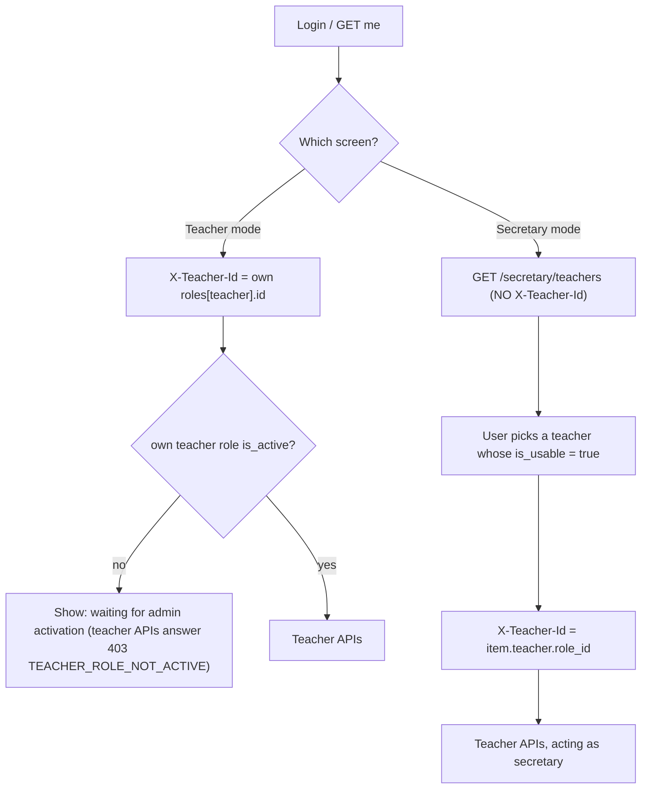

# Feature 02 — Teacher ↔ Secretary · Mobile integration guide

> For: mobile developers · API `v1` · technical reference: [feature-02-teacher-secretary.md](../features/feature-02-teacher-secretary.md) · QA guide: [feature-02-teacher-secretary-qa.md](feature-02-teacher-secretary-qa.md)

This guide covers what the app must do so that a **teacher** can manage their secretaries, and a **secretary** can pick a teacher and work for them. Every later teacher feature (courses, groups, enrollments, payments, group students …) relies on the same **teacher context**, so get this part right once.

---

## 1. Concepts you need

| Term | What it is | Where the app gets it |
|------|-----------|------------------------|
| **Role** | Every account owns 3 roles: `student`, `teacher`, `secretary`. Each has its own `id`, `code` and `is_active`. | `user.roles[]` in the login / `GET /me` response |
| **Role id** (`role_id`) | A UUID such as `7a203e94-2443-4c14-9aad-e080642b63ad`. A technical id; never shown to users. | `roles[].id` |
| **Role code** | Digits such as `32883`. People type it or read it out. | `roles[].code` |
| **Link** | One teacher role connected to one secretary role. It has `is_active` and `valid_until`. | `GET /teacher/secretaries` (teacher), `GET /secretary/teachers` (secretary) |
| **Teacher context** | The `X-Teacher-Id` header: the **teacher role id** the request works for. | the user's own teacher `role_id`, or the teacher picked by a secretary |

> ⚠️ `X-Teacher-Id` is the **teacher role id (UUID)**. It is never `users.id` and never the code. Sending the code gives `422 INVALID_TEACHER_CONTEXT`.

---

## 2. Common request rules

* **Base URL:** `{{host}}/api/v1`
* **Headers on every authenticated call:**

  ```
  Authorization: Bearer <access_token>
  Accept: application/json
  Accept-Language: ar | en        ← messages are translated, error codes never are
  Content-Type: application/json  ← for bodies
  ```

* **Teacher-context endpoints** (everything under `/teacher/...`, including Features 3–7) **also** need:

  ```
  X-Teacher-Id: <teacher role id>
  ```

* **Response envelope** for every response:

  ```json
  { "code": 200, "message": "…", "errors": [], "data": { … } }
  ```

  Errors add `error_code`. **Branch on `error_code`, never on `message`.** Validation errors fill `errors` as `[{ "key": "valid_until", "value": ["…"] }]`.

* **Pagination** for lists: `?page=1&per_page=20` (max 100). The response has `data.items[]` and `data.pagination { total, per_page, current_page, last_page, from, to }`.

---

## 3. Which context to send



* **Teacher:** read `roles` from login or `GET /me`, take the role where `role == "teacher"`, and send its `id`. If `is_active` is `false`, the admin has not activated the teacher yet; show a waiting state instead of calling teacher APIs.
* **Secretary:** call `GET /secretary/teachers` (without `X-Teacher-Id`), let the user pick a teacher, store `teacher.role_id` as the **current context**, and send it on every teacher API call. Offer a "switch teacher" action that reloads the list.
* A user can be a teacher **and** a secretary for other teachers. Use their own id in teacher mode and the picked id in secretary mode. Never mix them.
* **Do not cache permissions.** Access is re-checked on every request; a teacher can suspend or remove a secretary at any moment (see §7).

---

## 4. Teacher screens: manage my secretaries

Only the **teacher** can use these endpoints, with `X-Teacher-Id` = their own teacher role id. A secretary calling them gets `403 TEACHER_CONTEXT_FORBIDDEN`, so hide this screen in secretary mode.

### 4.1 List

```
GET /teacher/secretaries?page=1&per_page=20
```

```json
{
  "code": 200,
  "message": "…",
  "errors": [],
  "data": {
    "items": [
      {
        "id": "0198f3a2-…",
        "secretary": { "role_id": "0198f3a1-…", "code": "23119", "name": "Ahmed Hassan", "email": "ahmed@example.com" },
        "is_active": true,
        "valid_until": null,
        "is_expired": false,
        "created_at": "2026-10-13T10:00:00+00:00"
      }
    ],
    "pagination": { "total": 1, "per_page": 20, "current_page": 1, "last_page": 1, "from": 1, "to": 1 }
  }
}
```

`id` is the **link id**: use it in the URLs below. Detached links are not returned.

**Badge suggestion:**

| `is_active` | `is_expired` | Show |
|---|---|---|
| true | false | **Active** (and "until {valid_until}" when set) |
| false | – | **Suspended** |
| true | true | **Expired**: offer "extend" (§4.3) |

### 4.2 Add a secretary

```
POST /teacher/secretaries
{ "code": "23119", "valid_until": null }          ← null = never expires
{ "code": "23119", "valid_until": "2026-12-31T23:59:59+02:00" }
```

* `code` is the secretary's **secretary role code** (they read it from their own profile: `roles[secretary].code`). Digits only, at most 20.
* `valid_until` is optional and must be in the future. Send it with a timezone offset, or it is read in the server timezone.
* **201** creates a new link. **200** restores a link that was removed earlier: same `id`, active again with the new `valid_until`. Treat both as success.

| `error_code` | HTTP | Show the user |
|---|---|---|
| `SECRETARY_NOT_FOUND` | 404 | "No active secretary with this code." (unknown, wrong type of code and inactive secretaries all give this same answer, on purpose) |
| `CANNOT_ATTACH_SELF_AS_SECRETARY` | 422 | "You can't add your own account as a secretary." |
| `SECRETARY_ALREADY_ATTACHED` | 409 | "This secretary is already linked to you." Point to the existing row (it may be suspended or expired; use activate / update instead). |
| `VALIDATION_ERROR` | 422 | Field errors (code format, past date). |
| `TOO_MANY_REQUESTS` | 429 | "Too many attempts, try again in N seconds." Read the `Retry-After` header. Limit: **10 attaches / minute**. |

### 4.3 Change the expiry

```
PATCH /teacher/secretaries/{id}
{ "valid_until": "2027-06-30T23:59:59+02:00" }   or   { "valid_until": null }
```

`valid_until` **must be present**. `null` means never expires; a past date gives 422. This is the way to "extend" an expired link.

### 4.4 Suspend / reactivate

```
PATCH /teacher/secretaries/{id}/deactivate
PATCH /teacher/secretaries/{id}/activate
```

* Both are idempotent: calling them twice is fine.
* Activating an **expired** link answers `422 RELATION_EXPIRED`. Ask for a new date (§4.3) first, then activate.

### 4.5 Remove

```
DELETE /teacher/secretaries/{id}
```

* The secretary loses access immediately.
* A second delete answers `404 SECRETARY_RELATION_NOT_FOUND`; refresh the list.
* Adding the same code again **restores** the link (§4.2, answers 200).

**Errors on the link endpoints:**

| `error_code` | HTTP | Meaning |
|---|---|---|
| `SECRETARY_RELATION_NOT_FOUND` | 404 | The link no longer exists (already removed). |
| `TEACHER_CONTEXT_FORBIDDEN` | 403 | The link belongs to another teacher, or a secretary tried to manage links. |
| `TOO_MANY_REQUESTS` | 429 | More than **30** manage calls / minute. |

---

## 5. Secretary screens: pick a teacher

```
GET /secretary/teachers?page=1&per_page=20        ← NO X-Teacher-Id
```

```json
{
  "data": {
    "items": [
      {
        "id": "0198f3a2-…",
        "teacher": { "role_id": "7a203e94-…", "code": "32883", "name": "Mona Mahmoud", "is_active": true },
        "is_active": true,
        "valid_until": "2027-01-11T10:00:00+00:00",
        "is_expired": false,
        "is_usable": true
      }
    ],
    "pagination": { "…": "…" }
  }
}
```

* Show **every** item, but let the user **select only `is_usable: true`**. Grey out the others and say why:

  | Condition | Text |
  |---|---|
  | `is_active == false` | "This teacher suspended your access." |
  | `is_expired == true` | "Your access to this teacher expired." |
  | `teacher.is_active == false` | "This teacher's account is not active." |

* After a teacher is picked, send `X-Teacher-Id: <teacher.role_id>` on teacher APIs. The secretary can then use the shared teacher features (courses, groups, enrollments, payments, group students), but **not** the secretary-management screen of §4.
* An empty list means the secretary isn't linked to anyone yet. Show their **secretary code** (`roles[secretary].code` from `/me`) so they can give it to a teacher.
* If the secretary role itself is inactive, the list answers `403 SECRETARY_ROLE_NOT_ACTIVE`.

---

## 6. Teacher-context errors (any `/teacher/...` endpoint)

These come from the middleware **before** the feature logic, so handle them **globally** (one interceptor):

| `error_code` | HTTP | Cause | App behaviour |
|---|---|---|---|
| `TEACHER_CONTEXT_HEADER_REQUIRED` | 422 | header missing | bug: always send it |
| `INVALID_TEACHER_CONTEXT` | 422 | not a UUID (e.g. a code was sent) | bug: send the role **id** |
| `TEACHER_NOT_FOUND` | 404 | unknown / deleted teacher role | clear the stored context, go back to the picker |
| `TEACHER_ROLE_NOT_ACTIVE` | 403 | teacher not activated or deactivated by admin | teacher mode: show "waiting for activation"; secretary mode: back to the picker |
| `SECRETARY_ROLE_NOT_ACTIVE` | 403 | the user's secretary role is inactive | block secretary mode |
| `SECRETARY_NOT_LINKED_TO_TEACHER` | 403 | no link (or it was removed) | clear the context, refresh the picker |
| `SECRETARY_RELATION_INACTIVE` | 403 | link suspended by the teacher | clear the context, refresh the picker |
| `SECRETARY_RELATION_EXPIRED` | 403 | link expired | clear the context, refresh the picker |
| `TEACHER_CONTEXT_FORBIDDEN` | 403 | a secretary called a teacher-only action | hide that action in secretary mode |
| `PROFILE_INCOMPLETE` | 403 | profile not completed (Feature 1) | send the user to complete the profile |
| `LOGIN_NOT_ALLOWED` | 403 | account blocked by admin | log out |
| `UNAUTHENTICATED` | 401 | token missing / revoked | log out / re-login |

---

## 7. Things that change while the app is open

Access is evaluated **per request** from the database, with no cache. The app must expect any teacher API call to start failing with one of the §6 codes because of:

* the teacher suspending or removing the secretary, or the expiry date passing (no notification is sent; the next call fails);
* the admin deactivating the teacher or secretary role.

Recommended:

1. **Global interceptor:** on any §6 code in **secretary mode**, drop the stored teacher, show a short message and open the picker.
2. **Refresh the picker** when the app returns to the foreground.

---

## 8. Admin-made changes

The admin panel can attach, suspend, extend and remove links **on behalf of a teacher**. For the app nothing is different: the links simply appear, change or disappear and follow the same rules. Don't build anything special for it.

---

## 9. Quick checklist

- [ ] The teacher context uses `roles[teacher].id` (UUID), never the code or `users.id`.
- [ ] The secretary picker calls `/secretary/teachers` **without** `X-Teacher-Id` and only allows `is_usable` teachers.
- [ ] The picked teacher id is stored per session and sent on every `/teacher/...` call.
- [ ] A global handler covers all §6 codes; secretary mode falls back to the picker.
- [ ] 201 **and** 200 are both treated as success on "add secretary".
- [ ] `Retry-After` is honoured on 429.
- [ ] `valid_until` is sent with a timezone offset; `null` means never expires.
- [ ] Logic branches on `error_code`; the translated `message` is only displayed.
- [ ] The secretary-management screen is hidden in secretary mode.
