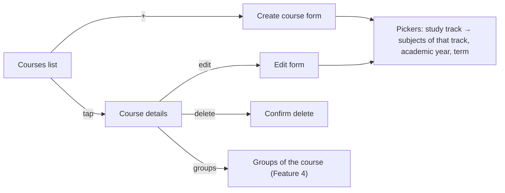

# Feature 03 — Courses · Mobile integration guide

> For: mobile developers · API `v1` · technical reference: [feature-03-courses.md](../features/feature-03-courses.md) · QA guide: [feature-03-courses-qa.md](feature-03-courses-qa.md) · prerequisite: [Feature 02 mobile guide](feature-02-teacher-secretary-mobile.md) (teacher context)

A **teacher**, or a **secretary** working for that teacher, creates and manages the teacher's courses. A course is described by an academic **study track**, a **subject**, an **academic year** and a **term**. The lists for those pickers come from the master-data endpoints in §3.

---

## 1. Common rules (same as every teacher feature)

* Base URL: `{{host}}/api/v1`.
* Headers on every call: `Authorization: Bearer <token>`, `Accept: application/json`, `Accept-Language: ar|en`.
* **Course endpoints** also need `X-Teacher-Id`:
  * teacher mode: the user's own `roles[teacher].id`;
  * secretary mode: the teacher picked from `/secretary/teachers`.
* Envelope: `{code, message, errors, data}`; errors add `error_code`. **Branch on `error_code`.**
* Lists: `?page=&per_page=` (default 15, max 100; more than 100 is a 422). Response: `data.items[]` + `data.pagination`.
* The teacher-context errors (`TEACHER_CONTEXT_HEADER_REQUIRED`, `SECRETARY_RELATION_EXPIRED`, …) are the Feature 2 ones. Handle them in the global interceptor described in the Feature 2 guide.
* A course **always belongs to the teacher**, even when a secretary creates it. There is no "owner" field to send.

---

## 2. Screens



---

## 3. Master data for the pickers (no `X-Teacher-Id`)

Any signed-in user may call these. They return only **active** items, so cache them for the session and refresh when the app reopens.

| Picker | Request | Item |
|---|---|---|
| Study track | `GET /study-tracks` | `{ "id": 1, "name": "الثانوية العامة" }` |
| Subject (after a track is chosen) | `GET /study-tracks/{id}/subjects` | `{ "id": 4, "name": "الرياضيات", "study_track_id": 1 }` |
| Academic year | `GET /academic-years` (newest first) | `{ "id": 2, "name": "2026 / 2027", "start_date": "2026-09-01", "end_date": "2027-06-30" }` |
| Term | fixed values | `first`, `second`, `both` |

* `name` comes back in the `Accept-Language` language.
* **Reset the subject** whenever the study track changes: a subject from another track is rejected with `SUBJECT_NOT_IN_STUDY_TRACK`.
* A track that is unknown or was deactivated answers `404 STUDY_TRACK_NOT_FOUND` on the subjects call. Reload the track list.

---

## 4. Courses API

| Action | Request | Success |
|---|---|---|
| List | `GET /teacher/courses` | 200, paginated |
| Details | `GET /teacher/courses/{id}` | 200 |
| Create | `POST /teacher/courses` | **201** |
| Edit | `PATCH /teacher/courses/{id}` (with an image: `POST` + `_method=PATCH`, multipart) | 200 |
| Delete | `DELETE /teacher/courses/{id}` | 200, `data: null` |

### 4.1 List filters

`?search=` (course name or code), `study_track_id`, `subject_id`, `academic_year_id`, `term` (`first|second|both`), `page`, `per_page`. Results are newest first.

### 4.2 Course object

```json
{
  "id": "019dd1f0-…",
  "code": "CO-483921",
  "name": "مراجعة الرياضيات - الصف الثالث الثانوي",
  "image": "https://…/courses/images/….jpg",
  "study_track": { "id": 1, "name": "الثانوية العامة" },
  "subject": { "id": 4, "name": "الرياضيات" },
  "academic_year": { "id": 2, "name": "2026 / 2027", "start_date": "2026-09-01", "end_date": "2027-06-30" },
  "term": "first",
  "students_count": 12,
  "created_at": "2026-10-14T10:00:00+00:00"
}
```

* `code` is generated by the server and is read-only. It is shown to people (for example to search by it).
* `image` is a full URL or `null`.
* `students_count` is returned **in the list only**. It counts active and suspended students (Feature 6) and is absent on the details response, so don't rely on it there.

### 4.3 Create / edit body

```json
{
  "name": "مراجعة الرياضيات - الصف الثالث الثانوي",
  "study_track_id": 1,
  "subject_id": 4,
  "academic_year_id": 2,
  "term": "first"
}
```

| Field | Rule |
|---|---|
| `name` | required on create, 2–255 characters (trimmed) |
| `study_track_id`, `subject_id`, `academic_year_id` | required on create; must be active, and the subject must belong to the track |
| `term` | `first`, `second` or `both` |
| `image` | optional file, jpg / jpeg / png / webp, at most **2 MB**. Multipart only. |

* **Edit** sends only the fields that changed.
* To upload an image on edit, send **`POST /teacher/courses/{id}`** as multipart with `_method=PATCH` (PHP doesn't parse multipart PATCH).
* Never send `code`, `id` or an owner: they are ignored.

### 4.4 Delete

Ask for confirmation. The course disappears from the list, and later calls to it answer `404 COURSE_NOT_FOUND`. There is no restore in the app. (Groups and enrollments are kept server-side; the admin panel can still see them.)

---

## 5. Errors to handle

| `error_code` | HTTP | Show |
|---|---|---|
| `VALIDATION_ERROR` | 422 | field errors from `errors[]` (`key` = field) |
| `STUDY_TRACK_NOT_FOUND` / `STUDY_TRACK_INACTIVE` | 422 | "This study track is no longer available." Reload the pickers. |
| `SUBJECT_NOT_FOUND` / `SUBJECT_INACTIVE` | 422 | "This subject is no longer available." |
| `SUBJECT_NOT_IN_STUDY_TRACK` | 422 | "Pick a subject of the selected study track." |
| `ACADEMIC_YEAR_NOT_FOUND` | 422 | "This academic year is no longer available." |
| `COURSE_NOT_FOUND` | 404 | the course was deleted. Remove it from the screen and go back to the list. |
| `COURSE_NOT_ACCESSIBLE` | 403 | the course belongs to another teacher. Usually a stale context, so reload with the right `X-Teacher-Id`. |
| `COURSE_CODE_GENERATION_FAILED` | 500 | "Please try again." (rare) |
| `TOO_MANY_REQUESTS` | 429 | wait for `Retry-After` (limit: **60 writes / minute**) |

---

## 6. Checklist

- [ ] Master-data pickers are loaded without `X-Teacher-Id`; the subject resets when the track changes.
- [ ] `term` offers `first`, `second` and `both`.
- [ ] Image upload on edit uses `POST` + `_method=PATCH` (multipart), at most 2 MB.
- [ ] Edit sends only changed fields.
- [ ] 404 `COURSE_NOT_FOUND` after a delete is handled gracefully (other devices may delete too).
- [ ] The same screens work in secretary mode with the picked teacher's id.
