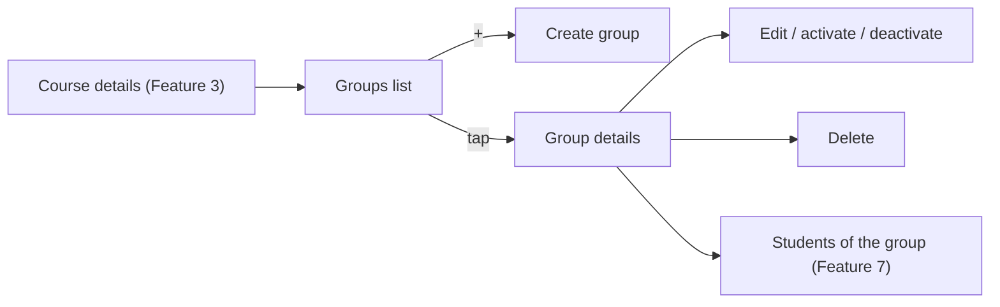

# Feature 04 — Groups · Mobile integration guide

> For: mobile developers · API `v1` · technical reference: [feature-04-groups.md](../features/feature-04-groups.md) · QA guide: [feature-04-groups-qa.md](feature-04-groups-qa.md) · prerequisites: [Feature 02](feature-02-teacher-secretary-mobile.md) (teacher context), [Feature 03](feature-03-courses-mobile.md) (courses)

A course has one or more **groups**, e.g. "Group A – Sunday/Tuesday" or "Evening group". The teacher, or a secretary working for them, creates and manages the groups. A group carries the **defaults** used when students are enrolled later (Features 6–7): a default subscription **end date**, a **price** and a **capacity**.

---

## 1. Common rules

* Base URL `{{host}}/api/v1`.
* Headers: `Authorization`, `Accept: application/json`, `Accept-Language: ar|en`, and **`X-Teacher-Id`** (own teacher role id, or the teacher picked in secretary mode).
* Envelope `{code, message, errors, data}`; errors add `error_code`. **Branch on `error_code`.**
* Lists: `?page=&per_page=` (default 15, max 100) → `data.items[]` + `data.pagination`.
* Teacher-context errors are handled globally (see the Feature 2 guide).
* Groups always live **inside a course**: every URL contains the course id.

---

## 2. Screens



---

## 3. API

| Action | Request | Success |
|---|---|---|
| List | `GET /teacher/courses/{courseId}/groups` | 200 |
| Details | `GET /teacher/courses/{courseId}/groups/{groupId}` | 200 |
| Create | `POST /teacher/courses/{courseId}/groups` | **201** |
| Edit | `PATCH /teacher/courses/{courseId}/groups/{groupId}` (with an image: `POST` + `_method=PATCH`, multipart) | 200 |
| Delete | `DELETE /teacher/courses/{courseId}/groups/{groupId}` | 200, `data: null` |

**List filters:** `search` (group name), `is_active` (`1` = active only, `0` = inactive only, omitted = all).

### 3.1 Group object

```json
{
  "id": "019dd1f0-…",
  "name": "المجموعة A",
  "description": "طلاب الأحد والثلاثاء",
  "image": null,
  "default_subscription_ends_at": "2027-01-31",
  "subscription_price": "300.00",
  "max_students": 50,
  "is_active": true,
  "created_at": "2026-10-15T10:00:00+00:00"
}
```

| Field | Meaning | Display |
|---|---|---|
| `default_subscription_ends_at` | default **end date** (`YYYY-MM-DD`) for new subscriptions in this group; `null` = none | a date, or "No default end date" |
| `subscription_price` | **string** with 2 decimals; `null` = no price set; `"0.00"` = **free** | keep `null` and `"0.00"` apart: "No price" vs "Free" |
| `max_students` | capacity; `null` = **unlimited** | "Unlimited" when null |
| `is_active` | `false` = the group is paused: it stays listed but takes **no new students** | an "Inactive" badge |

> Parse the price as a decimal string, never as a float (`"120.50"`).

### 3.2 Create

```json
{
  "name": "المجموعة A",
  "description": "طلاب الأحد والثلاثاء",
  "default_subscription_ends_at": "2027-01-31",
  "subscription_price": 300,
  "max_students": 50
}
```

| Field | Rule |
|---|---|
| `name` | required, 2–255 characters |
| `description` | optional, at most 5000 characters |
| `default_subscription_ends_at` | optional, `YYYY-MM-DD`, **today or later**; `null` = none |
| `subscription_price` | optional, ≥ 0, at most 2 decimals; `0` = free; `null` / omitted = no price |
| `max_students` | optional integer ≥ 1; `null` / omitted = unlimited |
| `image` | optional file, jpg / jpeg / png / webp, at most 2 MB (multipart) |

A new group is always **active**: `is_active` isn't accepted on create.

### 3.3 Edit

* Send **only the fields that change**. An explicit **`null` clears** `description`, `default_subscription_ends_at`, `subscription_price` or `max_students`. An **omitted** field is left unchanged.
* `is_active: false` / `true` deactivates or activates the group (use it for the Activate / Deactivate buttons).
* A date that is already in the past is kept when you edit other fields. A **new** date must be today or later.
* Image: `POST …/groups/{groupId}` as multipart with `_method=PATCH`.

### 3.4 Delete

Ask for confirmation. The group disappears from the list. Its students lose this group, but their enrollments aren't deleted (see the enrollment screens of Features 6–7). There is no restore in the app.

---

## 4. How groups are used later (Features 6–7)

* When a student is enrolled into a group, the app may **pre-fill** the subscription end date and the amount from the group's `default_subscription_ends_at` and `subscription_price`. These are only suggestions; changing them on the group never changes existing students.
* An **inactive** group can't receive new students: enrolling or adding answers `422 GROUP_INACTIVE`. Hide inactive groups in "add to group" pickers.
* A **full** group (members = `max_students`) answers `409 GROUP_CAPACITY_REACHED` when adding more students.

---

## 5. Errors to handle

| `error_code` | HTTP | Show |
|---|---|---|
| `VALIDATION_ERROR` | 422 | field errors (`errors[].key`): past or malformed date, negative price or more than 2 decimals, capacity < 1, name length |
| `COURSE_NOT_FOUND` | 404 | the course was deleted; go back to the courses list |
| `COURSE_NOT_ACCESSIBLE` | 403 | the course isn't this teacher's (stale context) |
| `GROUP_NOT_FOUND` | 404 | the group was deleted or isn't in this course; refresh the list |
| `GROUP_NOT_ACCESSIBLE` | 403 | rare; refresh |
| `TOO_MANY_REQUESTS` | 429 | wait for `Retry-After` (120 writes / minute) |

---

## 6. Checklist

- [ ] The price is shown and sent as a decimal; "No price" (`null`) and "Free" (`"0.00"`) are distinct.
- [ ] `max_students: null` shows as "Unlimited".
- [ ] The date picker sends `YYYY-MM-DD` and doesn't allow past days; the date can be cleared (sends `null`).
- [ ] Edit sends only changed fields; clearing a field sends an explicit `null`.
- [ ] Activate / Deactivate use `PATCH {is_active}`; inactive groups get a badge and are hidden from "add students" pickers.
- [ ] Image upload uses `POST` + `_method=PATCH` (multipart).
- [ ] Works the same in secretary mode.
