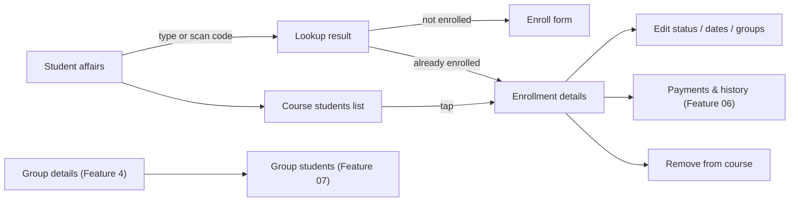

# Feature 05 — Students & Enrollment · Mobile integration guide

> For: mobile developers · API `v1` · technical reference: [feature-06-enrollment-transactions.md](../features/feature-06-enrollment-transactions.md) (the Feature 05 API in [feature-05-students-enrollment.md](../features/feature-05-students-enrollment.md) was **replaced** by Feature 06; use only the endpoints below) · QA guide: [feature-05-students-enrollment-qa.md](feature-05-students-enrollment-qa.md) · related: [Feature 06 — payments](feature-06-enrollment-transactions-mobile.md), [Feature 07 — group students](feature-07-group-student-management-mobile.md)

This guide covers the **student affairs** screens: find a student by code, enroll them into a course and its groups, see the course's students, change a student's status, dates and groups, and remove an enrollment. It also covers the student app's "My courses" view. Payments, renewals and the history are in the Feature 06 guide.

---

## 1. Common rules

* Base URL `{{host}}/api/v1`; headers `Authorization`, `Accept: application/json`, `Accept-Language: ar|en`.
* Teacher-side calls also send **`X-Teacher-Id`** (own teacher role id, or the teacher picked in secretary mode). See the [Feature 02 guide](feature-02-teacher-secretary-mobile.md).
* Envelope `{code, message, errors, data}`; errors add `error_code`. **Branch on `error_code`**, never on `message`.
* Lists: `?page=&per_page=` (default 15, max 100) → `data.items[]` + `data.pagination`.
* Amounts are **decimal strings** in EGP (`"350.00"`). `null` = not specified, `"0.00"` = free. Never parse them as floats for display or sums.
* Dates come back as ISO-8601 (`2026-11-01T00:00:00+00:00`, UTC). Send `YYYY-MM-DD` or a full ISO date.

---

## 2. Concepts

| Term | Meaning |
|---|---|
| **Enrollment** | One student in one course. A student has **at most one** enrollment per course; deleting it and enrolling again brings back the **same** enrollment (same id, history kept). |
| **Groups** | An enrollment is in **one or more groups** of its course. Groups are managed in Feature 4. |
| **Status** | `active`, `suspended` or `expelled`. Only `active` can open the course content. |
| **Subscription dates** | `subscription_started_at` / `subscription_ends_at`, both optional. The end is **exclusive**: the student loses access at that moment. The API **never computes dates**: for "+30 days" the app adds 30 days and sends the new `subscription_ends_at`. |
| **Access** | `has_access` = active **and** in at least one active group **and** inside the dates. `access_reason` says why not. |

### Access reason

| `access_reason` | Show | Fix |
|---|---|---|
| `null` | ✓ "Has access" | — |
| `suspended` | "Suspended" | set status `active` |
| `expelled` | "Expelled" | set status `active` (explicit) |
| `no_active_group` | "No active group" | add the student to an active group |
| `not_started` | "Starts on {date}" | wait, or move the start date |
| `expired` | "Ended on {date}" | renew (Feature 06) or change the end date |
| `removed` | (deleted enrollment — not shown in lists) | enroll again |

When several apply, the API reports the first one in the order above (status first, then groups, then dates).

---

## 3. Screens



---

## 4. API

| Action | Request | Success |
|---|---|---|
| Find a student | `GET /teacher/course-enrollments/student-lookup?course_id=&code=` (or `&email=`) | 200 |
| Suggested amount | `GET /teacher/course-enrollments/suggested-amount?course_id=&group_ids[]=…` | 200 |
| Enroll | `POST /teacher/course-enrollments` | **201** new / **200** restored |
| List | `GET /teacher/course-enrollments` | 200 |
| Details | `GET /teacher/course-enrollments/{id}` | 200 |
| Edit status / dates / groups | `PATCH /teacher/course-enrollments/{id}` | 200 |
| Remove from course | `DELETE /teacher/course-enrollments/{id}` | 200, `data: null` |
| Teacher settings | `GET /teacher/settings` | 200 |
| Student: my courses | `GET /student/course-enrollments` (no `X-Teacher-Id`) | 200 |
| Student: one course | `GET /student/course-enrollments/{id}` | 200 |

### 4.1 Find a student (code or QR)

```
GET /teacher/course-enrollments/student-lookup?course_id=0199…&code=48213375
```

* Send **exactly one** of `code` (digits) or `email`. There is no name search across the platform; to search by name, search the course's own students (§4.4).
* **QR codes** must encode the student's role **code** (`user_roles.code`, the same digits the student reads out). Scan → put the digits in `code`.
* Rate-limited together with enrolling (30 per minute per user), so don't call it on every keystroke: call it on submit or after a scan.

```json
{
  "student": { "role_id": "0199…", "code": "48213375", "name": "Omar Khaled", "email": "omar@darsly.test", "phone": "+20 1012345678", "image": null, "government": "Cairo" },
  "enrollment": null,
  "previously_enrolled": true
}
```

| Result | Show |
|---|---|
| `enrollment` is an object | "Already in this course" → open the details (it is a full enrollment object, §4.5) |
| `enrollment: null`, `previously_enrolled: false` | the enroll form, with the name and photo to confirm |
| `enrollment: null`, `previously_enrolled: true` | the enroll form with a note "Was enrolled before; enrolling restores the history" |
| `404 STUDENT_NOT_FOUND` | "No student with this code" (also: not a student, inactive, deleted — indistinguishable on purpose) |

### 4.2 Enroll

```json
{
  "course_id": "0199…",
  "student_code": "48213375",
  "group_ids": ["0199…a", "0199…b"],
  "status": "active",
  "subscription_started_at": "2026-10-01",
  "subscription_ends_at": "2026-11-01",
  "transaction": { "amount": "300.00", "payment_method": "cash", "message": "Paid at the center" }
}
```

| Field | Rule |
|---|---|
| `student_code` **or** `student_user_role_id` | exactly one (use `student.role_id` from the lookup when you have it) |
| `group_ids` | 1–50 groups of this course; active groups with a free seat |
| `status` | optional, default `active`; `active` needs an active group |
| dates | optional; start must be before end |
| `transaction.amount` | optional; `null` / omitted = unspecified; `0` = free; ≥ 0 with at most 2 decimals |
| `transaction.payment_method` | optional: `cash`, `vodafone_cash`, `instapay`, `other` |
| `transaction.message` | optional note, ≤ 2000 characters |
| `transaction_images[]` | optional transfer screenshots (multipart), ≤ 10 images, ≤ 5 MB each |

**Pre-fill the amount** with `GET …/suggested-amount?course_id=&group_ids[]=…` whenever the group selection changes. If `complete` is `false`, some groups have no price: show `partial_amount` with a warning. The suggestion is never saved by itself: send the amount the user confirms.

**Pre-fill the end date** with the selected group's `default_subscription_ends_at` (Feature 4).

Response: `201` (new) or `200` (restored) with `data.enrollment`, `data.restored`, `data.transactions`, `data.suggested_amount`.

### 4.3 Edit status, dates and groups

```json
{
  "status": "suspended",
  "subscription_ends_at": "2026-12-01",
  "groups": { "attach": ["0199…c"], "detach": ["0199…a"] }
}
```

* Send only what changes. An explicit `null` **clears** a date; an omitted field is kept.
* Without `status`, the API adjusts it: removing the last active group **suspends** an active student; adding a group **re-activates** a suspended one; an expelled student stays expelled.
* `status: "active"` without any active group → `422 ACTIVE_ENROLLMENT_REQUIRES_ACTIVE_GROUP` ("Add the student to an active group first").
* "+30 days" button: `new_end = (current end or today) + 30 days` computed in the app, then `PATCH {subscription_ends_at: new_end}`, or record it with a payment (Feature 06 renewal).
* Status changes for many students at once: use the group screen's bulk status (Feature 07).

### 4.4 Course students list

`GET /teacher/course-enrollments?course_id=&group_id=&status=&search=&expiry=&expiring_within_days=`

| Filter | Values |
|---|---|
| `course_id` / `group_id` | narrow to one course / group |
| `status` | `active`, `suspended`, `expelled` |
| `search` | part of the student's name, code, email or phone |
| `expiry` | `expiring` = still running and ends within N days; `expired` = already ended |
| `expiring_within_days` | 1–365, default 7; only with `expiry=expiring` |

Use `expiry=expiring` for an "Ending soon" tab and `expiry=expired` for "Ended". Students without an end date appear in neither.

### 4.5 Enrollment object

```json
{
  "id": "0199…",
  "course": { "id": "0199…", "name": "Mathematics" },
  "status": "active",
  "student": { "role_id": "0199…", "code": "48213375", "name": "Omar Khaled", "email": "omar@darsly.test", "phone": "+20 1012345678", "image": null },
  "groups": [ { "id": "0199…", "name": "Group A", "is_active": true } ],
  "subscription_started_at": "2026-10-01T00:00:00+00:00",
  "subscription_ends_at": "2026-11-01T00:00:00+00:00",
  "has_access": true,
  "access_reason": null,
  "last_payment": { "transaction_id": "0199…", "type": "renewal", "amount": "300.00", "payment_method": "cash", "paid_at": "2026-10-19T09:20:00+00:00" },
  "total_paid": "600.00",
  "currency": "EGP",
  "created_at": "…",
  "updated_at": "…"
}
```

* `last_payment` / `total_paid` are explained in the [Feature 06 guide](feature-06-enrollment-transactions-mobile.md). They are only on the teacher side.
* A group with `is_active: false` is still listed for the student; show it greyed out.

### 4.6 Remove from the course

`DELETE /teacher/course-enrollments/{id}`. Ask for confirmation. The student leaves every group of the course and loses access at once. Payments and history are kept and come back if the student is enrolled again (the same enrollment is **restored**, without its old groups and with the dates you send).

### 4.7 Teacher settings

`GET /teacher/settings` → `{ "automatic_transactions": false }`. When `false`, group changes and status changes are **not** written to the history (only payments and date changes are). Show a hint on the history screen so users don't think something is missing. Only the platform admin can change it.

### 4.8 Student app: My courses

`GET /student/course-enrollments` (no `X-Teacher-Id`): course, status, dates, group names, `has_access`, `access_reason`. No amounts or history. Use `access_reason` for the message on a locked course:

| `access_reason` | Student message |
|---|---|
| `suspended` | "Your subscription is paused. Contact the teacher." |
| `expelled` | "You were removed from this course." |
| `no_active_group` | "Your group isn't active right now." |
| `not_started` | "Starts on {subscription_started_at}." |
| `expired` | "Your subscription ended on {subscription_ends_at}. Renew with the teacher." |

---

## 5. Errors to handle

| `error_code` | HTTP | Show |
|---|---|---|
| `VALIDATION_ERROR` | 422 | field errors from `errors[].key` |
| `STUDENT_NOT_FOUND` | 404 | "No student with this code" |
| `STUDENT_ALREADY_ENROLLED` | 409 | "Already in this course" → open the details |
| `INVALID_GROUP_ASSIGNMENT` | 422 | a group isn't in this course; refresh the groups |
| `GROUP_INACTIVE` | 422 | "This group is not active" |
| `GROUP_CAPACITY_REACHED` | 409 | "The group is full" |
| `ACTIVE_ENROLLMENT_REQUIRES_ACTIVE_GROUP` | 422 | "Add an active group first" |
| `INVALID_SUBSCRIPTION_DATES` | 422 | "The start must be before the end" |
| `COURSE_NOT_FOUND` / `ENROLLMENT_NOT_FOUND` | 404 | deleted; go back and refresh |
| `COURSE_NOT_ACCESSIBLE` / `ENROLLMENT_NOT_ACCESSIBLE` | 403 | stale teacher context |
| `ROLE_NOT_ACTIVE` | 403 | student app: the student role is inactive |
| `TOO_MANY_REQUESTS` | 429 | wait `Retry-After` |

---

## 6. Checklist

- [ ] Lookup uses an exact code (typed or from the QR) or an email, on submit only.
- [ ] The enroll form pre-fills the amount from `suggested-amount` and the end date from the group, and lets the user change both.
- [ ] "Free" (`0`) and "not specified" (`null`) amounts are different.
- [ ] `has_access` / `access_reason` drive the badge and the locked-course message.
- [ ] "+30 days" is computed in the app and sent as `subscription_ends_at`.
- [ ] Edit sends only changed fields; clearing a date sends `null`.
- [ ] "Ending soon" / "Ended" tabs use `expiry=expiring` / `expiry=expired`.
- [ ] A 200 on enroll (restored) is handled like a 201.
- [ ] Works the same in secretary mode.
