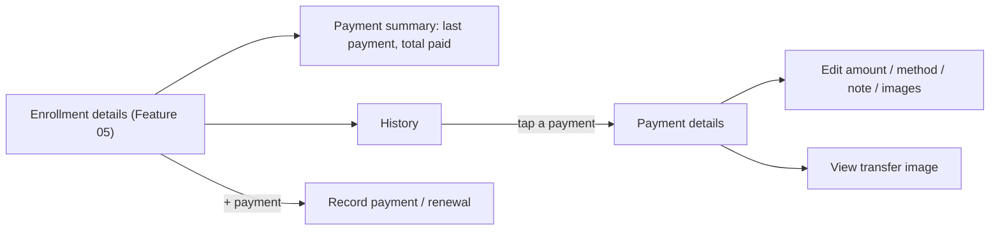

# Feature 06 — Payments, Renewals & History · Mobile integration guide

> For: mobile developers · API `v1` · technical reference: [feature-06-enrollment-transactions.md](../features/feature-06-enrollment-transactions.md) · QA guide: [feature-06-enrollment-transactions-qa.md](feature-06-enrollment-transactions-qa.md) · prerequisite: [Feature 05 — students & enrollment](feature-05-students-enrollment-mobile.md)

Everything that happens to an enrollment is written to its **history** ("transactions"): the first enrollment, payments and renewals, and — when the admin turned it on for the teacher — group and status changes. This guide covers the payment screens: record a payment or a renewal, show the payment summary, browse the history, edit a payment and its transfer screenshots.

---

## 1. Common rules

* Same as the Feature 05 guide: `X-Teacher-Id` on every call, envelope `{code, message, errors, data}`, **branch on `error_code`**.
* Amounts are **EGP decimal strings** (`"350.00"`). `null` = not specified; `"0.00"` = free. Send numbers or strings with at most 2 decimals; never format through a float.
* Students never see any of this: the student app has no amounts, history or images.

---

## 2. Transaction types

| `type` | Written when | Has money / images | Editable |
|---|---|:---:|:---:|
| `enrollment` | the first enrollment; or a manual payment with `type: "enrollment"` | ✓ | ✓ |
| `renewal` | a manual payment (default); a date change; enrolling again with money or dates | ✓ | ✓ |
| `group_added` / `group_removed` | a group joined / left | — | — |
| `status_changed` | the status moved (`changes.from` → `changes.to`, `changes.reason`) | — | — |

* The last three are written **only** when the teacher's *automatic transactions* setting is ON. Read it with `GET /teacher/settings` → `{ "automatic_transactions": true|false }` and, when `false`, show a hint on the history screen: "Group and status changes aren't recorded for this teacher."
* Transactions are **never deleted**. Only `amount`, `payment_method`, `message` and images of `enrollment` / `renewal` can be edited (`is_editable: true`).

### Payment methods

`payment_method`: `cash`, `vodafone_cash`, `instapay`, `other`, or `null` (not specified). Show it as a chip on the payment card and offer it as a picker on every payment form. A payment method alone (no amount, message, image or date change) is **not** a payment: the API answers `422 EMPTY_RENEWAL`.

---

## 3. Screens



---

## 4. API

| Action | Request | Success |
|---|---|---|
| Record payment / renewal | `POST /teacher/course-enrollments/{enrollmentId}/transactions` | **201** |
| History | `GET /teacher/course-enrollments/{enrollmentId}/transactions` | 200 |
| One transaction | `GET /teacher/enrollment-transactions/{transactionId}` | 200 |
| Edit | `PATCH /teacher/enrollment-transactions/{transactionId}` (with images: `POST` + `_method=PATCH`, multipart) | 200 |
| Transfer image | `GET /teacher/enrollment-transactions/{transactionId}/transfer-images/{mediaId}` | 200 (binary) |
| Teacher settings | `GET /teacher/settings` | 200 |

### 4.1 Payment summary (on the enrollment)

Every enrollment object on the teacher side carries:

```json
{
  "last_payment": { "transaction_id": "0199…", "type": "renewal", "amount": "300.00", "payment_method": "instapay", "paid_at": "2026-10-19T09:20:00+00:00" },
  "total_paid": "600.00",
  "currency": "EGP"
}
```

| Field | Meaning | Display |
|---|---|---|
| `last_payment` | the latest `enrollment` / `renewal` with an amount **above zero**; date-only renewals and free (`0.00`) rows are skipped | "Last payment: 300 EGP · InstaPay · 19 Oct"; `null` → "No payments yet" |
| `total_paid` | the sum of every `enrollment` / `renewal` amount | "Total paid: 600 EGP" |

No extra request is needed for the card: these fields are in the list and the details responses.

### 4.2 Record a payment or a renewal

```json
{
  "type": "renewal",
  "amount": 300,
  "payment_method": "vodafone_cash",
  "message": "November",
  "subscription_ends_at": "2026-12-01"
}
```

| Field | Rule |
|---|---|
| `type` | optional: `renewal` (default) or `enrollment`; nothing else |
| `amount` | optional; ≥ 0, at most 2 decimals; `null` = not specified |
| `payment_method` | optional: `cash`, `vodafone_cash`, `instapay`, `other` |
| `message` | optional, ≤ 2000 characters |
| `subscription_started_at`, `subscription_ends_at` | optional; **only sent fields change**; `null` clears; start before end |
| `images[]` | optional transfer screenshots (multipart): jpg / png / webp, ≤ 5 MB, ≤ 10 |

* At least one of amount, message, an image or a **real** date change is required; otherwise `422 EMPTY_RENEWAL`.
* **"+30 days"**: the API never computes durations. Compute `(current end, or today if it has passed) + 30 days` in the app and send it as `subscription_ends_at`, together with the amount. The response shows the old / new dates in `changes`.
* The renewal moves the enrollment's dates at once: refresh the enrollment (its `has_access` / `access_reason` may change from `expired` to `null`).

### 4.3 History

`GET …/{enrollmentId}/transactions?type=&from=YYYY-MM-DD&to=YYYY-MM-DD&page=&per_page=` — newest first. `type` is one of the five types; `from` / `to` are whole days, inclusive. The history of a removed enrollment stays readable.

```json
{
  "id": "0199…",
  "enrollment_id": "0199…",
  "type": "renewal",
  "amount": "300.00",
  "currency": "EGP",
  "payment_method": "vodafone_cash",
  "message": "November",
  "subscription_started_at": "2026-10-01T00:00:00+00:00",
  "subscription_ends_at": "2026-12-01T00:00:00+00:00",
  "changes": { "subscription_ends_at": { "from": "2026-11-01T00:00:00+00:00", "to": "2026-12-01T00:00:00+00:00" } },
  "created_by": { "role_id": "0199…", "role": "secretary", "name": "Ahmed Hassan", "by_admin": false },
  "transfer_images": [ { "id": 12, "mime_type": "image/jpeg", "size": 183224, "url": "https://…/transfer-images/12", "created_at": "…" } ],
  "is_editable": true,
  "created_at": "…",
  "updated_at": "…"
}
```

| Field | Display |
|---|---|
| `subscription_*_at` | the enrollment's dates **at that moment** (a snapshot) |
| `changes` | per type: date `from` / `to`; `group_id` + `operation`; status `from` / `to` / `reason` |
| `created_by` | "by Ahmed (secretary)"; `by_admin: true` → "by the admin on behalf of the teacher" |

`status_changed.reason`: `explicit` (someone chose it), `last_active_group_removed`, `group_added`, `enrollment_restored`.

### 4.4 Transfer images

* The `url` is an **API** endpoint: load it with the same `Authorization` and `X-Teacher-Id` headers (e.g. download to a temp file, then show it). There is no public link; it won't open in a browser without the headers.
* The response has `Cache-Control: private, no-store`: don't cache it to shared storage.

### 4.5 Edit a payment

```json
{ "amount": "250.00", "payment_method": "cash", "message": "Corrected", "remove_media_ids": [12] }
```

* Only `enrollment` / `renewal` rows (`is_editable: true`); others → `422 TRANSACTION_NOT_EDITABLE`.
* Omitted fields are kept; `amount: null` / `payment_method: null` clear them.
* `images[]` are **added** (existing ones stay); remove with `remove_media_ids` (ids from `transfer_images`). With images, use `POST` + `_method=PATCH` (multipart).
* The edit overwrites the row (no version history).

---

## 5. Errors to handle

| `error_code` | HTTP | Show |
|---|---|---|
| `VALIDATION_ERROR` | 422 | field errors (`amount`, `payment_method`, `type`, `images.*`, dates) |
| `EMPTY_RENEWAL` | 422 | "Enter an amount, a note, an image or new dates" |
| `INVALID_SUBSCRIPTION_DATES` | 422 | "The start must be before the end" |
| `TRANSACTION_NOT_EDITABLE` | 422 | hide the edit button when `is_editable` is false |
| `INVALID_MEDIA_REMOVAL` | 422 | refresh the images |
| `TRANSFER_IMAGE_NOT_FOUND` | 404 | "Image no longer available" |
| `ENROLLMENT_NOT_FOUND` / `TRANSACTION_NOT_FOUND` | 404 | refresh |
| `ENROLLMENT_NOT_ACCESSIBLE` / `TRANSACTION_NOT_ACCESSIBLE` | 403 | stale teacher context |
| `TOO_MANY_REQUESTS` | 429 | wait `Retry-After` (120 writes / minute) |
| `METHOD_NOT_ALLOWED` | 405 | there is no delete for transactions |

---

## 6. Checklist

- [ ] Amounts are shown and sent as decimals; `null` and `"0.00"` are distinct.
- [ ] The payment card uses `last_payment` / `total_paid` from the enrollment, without extra calls.
- [ ] Every payment form has a payment-method picker (optional).
- [ ] "+30 days" is computed in the app and sent as `subscription_ends_at`.
- [ ] After a renewal, the enrollment is refreshed (access may change).
- [ ] Transfer images load with the auth headers; nothing is cached publicly.
- [ ] Edit buttons only on `is_editable` rows; no delete button anywhere.
- [ ] The history shows a hint when `GET /teacher/settings` says `automatic_transactions: false`.
- [ ] Works the same in secretary mode (`created_by.role: "secretary"`).
