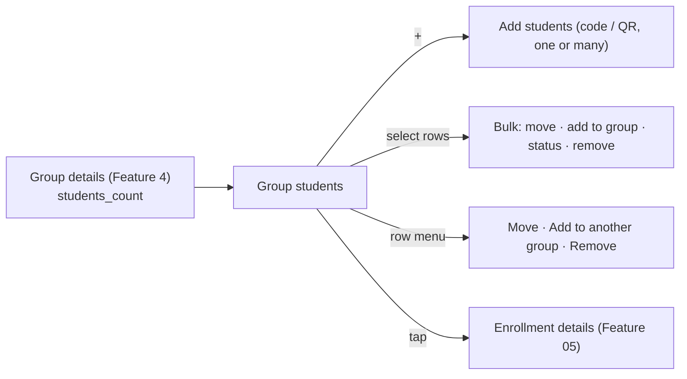

# Feature 07 — Group Students · Mobile integration guide

> For: mobile developers · API `v1` · technical reference: [feature-07-group-student-management.md](../features/feature-07-group-student-management.md) · QA guide: [feature-07-group-student-management-qa.md](feature-07-group-student-management-qa.md) · prerequisites: [Feature 04 — groups](feature-04-groups-mobile.md), [Feature 05 — students & enrollment](feature-05-students-enrollment-mobile.md), [Feature 06 — payments](feature-06-enrollment-transactions-mobile.md)

The **group students** screen manages the students of one group, from inside that group: list them, add one or many, move them to another group, add them to another group as well, change their status, and remove them. Every action reuses the enrollment rules of Features 05–06.

---

## 1. Common rules

* Base path: `/teacher/courses/{courseId}/groups/{groupId}/students` + `X-Teacher-Id`.
* `{enrollmentId}` in URLs is the **course enrollment id** (the roster item's `id`), not a user or role id.
* **All or nothing**: a bulk request either succeeds for every student or changes nothing. A failing student is named in `errors[0].key` (`students.3`, `course_enrollment_ids.1`): highlight that row.
* At most **50** students per request.
* Write responses are `{operation, enrollment, transactions}` (single) or `{items: [...]}` (add and bulk), in the order sent. `enrollment` is the full Feature 05 enrollment object (all its groups).

---

## 2. Screens



The groups list (`GET /teacher/courses/{courseId}/groups`) returns `students_count` per group (live members): use it for the badge on each group card.

---

## 3. API

| Action | Request | Success |
|---|---|---|
| List | `GET …/students?status=&search=&expiry=&expiring_within_days=&page=&per_page=` | 200 |
| Add one or many | `POST …/students` | **201** `{items}` |
| Remove one | `DELETE …/students/{enrollmentId}` | 200 |
| Remove many | `POST …/students/bulk-remove` `{course_enrollment_ids}` | 200 `{items}` |
| Move one | `POST …/students/{enrollmentId}/move` `{target_group_id}` | 200 |
| Move many | `POST …/students/bulk-move` `{course_enrollment_ids, target_group_id}` | 200 `{items}` |
| Add one to another group | `POST …/students/{enrollmentId}/add-to-group` `{target_group_id}` | 200 |
| Add many to another group | `POST …/students/bulk-add-to-group` `{course_enrollment_ids, target_group_id}` | 200 `{items}` |
| Change status of many | `POST …/students/bulk-status` `{course_enrollment_ids, status}` | 200 `{items}` |

### 3.1 List

```json
{
  "id": "0199…",
  "student": { "role_id": "0199…", "code": "48213375", "name": "Omar Khaled", "phone": "+20 1012345678", "image": null },
  "status": "active",
  "subscription_started_at": "2026-10-01T00:00:00+00:00",
  "subscription_ends_at": "2026-11-01T00:00:00+00:00",
  "groups": [ { "id": "0199…", "name": "Group A", "is_active": true } ]
}
```

* Every status is listed (`active`, `suspended`, `expelled`); filter with `status`.
* `search`: part of the name, code, phone or email.
* `expiry=expiring` (+ `expiring_within_days`, default 7) for "Ending soon", `expiry=expired` for "Ended".
* `groups` holds **only this group**. Nothing financial here: for payments open the enrollment (`GET /teacher/course-enrollments/{id}`).

### 3.2 Add students

```json
{
  "defaults": { "status": "active", "subscription_ends_at": "2026-12-01", "amount": 300, "payment_method": "cash", "message": "November" },
  "students": [
    { "student_code": "48213375" },
    { "student_user_role_id": "0199…", "amount": 150, "payment_method": "instapay" },
    { "student_code": "55120044", "amount": null }
  ]
}
```

* Each student: **exactly one** of `student_code` (typed or from the QR) or `student_user_role_id` (from the Feature 05 lookup).
* `defaults` fill what a student doesn't send. A value sent for a student — **even `null`** — wins.
* Transfer images are **per student** (multipart `students[N][images][]`); `defaults.images` is rejected.
* Per student `operation`:

| `operation` | Meaning |
|---|---|
| `created` | new enrollment in the course (with the resolved status, dates and payment) |
| `restored` | was enrolled before; same enrollment brought back |
| `attached` | already in the course; joined this group. Only that student's **own** amount / dates / images are recorded (a renewal); `defaults` money and dates are not applied to them |

* A student who is already in this group is **skipped** (`operation: "skipped"`, empty `transactions`); the other students are still added. Show it as "already in the group". The same applies to move / add-to-group when the student is already in the target (on a move they also stay in the current group).
* Adding a **suspended** student re-activates them unless a status is sent; an expelled student stays expelled.

### 3.3 Move · add to another group

* **Move**: leaves this group, joins the target. **Add to another group**: stays here **and** joins the target.
* The target must be another **active** group of the same course with free seats. Hide the current group and inactive groups in the picker.
* Status, dates and payments never change. A student is never suspended by a move.

### 3.4 Bulk status

```json
{ "course_enrollment_ids": ["0199…", "0199…"], "status": "suspended" }
```

* Sets the same status on every selected student of this group.
* Per item `operation`: `status_changed`, or `unchanged` when the student already had that status (nothing written).
* `active` needs an active group (any group of the course); otherwise `422 ACTIVE_ENROLLMENT_REQUIRES_ACTIVE_GROUP` on that student and nothing changes.
* Groups, dates and payments are untouched.

### 3.5 Remove

* Removes the student from **this group only**; the enrollment, other groups and payments stay.
* An active student removed from their **last active group** becomes `suspended` automatically (the response shows it). To leave the course entirely, use the Feature 05 delete.

---

## 4. Errors to handle

| `error_code` | HTTP | Show |
|---|---|---|
| `VALIDATION_ERROR` | 422 | field / row errors (`errors[].key`) |
| `STUDENT_NOT_FOUND` | 404 | "No student with this code" (row `students.N`) |
| `DUPLICATE_STUDENT_SELECTION` | 422 | "This student is selected twice" |
| `STUDENT_NOT_IN_GROUP` | 422 | the roster is stale; refresh |
| `TARGET_GROUP_SAME_AS_SOURCE` | 422 | pick another group |
| `INVALID_GROUP_ASSIGNMENT` | 422 | the target isn't in this course; refresh the groups |
| `GROUP_INACTIVE` | 422 | "This group is not active" |
| `GROUP_CAPACITY_REACHED` | 409 | "The group is full" |
| `ACTIVE_ENROLLMENT_REQUIRES_ACTIVE_GROUP` | 422 | "Add the student to an active group first" |
| `INVALID_SUBSCRIPTION_DATES` | 422 | "The start must be before the end" |
| `GROUP_NOT_FOUND` / `COURSE_NOT_FOUND` / `ENROLLMENT_NOT_FOUND` | 404 | deleted; go back and refresh |
| `*_NOT_ACCESSIBLE` | 403 | stale teacher context |
| `TOO_MANY_REQUESTS` | 429 | adding: 30 / min; other writes: 120 / min |

---

## 5. Checklist

- [ ] Group cards show `students_count`.
- [ ] The roster has status, search and "Ending soon" / "Ended" filters.
- [ ] Multi-select offers move, add to group, status and remove; at most 50 rows.
- [ ] On a bulk error, the row named in `errors[0].key` is highlighted and nothing is assumed saved.
- [ ] The add form supports shared defaults, per-student overrides (incl. clearing with `null`) and per-student images.
- [ ] Target pickers exclude the current group and inactive groups.
- [ ] After a remove, the status shown comes from the response (it may be `suspended`).
- [ ] Works the same in secretary mode.
