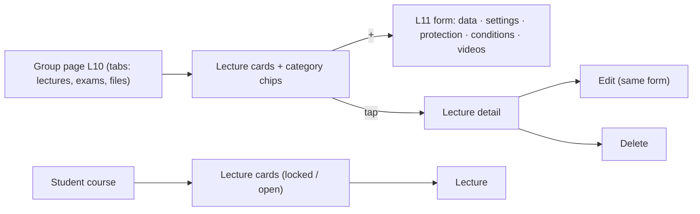

# Feature 10 — Lectures · Mobile integration guide

> For: mobile developers · API `v1` · technical reference: [feature-10-lectures.md](../features/feature-10-lectures.md) · QA guide: [feature-10-lectures-qa.md](feature-10-lectures-qa.md) · prerequisites: [Feature 04](feature-04-groups-mobile.md) (groups), [Feature 09](feature-09-categories-mobile.md) (categories) · same form: [11](feature-11-lecture-protection-conditions-mobile.md) protection & conditions, [12](feature-12-lecture-videos-mobile.md) videos, [13](feature-13-chapters-timed-questions-mobile.md) chapters & timed questions, [14](feature-14-files-mobile.md) files

A lecture belongs to one course and is assigned to one or more groups. The L11 form saves **everything in one request**: the lecture itself (this guide) plus the optional blocks `protection`, `conditions`, `videos`, `file_ids` and the lecture exams.

---

## 1. Common rules

* Base URL `{{host}}/api/v1`; headers `Authorization`, `Accept: application/json`, `Accept-Language: ar|en`, **`X-Teacher-Id`** (teacher screens).
* Envelope `{code, message, errors, data}`; **branch on `error_code`**. Lists: `?page=&per_page=` → `data.items[]` + `data.pagination`.
* With a cover image the body is **multipart**; an edit with a file is `POST` + `_method=PATCH`.
* Booleans in multipart are `1` / `0`; an empty value clears a field.

---

## 2. Screens



---

## 3. API

| Action | Request | Success |
|---|---|---|
| Course lectures (cards) | `GET /teacher/courses/{courseId}/lectures` | 200 |
| Cards with query parameters | `GET /teacher/lectures?course_id=&group_id=&category_id=&uncategorized=&status=&search=` | 200 |
| Group page | `GET /teacher/courses/{courseId}/groups/{groupId}/lectures` | 200 (+ `tabs`) |
| Next number | `GET /teacher/courses/{courseId}/lectures/next-number` | 200 `{next_lecture_number}` |
| Create | `POST /teacher/courses/{courseId}/lectures` | **201** `{lecture, next_lecture_number}` |
| Detail | `GET /teacher/courses/{courseId}/lectures/{lectureId}` | 200 |
| Edit | `PATCH /teacher/courses/{courseId}/lectures/{lectureId}` (file: `POST` + `_method=PATCH`) | 200 |
| Delete | `DELETE /teacher/courses/{courseId}/lectures/{lectureId}` | 200 |
| Student cards | `GET /student/courses/{courseId}/lectures?category_id=` | 200 |
| Student lecture | `GET /student/lectures/{lectureId}` | 200 |

**List filters** (all optional): `group_id`, `category_id` **or** `uncategorized=1`, `status` (`draft | scheduled | published | ended`), `search` (title or number), `page`, `per_page`. Newest number first.

### 3.1 Card (lists)

```json
{
  "id": "019a…", "course_id": "019a…", "lecture_number": 4, "title": "المحاضرة الرابعة",
  "status": "published", "category_id": "019a…", "group_ids": ["019a…"],
  "published_at": "2026-10-20T15:00:00+00:00", "available_until": null,
  "video_missing": false,
  "counts": { "videos": 2, "questions": 3, "views": 120 }
}
```

`data.filters.categories` = chips `{type: all | category | uncategorized, id?, name?, color?, count}`; the group page adds `data.tabs {lectures, exams, files}`.

| `status` | Meaning |
|---|---|
| `draft` | no publish date |
| `scheduled` | publish date in the future |
| `published` | visible to students now |
| `ended` | `available_until` passed (hidden from students) |

### 3.2 Create — full JSON body (no cover)

```json
POST /teacher/courses/{courseId}/lectures
{
  "title": "الفصل الثالث · التفاضل - الجزء الأول",
  "description": "شرح قواعد الاشتقاق الأساسية مع أمثلة محلولة.",
  "lecture_number": 7,
  "category_id": "019a…",
  "group_ids": ["019a…", "019a…"],
  "publish_now": true,
  "available_until": "2027-06-30T23:59:00+03:00",

  "pre_exam_id": "019b…",
  "pre_exam_must_pass": true,
  "post_exam_id": "019b…",
  "file_ids": ["019c…"],
  "protection": { "max_views": 3, "allow_screenshots": false, "allow_offline_download": false, "watermark_student_name": true, "require_headphones": true },
  "conditions": { "required_lecture_ids": ["019a…"], "required_exam_ids": [], "min_pass_percentage": 60 },
  "videos": [
    { "provider": "youtube", "url": "https://www.youtube.com/watch?v=WUvTyaaNkzM", "title": "مقدمة في المشتقات", "duration_seconds": 2530,
      "chapters": [ { "start_second": 0, "title": "مقدمة" }, { "start_second": 270, "title": "تعريف المشتقة" } ],
      "questions": [ { "at_second": 900, "question_id": "019d…", "points": 2, "pause_video": true, "must_answer": true, "show_explanation": true } ] }
  ]
}
```

Only `title` and `group_ids` are required. Every block below the blank line is optional and explained in its own guide.

### 3.3 Create with a cover (multipart, Postman bulk edit)

```
title:الفصل الثالث · التفاضل - الجزء الأول
lecture_number:7
group_ids[0]:{{group_id}}
publish_now:1
image:<file: cover.jpg>
category_id:{{category_id}}
available_until:2027-06-30T23:59:00+03:00
```

### 3.4 Fields

| Field | Rule |
|---|---|
| `title` | required on create, 1–150 |
| `description` | optional, ≤ 2000; empty clears |
| `lecture_number` | optional ≥ 1, unique in the course; omitted = next number (`GET …/next-number`) |
| `category_id` | a category of this course, or `null` |
| `group_ids` | required on create, 1–50 groups of this course; on edit **replaces** the set |
| `publish_now` | `true` = publish now. Don't send it together with `published_at` |
| `published_at` | a date-time (future = scheduled), or `null` = draft |
| `available_until` | after `published_at`, or `null` = no end |
| `image` | jpg / png / webp ≤ 5 MB (multipart); `remove_image: 1` removes the cover on edit |

### 3.5 Detail

`LectureResource`: `id, lecture_number, title, description, image_url, thumb_url, status, published_at, available_until, category, groups [{id, name, is_active}], protection, conditions, pre_exam, post_exam, counts {videos, views, files, blocked_students}, total_duration_seconds, video_missing, created_at, updated_at`.

### 3.6 Edit

Send only what changes (JSON `PATCH`, or multipart `POST` + `_method=PATCH`). Full multipart example: see the Feature 11 / 12 guides; the rules per block are:

* `group_ids`, `file_ids`, `conditions` **replace** their whole set; `protection` is **partial**; `videos` is **synced** (items with `id` updated, without `id` added, missing ones deleted).

### 3.7 Student

* Cards: `GET /student/courses/{courseId}/lectures` → `{id, lecture_number, title, thumb_url, category_id, published_at, available_until, counts {videos, questions, duration_seconds}, locked, lock_reason, views_remaining}` + category chips. Only published lectures of the student's groups appear; not enrolled → `404 COURSE_NOT_FOUND`.
* Lecture: `GET /student/lectures/{lectureId}` (lock state, conditions, exams: [Feature 11](feature-11-lecture-protection-conditions-mobile.md)).

---

## 4. Errors to handle

| `error_code` | HTTP | Show |
|---|---|---|
| `VALIDATION_ERROR` | 422 | field errors (`publish_now` + `published_at`, `available_until` ≤ `published_at`, image) |
| `LECTURE_NUMBER_TAKEN` | 422 | "This number is used" — offer `next-number` |
| `INVALID_GROUP_ASSIGNMENT` | 422 | a group of another course; refresh groups |
| `INVALID_CATEGORY` | 422 | the category was deleted; refresh chips |
| `LECTURE_NOT_FOUND` | 404 | deleted / hidden; refresh |
| `COURSE_NOT_FOUND` / `COURSE_NOT_ACCESSIBLE` | 404 / 403 | back to courses |
| `PLATFORM_SUBSCRIPTION_EXPIRED` | 402 | the teacher's Darsly subscription ended ([Feature 23](feature-23-platform-subscription-mobile.md)) |

---

## 5. Checklist

- [ ] The form saves every block in one request; a 422 in any block means nothing was saved.
- [ ] "Save & add another" pre-fills `lecture_number` from `next_lecture_number`.
- [ ] Publish choices: now (`publish_now: true`), later (`published_at`), draft (`published_at: null`).
- [ ] Edit with a cover uses `POST` + `_method=PATCH`.
- [ ] Group page shows the tab counts and category chips.
- [ ] Student cards show the lock icon and `views_remaining`.


### Exhausted view allowances

Teacher lecture details include `counts.exhausted_students`: number of lecture progress records with `views_used >= max_views + extra_views`. This counts exhausted allowances, not completed watching. Unlimited views (`max_views: null`) returns 0. Verify the exact limit, extra views, and unlimited access.
