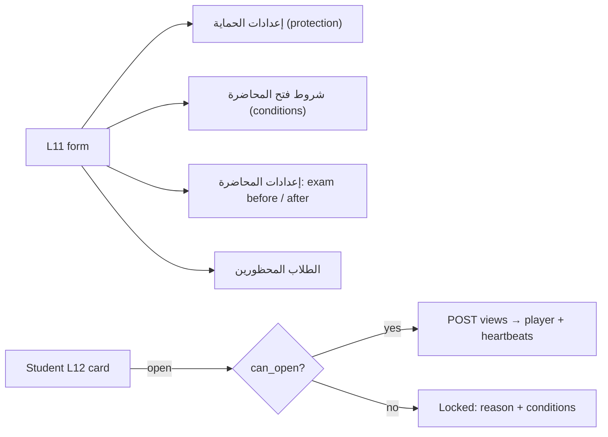

# Feature 11 — Lecture protection & opening conditions · Mobile integration guide

> For: mobile developers · API `v1` · technical reference: [feature-11-lecture-protection-conditions.md](../features/feature-11-lecture-protection-conditions.md) · QA guide: [feature-11-lecture-protection-conditions-qa.md](feature-11-lecture-protection-conditions-qa.md) · prerequisites: [Feature 10](feature-10-lectures-mobile.md) (lectures)

Per-lecture **protection** (views limit, screenshots, offline download, watermark, headphones), **opening conditions** (lectures to watch / exams to pass first), the **exam before / after** the lecture, **blocked students**, teacher overrides, and the **student playback** flow (open, start a view, heartbeats).

---

## 1. Common rules

* Base URL `{{host}}/api/v1`; teacher screens send **`X-Teacher-Id`**.
* Envelope `{code, message, errors, data}`; **branch on `error_code`**. Errors may add a `details` object (lock reason, conditions, views).
* All settings can be saved **inside the lecture create / update body** ([Feature 10](feature-10-lectures-mobile.md)) or through the dedicated endpoints below.

---

## 2. Screens



---

## 3. Teacher API

Base path `/teacher/courses/{courseId}/lectures/{lectureId}`:

| Action | Request | Success |
|---|---|---|
| Protection | `GET protection` / `PATCH protection` | 200 |
| Conditions | `GET conditions` / `PUT conditions` | 200 |
| Blocked students | `GET blocked-students` · `POST blocked-students` · `DELETE blocked-students/{enrollmentId}` | 200 / **201** new block / 200 |
| Extra views | `POST students/{enrollmentId}/extra-views` | 200 |
| Mark watched | `POST students/{enrollmentId}/mark-watched` | 200 |

### 3.1 Protection

```json
PATCH /teacher/courses/{courseId}/lectures/{lectureId}/protection
{
  "max_views": 3,
  "allow_screenshots": false,
  "allow_offline_download": false,
  "watermark_student_name": true,
  "require_headphones": true,
  "blocked_students": [
    { "course_enrollment_id": "019a…", "reason": "مشاركة الحساب مع طالب آخر" }
  ]
}
```

| Field | Default | Rule |
|---|---|---|
| `max_views` | `null` (unlimited) | 1–1000 or `null` |
| `allow_screenshots` | false | enforced by the app (`FLAG_SECURE` / iOS capture detection) |
| `allow_offline_download` | false | experimental; enforced by the app |
| `watermark_student_name` | true | the app draws `watermark.name` + `watermark.code` |
| `require_headphones` | false | the app pauses without headphones |
| `blocked_students` | — | when sent, **replaces** the blocked list (`[]` unblocks everyone) |

PATCH is partial: omitted fields stay.

### 3.2 Opening conditions (replace)

```json
PUT /teacher/courses/{courseId}/lectures/{lectureId}/conditions
{ "required_lecture_ids": ["019a…"], "required_exam_ids": ["019b…"], "min_pass_percentage": 60 }
```

* `required_lecture_ids`: other lectures of the same course the student must **watch** first (not itself; no loops → `422 CONDITION_CYCLE`).
* `required_exam_ids`: **published** exams of the course to pass first.
* `min_pass_percentage`: 1–100, or `null` = each exam's own pass mark.
* A missing list = none.

### 3.3 Exam before / after the lecture (L11 «إعدادات المحاضرة»)

In the lecture create / update body:

```json
{ "pre_exam_id": "019b…", "pre_exam_must_pass": true, "post_exam_id": "019b…" }
```

| Field | Meaning |
|---|---|
| `pre_exam_id` | exam shown at the start of the lecture as practice / recitation (draft or published exam of the course); `null` removes it and turns `pre_exam_must_pass` off |
| `pre_exam_must_pass` | `true`: the rest of the lecture stays locked until the student passes that exam |
| `post_exam_id` | the exam after the lecture (the lecture exam counted in progress); `null` unlinks |

The detail returns `pre_exam {id, title, must_pass} | null` and `post_exam {id, title} | null`.

### 3.4 Multipart form data (full lecture update with protection and conditions)

```
_method:PATCH
pre_exam_id:{{exam_id}}
pre_exam_must_pass:1
post_exam_id:{{post_exam_id}}
protection[max_views]:3
protection[allow_screenshots]:0
protection[allow_offline_download]:0
protection[watermark_student_name]:1
protection[require_headphones]:1
protection[blocked_students][0][course_enrollment_id]:{{enrollment_id}}
protection[blocked_students][0][reason]:مشاركة الحساب مع طالب آخر
conditions[required_lecture_ids][0]:{{seeded_lecture_id}}
conditions[required_exam_ids][0]:{{required_exam_id}}
conditions[min_pass_percentage]:60
```

### 3.5 Blocks and overrides

```json
POST …/blocked-students                     { "course_enrollment_id": "019a…", "reason": "غش" }     → 201 (200 if already blocked)
POST …/students/{enrollmentId}/extra-views  { "count": 2 }                                           → 1–100, added to max_views
POST …/students/{enrollmentId}/mark-watched                                                           → counts as watched (unlocks lectures that require it)
```

---

## 4. Student API

| Action | Request | Success |
|---|---|---|
| Lecture (with lock state) | `GET /student/lectures/{lectureId}` | 200 |
| Access card only | `GET /student/lectures/{lectureId}/access` | 200 |
| Start a view | `POST /student/lectures/{lectureId}/views` | **201** |
| Heartbeat | `POST /student/lecture-views/{viewId}/heartbeat` | 200 |

### 4.1 Lock state

```json
{
  "can_open": false, "locked": true, "lock_reason": "conditions_not_met",
  "views": { "used": 1, "allowed": 3, "remaining": 2 },
  "conditions": [
    { "type": "pre_exam", "id": "019b…", "title": "امتحان الوحدة الأولى", "met": false, "detail": { "best_percentage": 40, "required": 60 } },
    { "type": "lecture", "id": "019a…", "title": "Chapter 1 · Part 1", "met": true, "detail": { "completed_at": "2026-10-20T19:00:00+00:00" } },
    { "type": "exam", "id": "019b…", "title": "امتحان قصير", "met": false, "detail": { "best_percentage": null, "required": 60 } }
  ],
  "pre_exam": { "id": "019b…", "title": "امتحان الوحدة الأولى", "must_pass": true },
  "post_exam": null
}
```

| `lock_reason` | Show |
|---|---|
| `blocked` | "You are blocked from this lecture" |
| `conditions_not_met` | the unmet conditions as a checklist (exam → open the exam; lecture → open that lecture) |
| `views_exhausted` | "No views left" |

### 4.2 Start a view

`POST /student/lectures/{lectureId}/views` (counts **one** view) → 201:

```json
{
  "view_id": "019e…", "lecture_id": "019a…",
  "protection": { "allow_screenshots": false, "allow_offline_download": false, "watermark_student_name": true, "require_headphones": true },
  "watermark": { "name": "نور سالم", "code": "48213907" },
  "views": { "used": 2, "allowed": 3, "remaining": 1 },
  "videos": [ "… (Feature 12)" ]
}
```

Apply the protection flags in the player; draw the watermark when it isn't `null`.

### 4.3 Heartbeat

Every ≥ 10 seconds while playing:

```json
POST /student/lecture-views/{viewId}/heartbeat
{ "position_seconds": 640, "watched_seconds_delta": 10, "video_id": "019f…", "video_ended": false }
```

→ `{view_id, watched_seconds, max_position_seconds, completed}`. `completed: true` = the lecture counts as watched (≥ 90 % of its duration).

---

## 5. Errors to handle

| `error_code` | HTTP | Show |
|---|---|---|
| `LECTURE_LOCKED` | 403 | conditions not met; `details.conditions` |
| `LECTURE_BLOCKED` | 403 | blocked (also on heartbeat: stop the player) |
| `LECTURE_VIEWS_EXHAUSTED` | 403 | no views left; `details.views` |
| `LECTURE_NOT_FOUND` | 404 | hidden (not published / not in the student's groups) |
| `VIEW_NOT_FOUND` | 404 | stale view id: start a new view |
| `TOO_MANY_REQUESTS` | 429 | heartbeat too often: keep ≥ 10 s |
| `INVALID_REQUIRED_LECTURE` / `CONDITION_CYCLE` / `INVALID_EXAM` | 422 | condition errors (teacher form) |
| `STUDENT_NOT_IN_COURSE` | 422 | blocking a student of another course |
| `COURSE_NOT_OPEN_YET` / `COURSE_ACCESS_CLOSED` | 403 | the course access window ([Feature 22](feature-22-course-tools-access-mobile.md)) |

---

## 6. Checklist

- [ ] Player applies `allow_screenshots`, `require_headphones`, the watermark and `allow_offline_download`.
- [ ] Heartbeats every 10 s with the real watched delta; stop on `LECTURE_BLOCKED`.
- [ ] Locked cards show the reason and the condition checklist; a `pre_exam` condition opens the exam.
- [ ] "Remaining views" is shown before starting a view.
- [ ] Teacher form: three states for `max_views` (number / unlimited), block list replace semantics.
