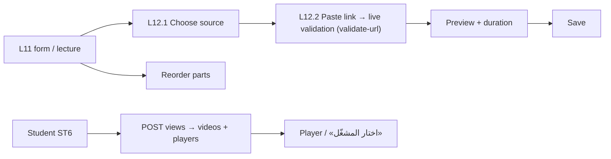

# Feature 12 — Lecture videos · Mobile integration guide

> For: mobile developers · API `v1` · technical reference: [feature-12-lecture-videos.md](../features/feature-12-lecture-videos.md) · QA guide: [feature-12-lecture-videos-qa.md](feature-12-lecture-videos-qa.md) · prerequisites: [Feature 10](feature-10-lectures-mobile.md), [Feature 11](feature-11-lecture-protection-conditions-mobile.md) (playback views)

A lecture has 0–20 **videos** («الأجزاء»). Each is a link to an external provider: YouTube, Vimeo, Google Drive or a direct link. Darsly stores the link, never the file. The teacher picks the **source first**, then pastes the link; the app validates it live.

---

## 1. Common rules

* Base URL `{{host}}/api/v1`; teacher screens send **`X-Teacher-Id`**.
* Envelope `{code, message, errors, data}`; **branch on `error_code`** and read `details` for link errors.
* Videos can be saved inside the lecture body (`videos[]`) or one by one with the endpoints below.

---

## 2. Screens



---

## 3. Teacher API

Base `/teacher/courses/{courseId}/lectures/{lectureId}/videos`:

| Action | Request | Success |
|---|---|---|
| List | `GET /` | 200 |
| Add | `POST /` | **201** |
| Edit | `PATCH /{videoId}` | 200 |
| Delete | `DELETE /{videoId}` | 200 |
| Reorder | `PUT /order` | 200 |
| Validate a link (saves nothing) | `POST /validate-url` | 200 |
| Validate before the lecture exists | `POST /teacher/courses/{courseId}/videos/validate-url` | 200 |

### 3.1 Validate a link (live feedback)

```json
POST /teacher/courses/{courseId}/videos/validate-url
{ "provider": "youtube", "url": "https://youtu.be/dQw4w9WgXcQ" }
```

Always **200**:

```json
{ "valid": true, "provider": "youtube", "external_id": "dQw4w9WgXcQ", "detected_provider": null,
  "error_code": null, "message": null, "hint": null,
  "preview": { "thumbnail_url": "https://i.ytimg.com/vi/dQw4w9WgXcQ/hqdefault.jpg", "embed_url": "https://www.youtube-nocookie.com/embed/dQw4w9WgXcQ" },
  "duration_seconds": 2530 }
```

`valid: false` comes with `error_code` (`INVALID_VIDEO_URL` / `VIDEO_URL_PROVIDER_MISMATCH`), a translated `message`, a `hint` (e.g. the Drive sharing rule) and `detected_provider` ("this link is YouTube"). Show it under the field; it is **not** an error response.

### 3.2 Add

```json
POST /teacher/courses/{courseId}/lectures/{lectureId}/videos
{ "provider": "vimeo", "url": "https://vimeo.com/76979871/abc123def4", "title": "تمارين على قاعدة القوة", "duration_seconds": 1500 }
```

| Field | Rule |
|---|---|
| `provider` | required: `youtube`, `vimeo`, `google_drive`, `other_link` |
| `url` | required, ≤ 2048, must match the provider (table below) |
| `title` | optional ≤ 150; default «الجزء N» |
| `duration_seconds` | optional 1–86400; when omitted the server looks it up (Vimeo always, YouTube when configured) |

| Provider | Accepted links |
|---|---|
| `youtube` | `youtube.com/watch?v=…`, `youtu.be/…`, `/shorts/…`, `/live/…`, `/embed/…` |
| `vimeo` | `vimeo.com/{id}`, `vimeo.com/{id}/{hash}`, `player.vimeo.com/video/{id}` |
| `google_drive` | `drive.google.com/file/d/{id}/view` (shared "anyone with the link"), `open?id=`, `uc?id=` |
| `other_link` | an **https** link ending in `.mp4`, `.m3u8` or `.webm` |

### 3.3 Video object

```json
{ "id": "019f…", "position": 1, "provider": "youtube", "url": "https://youtu.be/dQw4w9WgXcQ", "external_id": "dQw4w9WgXcQ",
  "title": null, "display_title": "الجزء 1", "duration_seconds": 2530, "metadata_status": "manual",
  "preview": { "thumbnail_url": "…", "embed_url": "…" }, "chapters_count": 6, "questions_count": 2 }
```

`metadata_status`: `manual` (typed), `pending` (looking it up), `resolved`, `failed` (unknown: ask the teacher to type it).

### 3.4 Edit, delete, reorder

```json
PATCH …/videos/{videoId}      { "title": "الجزء الأول", "duration_seconds": 2600 }
PUT   …/videos/order          { "video_ids": ["019f…c", "019f…a", "019f…b"] }   ← every live video id, new order
```

A new `url` / `provider` is validated again. Delete compacts the positions.

### 3.5 Inside the lecture body (sync)

```json
"videos": [
  { "id": "019f…a", "title": "مقدمة في المشتقات" },
  { "provider": "youtube", "url": "https://www.youtube.com/watch?v=rAof9Ld5sOg", "title": "قاعدة السلسلة", "duration_seconds": 1850 }
]
```

With `id` = update, without `id` = new (`provider` + `url` required), missing = **deleted**, list order = new order. Multipart: `videos[0][id]`, `videos[1][provider]`, `videos[1][url]` …

---

## 4. Student playback

`POST /student/lectures/{lectureId}/views` ([Feature 11](feature-11-lecture-protection-conditions-mobile.md)) returns the parts:

```json
"videos": [
  { "id": "019f…", "position": 1, "title": "الجزء 1", "duration_seconds": 2530, "provider": "youtube",
    "players": ["native", "webview", "low_bandwidth"],
    "playback": { "embed_url": "https://www.youtube-nocookie.com/embed/dQw4w9WgXcQ", "external_id": "dQw4w9WgXcQ" } }
]
```

* `players` = the choices of «اختار المشغّل»; `playback.hash` is present for private Vimeo links.
* Playback data is returned **only** here (after the access check and the view count), never in lists.
* Heartbeats send `video_id` and `video_ended: true` at the end of a part (used to mark the lecture watched when durations are unknown).

---

## 5. Errors to handle

| `error_code` | HTTP | Show |
|---|---|---|
| `INVALID_VIDEO_URL` | 422 | `details.hint` under the URL field |
| `VIDEO_URL_PROVIDER_MISMATCH` | 422 | "This link is {detected_provider}" — offer to switch the source |
| `VIDEO_LIMIT_REACHED` | 422 | "Maximum 20 parts" |
| `VIDEO_NOT_FOUND` | 404 / 422 | deleted meanwhile; refresh |
| `VALIDATION_ERROR` | 422 | bad provider / order list / duration |

---

## 6. Checklist

- [ ] Source is chosen before the link; validation runs while typing (debounced) through `validate-url`.
- [ ] `valid: false` shows message + hint, not an error dialog.
- [ ] Preview thumbnail and duration from the validation result.
- [ ] Reorder sends every live id.
- [ ] `metadata_status: failed` asks the teacher to type the duration.
- [ ] Student player offers the `players` of each part and sends `video_id` / `video_ended` in heartbeats.
