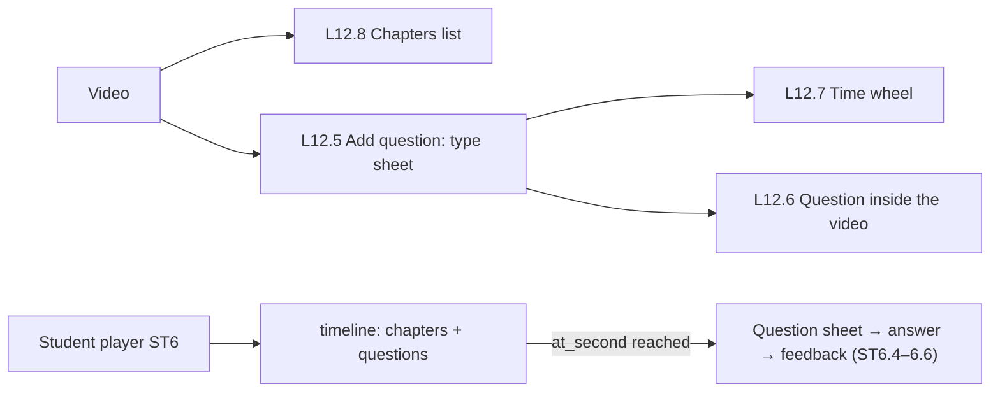

# Feature 13 — Video chapters & timed questions · Mobile integration guide

> For: mobile developers · API `v1` · technical reference: [feature-13-chapters-timed-questions.md](../features/feature-13-chapters-timed-questions.md) · QA guide: [feature-13-chapters-timed-questions-qa.md](feature-13-chapters-timed-questions-qa.md) · prerequisites: [Feature 12](feature-12-lecture-videos-mobile.md) (videos), [Feature 15](feature-15-question-bank-mobile.md) (questions)

Each video can have **chapters** (time → title) and **timed questions** (time → a question that pauses the video). The questions are the same course questions used by the bank and exams.

---

## 1. Common rules

* Base URL `{{host}}/api/v1`; teacher screens send **`X-Teacher-Id`**.
* Envelope `{code, message, errors, data}`; **branch on `error_code`**.
* Times are whole **seconds** from the start of the video.

---

## 2. Screens



---

## 3. Teacher API

Base `/teacher/courses/{courseId}/lectures/{lectureId}/videos/{videoId}`:

| Action | Request | Success |
|---|---|---|
| Chapters | `GET chapters` / `PUT chapters` (replace) | 200 |
| Timed questions | `GET questions` | 200 |
| Add | `POST questions` | **201** |
| Edit | `PATCH questions/{videoQuestionId}` | 200 |
| Remove | `DELETE questions/{videoQuestionId}` | 200 |

### 3.1 Chapters (replace)

```json
PUT …/videos/{videoId}/chapters
{
  "chapters": [
    { "start_second": 0, "title": "مقدمة" },
    { "start_second": 270, "title": "تعريف المشتقة" },
    { "start_second": 680, "title": "مشتقة الثابت والقوة" }
  ]
}
```

`[]` removes all. Seconds unique; `start_second` < the video duration; title 1–100; max 100.

### 3.2 Add a timed question — existing bank question

```json
POST …/videos/{videoId}/questions
{ "at_second": 900, "question_id": "019d…", "points": 2, "pause_video": true, "must_answer": true, "show_explanation": true }
```

### 3.3 Add a timed question — new inline question

```json
POST …/videos/{videoId}/questions
{
  "at_second": 1870,
  "question": {
    "type": "true_false",
    "body": "مشتقة أي عدد ثابت تساوي صفر.",
    "explanation": "الثابت لا يتغير بتغير س، لذلك معدل تغيره صفر.",
    "default_points": 1,
    "category_id": null,
    "options": [ { "body": "صح", "is_correct": true }, { "body": "خطأ", "is_correct": false } ]
  },
  "pause_video": true, "must_answer": false, "show_explanation": true
}
```

The inline question is also added to the course question bank.

| Field | Rule |
|---|---|
| `at_second` | required, < the video duration, one live question per second |
| `question_id` **or** `question` | an existing question of this course, or a new one |
| `points` | 0–999.99 or `null` = the question's `default_points` |
| `pause_video` / `must_answer` / `show_explanation` | default `true` |

Question types: `true_false` (2 options, 1 correct), `single_choice` (2–8, 1 correct), `multiple_choice` (2–8, ≥ 1 correct; all-or-nothing grading).

### 3.4 Edit / remove

```json
PATCH …/questions/{videoQuestionId}    { "at_second": 950, "points": 3, "must_answer": true }
```

Change the question's text / options through the question endpoint ([Feature 15](feature-15-question-bank-mobile.md)). Removing keeps the students' answers.

### 3.5 Inside the lecture body

```
videos[0][chapters][0][start_second]:0
videos[0][chapters][0][title]:مقدمة
videos[0][questions][0][id]:{{timed_question_id}}          ← existing: update
videos[0][questions][0][at_second]:950
videos[0][questions][1][at_second]:2400                    ← new
videos[0][questions][1][question_id]:{{question_id}}
videos[0][questions][1][points]:2
```

`chapters` replace; `questions` sync (missing ones removed). Errors point at the nested key (`videos.0.questions.1.at_second`).

---

## 4. Student API

Through the student's playback view ([Feature 11](feature-11-lecture-protection-conditions-mobile.md)):

| Action | Request | Success |
|---|---|---|
| Timeline | `GET /student/lecture-views/{viewId}/videos/{videoId}/timeline` | 200 |
| Answer | `POST /student/lecture-views/{viewId}/video-questions/{videoQuestionId}/answer` | **201** first / 200 stored |

### 4.1 Timeline

```json
{
  "video_id": "019f…",
  "chapters": [ { "id": "…", "start_second": 0, "title": "مقدمة" } ],
  "questions": [
    { "id": "019g…", "at_second": 900, "pause_video": true, "must_answer": true, "points": 2,
      "question": { "type": "single_choice", "body": "ما مشتقة الدالة د(س) = س³ ؟", "images": [],
                    "options": [ { "id": "o1", "body": "٣س²" }, { "id": "o2", "body": "س²" } ] },
      "answered": null }
  ]
}
```

Correct answers are **never** in the timeline before answering. `answered` is filled for questions already answered.

### 4.2 Answer

```json
POST /student/lecture-views/{viewId}/video-questions/{videoQuestionId}/answer
{ "selected_option_ids": ["o1"] }
```

```json
{ "video_question_id": "019g…", "is_correct": true, "points_awarded": 2, "selected_option_ids": ["o1"], "correct_option_ids": ["o1"], "explanation": "بقاعدة القوة …", "already_answered": false }
```

**The first answer counts**: answering again returns the stored result with `already_answered: true`. `explanation` is `null` when `show_explanation` is off. With `must_answer`, don't let the student continue the video until answered.

---

## 5. Errors to handle

| `error_code` | HTTP | Show |
|---|---|---|
| `TIMED_QUESTION_TIME_TAKEN` | 422 | another question at that second |
| `TIMED_QUESTION_OUT_OF_RANGE` / `CHAPTER_OUT_OF_RANGE` | 422 | time after the video end |
| `TIMED_QUESTION_LIMIT_REACHED` | 422 | max 30 per video |
| `INVALID_QUESTION_OPTIONS` | 422 | option rules of the type |
| `QUESTION_NOT_FOUND` | 404 / 422 | question deleted / of another course |
| `INVALID_ANSWER` | 422 | foreign option / several for a single answer |
| `VIEW_NOT_FOUND` / `VIDEO_NOT_FOUND` | 404 | stale view: start a new view |
| `LECTURE_BLOCKED` | 403 | blocked: stop playback |

---

## 6. Checklist

- [ ] Chapters list sorted by time; tapping seeks.
- [ ] The video pauses at `at_second` when `pause_video`; `must_answer` blocks continuing.
- [ ] Correct / wrong feedback from the answer response; explanation only when returned.
- [ ] Re-opening shows the stored answer (`answered`), no second attempt.
- [ ] Time wheel prevents times beyond the duration.
