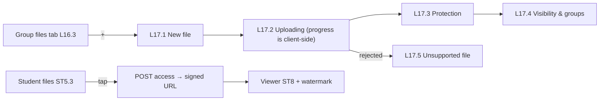

# Feature 14 — Files · Mobile integration guide

> For: mobile developers · API `v1` · technical reference: [feature-14-files.md](../features/feature-14-files.md) · QA guide: [feature-14-files-qa.md](feature-14-files-qa.md) · prerequisites: [Feature 10](feature-10-lectures-mobile.md) (lectures), [Feature 09](feature-09-categories-mobile.md) (categories)

Course **files** (mostly PDF summaries and sheets, also images) that students read **inside the app**. Each file has protection flags (watermark, highlights, download, print), groups, an optional lecture and a publish date. Files are private: students get a short-lived signed link.

---

## 1. Common rules

* Base URL `{{host}}/api/v1`; teacher screens send **`X-Teacher-Id`**.
* Envelope `{code, message, errors, data}`; **branch on `error_code`**, read `details` for file errors.
* Upload and replace are **multipart**; at most 50 MB; 20 uploads / minute.
* Supported: **PDF, JPG, PNG, WEBP** — detected by the file content, not the name.

---

## 2. Screens



---

## 3. Teacher API

| Action | Request | Success |
|---|---|---|
| List (course) | `GET /teacher/courses/{courseId}/files` | 200 |
| List (group tab) | `GET /teacher/courses/{courseId}/groups/{groupId}/files` | 200 |
| List (query parameters) | `GET /teacher/files?course_id=&group_id=&category_id=&lecture_id=&status=&search=` | 200 |
| Upload | `POST /teacher/courses/{courseId}/files` (multipart) | **201** |
| Detail | `GET …/files/{fileId}` | 200 |
| Edit | `PATCH …/files/{fileId}` (JSON) | 200 |
| Replace the file | `POST …/files/{fileId}/replace` (multipart) | 200 |
| Teacher preview | `GET …/files/{fileId}/preview` | 200 `{url, expires_at}` |
| Delete | `DELETE …/files/{fileId}` | 200 |

**List filters:** `group_id`, `category_id`, `lecture_id`, `status` (`processing | ready | failed`), `search`, `page`, `per_page`.

### 3.1 Upload — full form data

```
POST /teacher/courses/{courseId}/files
file:<file: summary.pdf>
title:ملخص الفصل الثالث - التفاضل
category_id:{{category_id}}
lecture_id:{{lecture_id}}
group_ids[0]:{{group_id}}
group_ids[1]:{{evening_group_id}}
visible_on_student_home:1
publish_now:1
watermark_student_name:1
allow_highlights:1
allow_download:0
allow_print:0
```

| Field | Rule |
|---|---|
| `file` | required (create only), PDF / JPG / PNG / WEBP, ≤ 50 MB |
| `title` | required, 1–150 |
| `group_ids` | required, 1–50 groups of the course; on edit **replaces** the set |
| `category_id` | a category of the course, or empty |
| `lecture_id` | a lecture of the **same** course (the «ملف المحاضرة»), or empty |
| `visible_on_student_home` | default `1` (shown on the student home) |
| `publish_now` / `published_at` | like lectures: now, a date (scheduled), or empty = draft |
| `watermark_student_name` | default `1` — the app draws «name · code» on every page |
| `allow_highlights` | default `1` — highlights / notes in the viewer (kept on the device) |
| `allow_download` | default `0` — offline reading inside the app |
| `allow_print` | default `0` |

### 3.2 File object & status

```json
{ "id": "019c…", "course_id": "019a…", "title": "ملخص الفصل الثالث", "type": "pdf", "mime_type": "application/pdf",
  "size_bytes": 1835008, "pages": 14, "status": "ready", "failure_reason": null,
  "flags": { "watermark_student_name": true, "allow_highlights": true, "allow_download": false, "allow_print": false },
  "visible_on_student_home": true, "published_at": "2026-10-20T15:00:00+00:00",
  "category": { "id": "…", "name": "أخرى", "color": "…" }, "lecture": { "id": "…", "title": "Preface" },
  "groups": [ { "id": "…", "name": "المجموعة A" } ], "opens_count": 37 }
```

`status`: `processing` (page counting) → `ready` or `failed` (`failure_reason`: `corrupt`, `encrypted`, `unreadable`, `unsafe_content`). Poll the detail while `processing`. Students only see `ready` files.

### 3.3 Edit (JSON) and replace

```json
PATCH /teacher/courses/{courseId}/files/{fileId}
{ "title": "ملخص الفصل الثالث (مُحدَّث)", "allow_download": true, "group_ids": ["019a…"], "lecture_id": null }
```

```
POST /teacher/courses/{courseId}/files/{fileId}/replace
file:<file: summary-v2.pdf>
```

Replace keeps the id and settings; previous student links stop working.

### 3.4 Attach files to a lecture

In the lecture body ([Feature 10](feature-10-lectures-mobile.md)): `file_ids: ["019c…"]` (replaces the set).

---

## 4. Student API

| Action | Request | Success |
|---|---|---|
| Files of a course | `GET /student/courses/{courseId}/files?category_id=&home=1` | 200 |
| Open a file | `POST /student/files/{fileId}/access` | 200 |

```json
POST /student/files/{fileId}/access
→ {
  "file": { "id": "019c…", "title": "ملخص الفصل الثالث", "type": "pdf", "pages": 14, "size_bytes": 1835008 },
  "url": "https://…/api/v1/files/019c…/download?u=…&v=…&expires=…&signature=…",
  "expires_at": "2026-10-25T12:05:00+00:00",
  "flags": { "allow_highlights": true, "allow_download": false, "allow_print": false },
  "watermark": { "name": "نور سالم", "code": "48213907" }
}
```

* Open `url` within **5 minutes** (no bearer needed; never send another user's token). Ask for a new access when it expires.
* Draw the watermark when not `null`; hide download / print when the flags are false.
* The list items carry `locked` / `lock_reason`: a file attached to a locked lecture is locked too.

---

## 5. Errors to handle

| `error_code` | HTTP | Show |
|---|---|---|
| `FILE_TYPE_NOT_SUPPORTED` | 422 | L17.5 screen; `details.allowed_types` |
| `FILE_TOO_LARGE` | 422 | "Max {details.max_mb} MB" |
| `FILE_NOT_READY` | 409 | still processing / failed (`details.status`) |
| `FILE_LOCKED` | 403 | its lecture is locked (`details.lecture_id`) |
| `FILE_NOT_FOUND` | 404 / 422 | deleted / not visible; refresh |
| `FILE_NOT_ACCESSIBLE` | 403 | the link belongs to another user |
| `INVALID_LECTURE` / `INVALID_GROUP_ASSIGNMENT` / `INVALID_CATEGORY` | 422 | refresh the pickers |

---

## 6. Checklist

- [ ] Upload shows client-side progress, then polls while `processing`.
- [ ] Unsupported files show L17.5 with the allowed types.
- [ ] Student viewer: watermark on every page, highlights / download / print per flags.
- [ ] Signed URLs are used immediately and re-requested after expiry.
- [ ] Locked files show the lecture they depend on.


### Teacher files list response

`GET /teacher/files` returns file metadata and pagination without the `category`, `lecture`, or `groups` objects. These keys are omitted, not null. Query filters for these relations remain available. Course-scoped lists and file details retain their existing relation data. Verify the three keys are absent even when the file has assigned relations.
