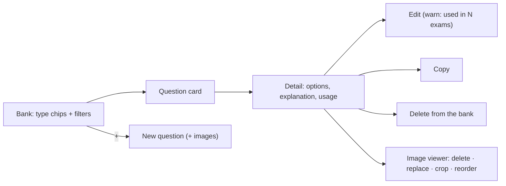

# Feature 15 — Question bank · Mobile integration guide

> For: mobile developers · API `v1` · technical reference: [feature-15-question-bank.md](../features/feature-15-question-bank.md) · QA guide: [feature-15-question-bank-qa.md](feature-15-question-bank-qa.md) · prerequisites: [Feature 09](feature-09-categories-mobile.md) (categories) · used by: [13](feature-13-chapters-timed-questions-mobile.md) timed questions, [16](feature-16-exams-mobile.md) exams

The **question bank** of a course: every question used in exams and inside videos. One question can be used in many places — editing it changes it everywhere (the response says where). Questions can carry **up to 5 images**.

---

## 1. Common rules

* Base URL `{{host}}/api/v1`; headers `Authorization`, `Accept: application/json`, `Accept-Language: ar|en`, **`X-Teacher-Id`**.
* Envelope `{code, message, errors, data}`; **branch on `error_code`**.
* With images the body is **multipart**; an edit with files is `POST` + `_method=PATCH`.

---

## 2. Screens



---

## 3. API

| Action | Request | Success |
|---|---|---|
| Bank (one course) | `GET /teacher/courses/{courseId}/questions` | 200 |
| Bank (query parameter) | `GET /teacher/questions?course_id=` (none = every course) | 200 |
| Detail | `GET …/questions/{questionId}` | 200 |
| Create | `POST …/questions` | **201** |
| Edit | `PATCH …/questions/{questionId}` (files: `POST` + `_method=PATCH`) | 200 |
| Copy | `POST …/questions/{questionId}/copy` | **201** |
| Delete from the bank | `DELETE …/questions/{questionId}` | 200 `{usage}` |

### 3.1 Bank filters

| Parameter | Values |
|---|---|
| `type` | `true_false`, `single_choice`, `multiple_choice`; repeatable `type[]=…&type[]=…` or `type=a,b` |
| `category_id` / `uncategorized=1` | one category / without category (not both) |
| `search` | in the body **and** the options |
| `not_in_exam` | exam id: hide questions already in that exam (exam picker) |
| `exam_id` | exam id: mark each card with `in_exam: true/false` |
| `sort` | `latest` (default) / `oldest` |
| `page`, `per_page` | default 15, max 100 |

`data.meta.counts_by_type` = `{all, true_false, single_choice, multiple_choice}` for the type chips (every filter except the type). `correct_summary` is the correct option text (single choice) or «صح» / «خطأ» (true / false); `null` for multiple choice.

Card:

```json
{ "id": "019d…", "course_id": "019a…", "type": "single_choice", "body": "ما مشتقة الدالة د(س) = س³ ؟",
  "images_count": 2, "image_thumb_url": "https://…/conversions/…-thumb.jpg",
  "category": { "id": "…", "name": "الوحدة الأولى", "color": "#1F6FEB" },
  "options_count": 4, "correct_count": 1, "correct_summary": "٣س²", "default_points": 1,
  "usage": { "exams": 2, "videos": 1 }, "in_exam": false, "created_at": "…" }
```

### 3.2 Create — JSON (no images)

```json
POST /teacher/courses/{courseId}/questions
{
  "type": "single_choice",
  "body": "ما مشتقة الدالة د(س) = س³ ؟",
  "explanation": "بقاعدة القوة: مشتقة سⁿ = ن·سⁿ⁻¹.",
  "default_points": 1,
  "category_id": "019a…",
  "options": [
    { "body": "٣س²", "is_correct": true },
    { "body": "س²", "is_correct": false },
    { "body": "٣س", "is_correct": false },
    { "body": "س⁴ ÷ ٤", "is_correct": false }
  ],
  "add_to_exam_id": "019b…"
}
```

### 3.3 Create — with images (multipart)

```
POST /teacher/courses/{courseId}/questions
type:single_choice
body:من الرسم البياني، ما نقطة التوازن؟
explanation:عند تقاطع منحنى العرض مع منحنى الطلب.
default_points:2
category_id:{{category_id}}
options[0][body]:A
options[0][is_correct]:1
options[1][body]:B
options[1][is_correct]:0
images[]:<file 1>
images[]:<file 2>
```

| Field | Rule |
|---|---|
| `type` | required on create |
| `body` | required on create, 1–2000 |
| `explanation` | ≤ 2000 or empty |
| `default_points` | 0–999.99 (default 1) |
| `category_id` | a category of the course, or empty |
| `options` | `true_false`: exactly 2, 1 correct · `single_choice`: 2–8, 1 correct · `multiple_choice`: 2–8, ≥ 1 correct · distinct texts; on edit **replaces** the list |
| `images[]` | up to 5, jpg / png / webp ≤ 5 MB |
| `add_to_exam_id` | create only: also add it to that exam (L9.7 «ضيفه للامتحان») |

### 3.4 Question detail

```json
{ "id": "019d…", "type": "single_choice", "body": "…", "explanation": "…", "default_points": 1,
  "images": [ { "id": 15, "url": "https://…/1.jpg", "thumb_url": "https://…/1-thumb.jpg" } ],
  "category": { "…": "…" },
  "options": [ { "id": "o1", "body": "٣س²", "is_correct": true, "position": 1 } ],
  "usage": { "exams": 2, "videos": 1, "total": 3 },
  "exams": [ { "id": "…", "exam_number": 3, "title": "امتحان الوحدة الأولى", "status": "open" } ],
  "used_in_count": 1 }
```

Before saving an edit of a question with `usage.total > 0`, warn: «السؤال ده مستخدم في N امتحانات».

### 3.5 Edit, including the image actions (L9 image viewer)

All image actions combine with each other and with the other fields in **one** update:

```
POST /teacher/courses/{courseId}/questions/{questionId}
_method:PATCH
body:السؤال بعد التعديل
remove_image_ids[]:14                ← حذف
replace_images[0][id]:15             ← استبدال (new file, same place)
replace_images[0][file]:<file>
crop_images[0][id]:16                ← قص (pixels of the stored image)
crop_images[0][x]:0
crop_images[0][y]:0
crop_images[0][width]:400
crop_images[0][height]:300
image_order[]:16                     ← ترتيب (every remaining image id)
image_order[]:15
images[]:<new file>                  ← add (appended)
```

* Order of execution: remove → replace → crop → reorder → add. Replace / crop return a **new** image id; `image_order` may still use the old ids.
* Reorder alone works as JSON: `PATCH {"image_order": [16, 15, 17]}`.
* A JSON edit without image fields keeps the images.

### 3.6 Copy & delete

* Copy → a new independent question (images copied), used nowhere.
* Delete removes it from the **bank** only: exams and videos that use it keep it. Response `{usage: {exams, videos, total}}`.

---

## 4. Errors to handle

| `error_code` | HTTP | Show |
|---|---|---|
| `INVALID_QUESTION_OPTIONS` | 422 | option rules of the type |
| `INVALID_CATEGORY` | 422 | the category was deleted |
| `QUESTION_NOT_FOUND` | 404 | deleted; refresh |
| `QUESTION_IMAGES_LIMIT` | 422 | max 5 images (`details.max`) |
| `QUESTION_IMAGE_NOT_FOUND` | 422 | stale image id; refresh |
| `INVALID_IMAGE_OPERATIONS` | 422 | the same image in two actions |
| `INVALID_IMAGE_ORDER` | 422 | the order must list every image once |
| `INVALID_IMAGE_CROP` | 422 | crop area outside the image (`details.image_width/height`) |
| `VALIDATION_ERROR` | 422 | field errors (file type / size …) |

---

## 5. Checklist

- [ ] Type chips use `meta.counts_by_type`; filters keep each other.
- [ ] Exam picker uses `not_in_exam` (or `exam_id` to show "already added").
- [ ] Edit warns when the question is used elsewhere.
- [ ] Image viewer: delete / replace / crop / reorder send one combined update.
- [ ] Crop sends pixels of the stored image (scale from the displayed size).
- [ ] Booleans in multipart are `1` / `0`.
