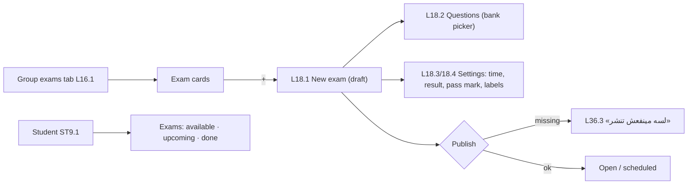

# Feature 16 — Exams · Mobile integration guide

> For: mobile developers · API `v1` · technical reference: [feature-16-exams.md](../features/feature-16-exams.md) · QA guide: [feature-16-exams-qa.md](feature-16-exams-qa.md) · prerequisites: [Feature 15](feature-15-question-bank-mobile.md) (question bank) · next: [17](feature-17-exam-import-sharing-mobile.md) import & sharing, [18](feature-18-exam-attempts-results-mobile.md) attempts & results

An exam belongs to one course, is assigned to groups and is built from **bank questions**. It is saved as a **draft** and published when complete (or published directly on create).

---

## 1. Common rules

* Base URL `{{host}}/api/v1`; headers `Authorization`, `Accept: application/json`, `Accept-Language: ar|en`, **`X-Teacher-Id`**.
* Envelope `{code, message, errors, data}`; **branch on `error_code`** (`details.missing` for the publish checklist).
* Lists: `?page=&per_page=` → `data.items[]` + `data.pagination`.

---

## 2. Screens



---

## 3. API

Base `/teacher/courses/{courseId}/exams`:

| Action | Request | Success |
|---|---|---|
| List (cards) | `GET /` | 200 |
| Group tab | `GET /teacher/courses/{courseId}/groups/{groupId}/exams` | 200 (+ `tabs`) |
| Next number | `GET /next-number` | 200 `{next_exam_number}` |
| Create (draft, or `publish: true`) | `POST /` | **201** |
| Detail | `GET /{examId}` | 200 |
| Edit | `PATCH /{examId}` | 200 |
| Publish / back to draft | `POST /{examId}/publish` · `POST /{examId}/unpublish` | 200 |
| Delete | `DELETE /{examId}` | 200 |
| Add questions | `POST /{examId}/questions` | 200 |
| Points of one question | `PATCH /{examId}/questions/{questionId}` | 200 |
| Remove a question | `DELETE /{examId}/questions/{questionId}` | 200 |
| Reorder questions | `PUT /{examId}/questions/order` | 200 |
| Student list | `GET /student/courses/{courseId}/exams` | 200 |

### 3.1 List filters

| Parameter | Values |
|---|---|
| `group_id` | a group of the course |
| `category_id` / `uncategorized=1` | not both |
| `status` | `draft`, `scheduled`, `open`, `closed` |
| `type` | `practice`, `quiz`, `final` |
| `search` | exam title |
| `page`, `per_page` | default 15, max 100 |

Sorted by `exam_number`. `data.filters.categories` = category chips.

Card:

```json
{ "id": "019b…", "exam_number": 3, "title": "امتحان الوحدة الأولى", "type": "quiz", "status": "open",
  "questions_count": 20, "total_points": 20, "duration_minutes": 30, "max_attempts": 2,
  "opens_at": null, "closes_at": "2026-10-30T20:59:00+00:00", "published_at": "…",
  "category": { "id": "…", "name": "الوحدة الأولى", "color": "…" }, "groups": [ { "id": "…", "name": "المجموعة A" } ],
  "shared_in_bank": false, "stats": { "attempted_students": 37, "average_percentage": 72.5 } }
```

### 3.2 Create — every field

```json
POST /teacher/courses/{courseId}/exams
{
  "title": "امتحان الوحدة الأولى",
  "exam_number": 3,
  "description": "امتحان على العرض والطلب - 20 سؤال",
  "type": "quiz",
  "max_attempts": 2,
  "duration_minutes": 30,
  "opens_at": "2026-10-27T17:00:00+03:00",
  "closes_at": "2026-10-30T23:59:00+03:00",
  "result_visibility": "immediately",
  "show_correct_answers": true,
  "shuffle_questions": true,
  "shuffle_options": false,
  "option_labels": "arabic_letters",
  "pass_percentage": 60,
  "category_id": "019a…",
  "group_ids": ["019a…", "019a…"],
  "questions": [
    { "question_id": "019d…", "points": 2 },
    { "question_id": "019d…", "points": 1.5 },
    { "question_id": "019d…", "points": null }
  ],
  "shared_in_bank": false,
  "lecture_id": "019a…",
  "publish": true
}
```

| Field | Values | Default |
|---|---|---|
| `title` | ≤ 150 (required to publish) | — |
| `exam_number` | 1–100000, unique in the course | next number |
| `description` | ≤ 250 | — |
| `type` | `practice` · `quiz` · `final` (label only) | `quiz` |
| `max_attempts` | 1–20, `null` = unlimited | 1 |
| `duration_minutes` | 1–600, `null` = no limit | `null` |
| `opens_at` / `closes_at` | ISO date-time; `null` = opens on publish / never closes | `null` |
| `result_visibility` | `immediately` · `after_close` · `hidden` | `immediately` |
| `show_correct_answers` | bool | true |
| `shuffle_questions` / `shuffle_options` | bool | false |
| `option_labels` | `arabic_letters` (أ ب ج) · `latin_letters` · `numbers` | `arabic_letters` |
| `pass_percentage` | 1–100 | 50 |
| `category_id` | a category of the course | — |
| `group_ids` | ≤ 50 groups of the course (≥ 1 to publish) | — |
| `questions` | ≤ 200 `{question_id, points?}`; order = list order; `points: null` = the question's default | — |
| `shared_in_bank` | share the exam in the teacher's exam bank ([Feature 17](feature-17-exam-import-sharing-mobile.md)) | false |
| `lecture_id` | the lecture this exam follows (progress) | — |
| `publish` | **create only**: create and publish at once (all or nothing) | false |

Everything is optional for a draft: `{}` creates an empty draft.

### 3.3 Edit

Same fields (except `publish`), all optional; `group_ids` and `questions` **replace**. Questions can't change once a student has attempted (`409 EXAM_HAS_ATTEMPTS`); settings can.

### 3.4 Questions endpoints

```json
POST  …/exams/{examId}/questions                 { "question_ids": ["019d…", "019d…"], "points": 2 }   ← appended
PATCH …/exams/{examId}/questions/{questionId}    { "points": 3 }                                      ← null = default
PUT   …/exams/{examId}/questions/order           { "question_ids": ["…every question of the exam, new order…"] }
```

Or create a question and add it in one step: `POST /teacher/courses/{courseId}/questions` with `add_to_exam_id` ([Feature 15](feature-15-question-bank-mobile.md)).

### 3.5 Publish checklist

`GET …/exams/{examId}` returns:

```json
"publish_checklist": { "ready": false, "missing": ["questions", "groups"],
  "items": [ { "key": "title", "ok": true }, { "key": "questions", "ok": false }, { "key": "groups", "ok": false }, { "key": "schedule", "ok": true } ] }
```

Draw the red dots from it. `POST …/publish` with something missing → `422 EXAM_NOT_PUBLISHABLE` + `details.missing`.

| Status | Meaning |
|---|---|
| `draft` | not published |
| `scheduled` | published, opens later |
| `open` | students can take it |
| `closed` | `closes_at` passed |

### 3.6 Student list

`GET /student/courses/{courseId}/exams` → `{id, title, type, status, section, questions_count, total_points, duration_minutes, max_attempts, opens_at, closes_at, category}`, open first. `section`: `available` · `upcoming` · `done`. Taking the exam: [Feature 18](feature-18-exam-attempts-results-mobile.md).

---

## 4. Errors to handle

| `error_code` | HTTP | Show |
|---|---|---|
| `EXAM_NOT_PUBLISHABLE` | 422 | L36.3 with `details.missing` |
| `EXAM_HAS_ATTEMPTS` | 409 | L36.4 «الأسئلة مقفولة» |
| `EXAM_NUMBER_TAKEN` | 422 | number used; offer `next-number` |
| `INVALID_EXAM_WINDOW` | 422 | `closes_at` before `opens_at` |
| `EXAM_QUESTION_LIMIT_REACHED` | 422 | max 200 questions |
| `INVALID_QUESTION` / `INVALID_GROUP_ASSIGNMENT` / `INVALID_CATEGORY` / `INVALID_LECTURE` | 422 | stale pickers; refresh |
| `EXAM_NOT_FOUND` | 404 | deleted; refresh |

---

## 5. Checklist

- [ ] Draft saves anything; publish shows the checklist.
- [ ] "Publish now" on create sends `publish: true`; a 422 means nothing was saved.
- [ ] Question order = list order; reorder sends the moved question_id and its 1-based position.
- [ ] Points: empty = the question's default points.
- [ ] Questions screen locks after the first attempt (409).
- [ ] Student list grouped by `section`.


### Move one exam question

`PUT /teacher/courses/{course}/exams/{exam}/questions/order`

```json
{"question_id": "{questionId}", "position": 1}
```

Use the bank question ID returned as `questions[].id`, not the exam slot ID. Position starts at 1 and cannot exceed the number of questions in the exam. Other questions shift automatically, preserving relative order. The response is the updated exam with ordered questions. Invalid IDs, questions outside this exam, or invalid positions return 422 without changes. Existing attempts still prevent reordering (409 EXAM_HAS_ATTEMPTS).

Legacy full-list `question_ids` remains supported; do not combine formats. Verify moves to first/last, invalid positions, foreign questions, and the attempt lock.
