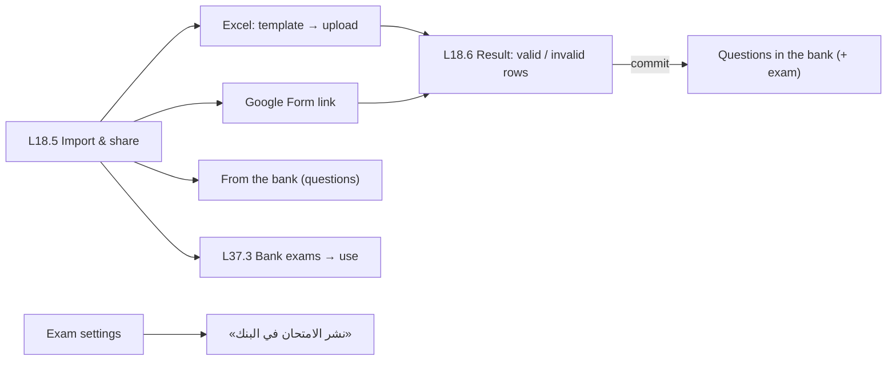

# Feature 17 — Exam import & sharing · Mobile integration guide

> For: mobile developers · API `v1` · technical reference: [feature-17-exam-import-sharing.md](../features/feature-17-exam-import-sharing.md) · QA guide: [feature-17-exam-import-sharing-qa.md](feature-17-exam-import-sharing-qa.md) · prerequisites: [Feature 15](feature-15-question-bank-mobile.md) (bank), [Feature 16](feature-16-exams-mobile.md) (exams)

Bring questions in from **Excel**, a **Google Form** quiz, the **question bank**, or a whole **exam shared in the bank**. Excel and Google Form imports go through three steps: **parse → preview (valid / invalid rows with reasons) → commit**. Everything lands in the course question bank, and optionally in an exam.

---

## 1. Common rules

* Base URL `{{host}}/api/v1`; teacher screens send **`X-Teacher-Id`**.
* Envelope `{code, message, errors, data}`; **branch on `error_code`**, read `details` for file errors.
* An import expires after **24 hours** if not committed.

---

## 2. Screens



---

## 3. API

Base `/teacher/courses/{courseId}`:

| Action | Request | Success |
|---|---|---|
| Excel template | `GET /imports/excel-template` | the `.xlsx` |
| Upload Excel | `POST /imports/excel` (multipart) | **202** (`parsing`) |
| Google Form | `POST /imports/google-form` | **201** (`ready`) |
| Preview | `GET /imports/{importId}?valid=0|1&page=` | 200 |
| Commit | `POST /imports/{importId}/commit` | 200 |
| Add bank questions to an exam | `POST /exams/{examId}/import-from-bank` | 200 |
| Share an exam | `PATCH /exams/{examId}` `{shared_in_bank: true}` | 200 |
| Bank exams | `GET /bank/exams?search=` | 200 |
| Use a bank exam | `POST /bank/exams/{examId}/use` | **201** new draft |

### 3.1 Excel

Download the template, fill one row per question, upload:

```
POST /teacher/courses/{courseId}/imports/excel
file:<file: unit2-questions.xlsx>
exam_id:{{exam_id}}                       ← optional: also add the questions to this exam
create_missing_categories:1               ← optional: unknown category names are created on commit
```

| Column (Arabic / key) | Required | Content |
|---|---|---|
| نوع السؤال / `type` | ✓ | `صح أو خطأ`, `إجابة واحدة`, `أكثر من إجابة` (or `true_false`, `single_choice`, `multiple_choice`) |
| السؤال / `question` | ✓ | 1–2000 |
| اختيار 1 … 8 / `option_1` … `option_8` | 1, 2 | ≤ 500 each (true / false may be empty → «صح / خطأ») |
| الإجابة الصحيحة / `correct` | ✓ | option numbers `1، 2`, an option text, or `صح` / `خطأ` |
| الدرجة / `points` | | 0–999.99 (default 1) |
| الشرح / `explanation` | | ≤ 2000 |
| التصنيف / `category` | | a category **name** of the course |

`.xlsx` only, ≤ 5 MB, ≤ 500 rows. The response is **202** with the import in `parsing`: poll `GET /imports/{importId}` until `ready` (or `failed`).

### 3.2 Google Form

```json
POST /teacher/courses/{courseId}/imports/google-form
{ "url": "https://docs.google.com/forms/d/1FAIpQLSf…/edit", "exam_id": "019b…", "google_access_token": "ya29.a0…" }
```

The app asks Google (incrementally) for the `https://www.googleapis.com/auth/forms.body.readonly` scope and sends the access token; the server uses it once and never stores it. The form must be a **quiz**. Answer **201** with the import already `ready`. This source may be disabled on the server (`503 GOOGLE_FORM_UNAVAILABLE`): hide the option then.

### 3.3 Preview

```json
GET /teacher/courses/{courseId}/imports/{importId}?valid=0
{
  "import": { "id": "…", "source": "excel", "status": "ready", "file_name": "unit2-questions.xlsx",
              "summary": { "total": 24, "valid": 22, "invalid": 2, "warnings": 1, "total_points": 26 }, "failure_reason": null, "expires_at": "…" },
  "rows": [
    { "row": 7, "is_valid": false, "question": { "type": "single_choice", "body": "…", "options": [ "…" ] },
      "errors": [ { "column": "correct", "code": "NO_CORRECT_ANSWER", "message": "مفيش إجابة صحيحة متعلّمة" } ], "warnings": [] },
    { "row": 15, "is_valid": false, "errors": [ { "column": "type", "code": "UNKNOWN_TYPE", "message": "نوع السؤال «MCQ2» مش معروف …" } ] }
  ],
  "pagination": { "…": "…" }
}
```

`?valid=0` = invalid rows only, `?valid=1` = valid only, omitted = all. Row codes: `UNKNOWN_TYPE`, `MISSING_QUESTION`, `NO_CORRECT_ANSWER`, `INVALID_CORRECT_ANSWER`, `INVALID_QUESTION_OPTIONS`, `INVALID_POINTS`, `UNKNOWN_CATEGORY`, `TEXT_TOO_LONG`, `UNSUPPORTED_QUESTION_TYPE`; warning `DUPLICATE_QUESTION`.

### 3.4 Commit

```json
POST /teacher/courses/{courseId}/imports/{importId}/commit
{ "category_id": "019a…" }        ← optional: category for rows without one
→ { "created": 22, "added_to_exam": 22 }
```

Only valid rows are imported, in one transaction. Commit once (`409 IMPORT_ALREADY_COMMITTED` after).

### 3.5 Bank questions into an exam

```json
POST /teacher/courses/{courseId}/exams/{examId}/import-from-bank
{ "question_ids": ["019d…", "019d…"] }
```

The questions are **reused** (not copied). Use the bank list with `not_in_exam={examId}` to pick them.

### 3.6 Sharing & bank exams

* Share: `PATCH /exams/{examId} {"shared_in_bank": true}`.
* List: `GET /bank/exams?search=` → cards (`questions_count`, `total_points`, `type` …).
* Use: `POST /bank/exams/{examId}/use` → a **new draft** with the same settings and questions, title «… · نسخة», **no groups and no dates** (the checklist shows them missing). Same course only.

---

## 4. Errors to handle

| `error_code` | HTTP | Show |
|---|---|---|
| `IMPORT_FILE_INVALID` | 422 | `details.reason`: `not_xlsx` / `unreadable` / `wrong_headers` (+ `missing_headers`, `expected_headers`) |
| `IMPORT_TOO_MANY_ROWS` | 422 | `details.rows` / `max_rows` (500) |
| `IMPORT_NOT_READY` | 409 | still parsing: keep polling |
| `IMPORT_ALREADY_COMMITTED` | 409 | already imported |
| `IMPORT_EXPIRED` | 410 | older than 24 h: upload again |
| `IMPORT_NOTHING_VALID` | 422 | no valid row to import |
| `GOOGLE_FORM_INVALID_URL` / `GOOGLE_FORM_NOT_QUIZ` | 422 | L37.2 «الفورم مش Quiz» |
| `GOOGLE_FORM_NOT_ACCESSIBLE` | 403 | not the teacher's form / scope missing: re-ask the scope |
| `GOOGLE_FORM_UNAVAILABLE` | 503 | the option is disabled on the server |
| `EXAM_HAS_ATTEMPTS` / `EXAM_QUESTION_LIMIT_REACHED` | 409 / 422 | the target exam can't take questions |
| `EXAM_NOT_FOUND` | 404 | the bank exam isn't shared anymore |

---

## 5. Checklist

- [ ] Template download offered before upload.
- [ ] Upload → poll while `parsing` → preview with valid / invalid tabs.
- [ ] Invalid rows show the row number, column and message.
- [ ] Commit button disabled when `summary.valid = 0`.
- [ ] Google Form option hidden when the server answers 503.
- [ ] «استيراد امتحان جاهز» → bank exams → use → open the new draft.
