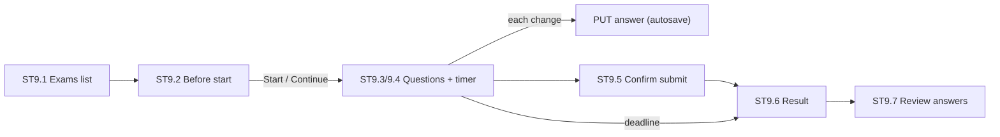

# Feature 18 — Exam attempts & results · Mobile integration guide

> For: mobile developers · API `v1` · technical reference: [feature-18-exam-attempts-results.md](../features/feature-18-exam-attempts-results.md) · QA guide: [feature-18-exam-attempts-results-qa.md](feature-18-exam-attempts-results-qa.md) · prerequisites: [Feature 16](feature-16-exams-mobile.md) (exams)

The student takes an exam: info screen → start (or resume) → answer with autosave and a timer → submit → result → review. The server applies the exam's own settings (attempts, duration, window, shuffling, labels, result visibility, pass mark). Teachers get a minimal results view.

---

## 1. Common rules

* Base URL `{{host}}/api/v1`; student calls need a student role; teacher calls send **`X-Teacher-Id`**.
* Envelope `{code, message, errors, data}`; **branch on `error_code`**.
* **Use `server_time`** (returned on start / answer / info) with `deadline_at` for the timer — never the phone clock alone.
* Answers are autosaved per question (max 120 saves / minute per attempt).

---

## 2. Screens



---

## 3. Student API

| Action | Request | Success |
|---|---|---|
| Exam info | `GET /student/exams/{examId}` | 200 |
| Start / resume | `POST /student/exams/{examId}/attempts` | **201** start / **200** resume |
| Save an answer / flag | `PUT /student/exam-attempts/{attemptId}/answers/{questionId}` | 200 |
| Submit | `POST /student/exam-attempts/{attemptId}/submit` | 200 |
| Attempt (state or result) | `GET /student/exam-attempts/{attemptId}` | 200 |
| My attempts | `GET /student/exams/{examId}/attempts` | 200 |

### 3.1 Before start (ST9.2)

```json
{ "id": "019b…", "title": "امتحان الوحدة الأولى", "questions_count": 20, "total_points": 20, "duration_minutes": 30,
  "pass_percentage": 60, "teacher": { "name": "منى محمود" },
  "attempts": { "used": 1, "allowed": 2, "remaining": 1 }, "in_progress_attempt_id": null,
  "can_start": true, "reason": null,
  "unlocks_lectures": [ { "id": "…", "title": "Chapter 2 · Part 1" } ],
  "server_time": "2026-10-25T12:00:00+00:00" }
```

`reason` when `can_start: false`: `not_open`, `closed`, `no_attempts_left`, `no_access`. With `in_progress_attempt_id` show «كمّل المحاولة».

### 3.2 Start / resume

```json
POST /student/exams/{examId}/attempts
→ {
  "attempt_id": "019h…", "attempt_number": 2, "started_at": "…", "deadline_at": "2026-10-25T12:30:00+00:00",
  "server_time": "2026-10-25T12:00:00+00:00", "option_labels": "arabic_letters",
  "progress": { "answered": 0, "flagged": 0, "unanswered": 20, "total": 20 },
  "questions": [
    { "id": "019d…", "number": 1, "type": "single_choice", "body": "ما مشتقة الدالة د(س) = س³ ؟", "points": 1,
      "images": [ { "id": 15, "url": "…", "thumb_url": "…" } ],
      "options": [ { "id": "o1", "label": "أ", "body": "٣س²" }, { "id": "o2", "label": "ب", "body": "س²" } ],
      "selected_option_ids": [], "flagged": false }
  ]
}
```

The order (questions and options) is fixed per attempt; a resume returns the same order and the saved answers. No correct answers are ever sent during the attempt. `deadline_at: null` = no time limit.

### 3.3 Save an answer / flag

```json
PUT /student/exam-attempts/{attemptId}/answers/{questionId}
{ "selected_option_ids": ["o1"], "flagged": true }
```

* true/false and single choice: exactly one id; multiple choice: one or more; `[]` clears the answer.
* `flagged` («علّم السؤال») can be sent alone.
* Response: `{question_id, selected_option_ids, flagged, answered_at, progress, deadline_at, server_time}`.

### 3.4 Submit and result

`POST /student/exam-attempts/{attemptId}/submit` (idempotent). The result depends on the exam settings:

| Exam settings | Result |
|---|---|
| shown immediately + correct answers | score, per question `is_correct`, `correct_option_ids`, `explanation` |
| shown immediately, no correct answers | score, per question `is_correct` only |
| after close (before it closes) | `{result_visible: false, result_pending: true, available_at}` |
| hidden | `{result_visible: false}` («تم التسليم») |

```json
{ "result_visible": true, "score": 14, "max_score": 20, "percentage": 70, "passed": true,
  "correct_count": 14, "wrong_count": 4, "unanswered_count": 2, "duration_seconds": 1320,
  "rank": { "position": 12, "out_of": 91 }, "unlocked_lectures": [ { "id": "…", "title": "…" } ],
  "questions": [ { "id": "…", "number": 1, "answered": true, "is_correct": true, "earned_points": 1, "correct_option_ids": ["o1"], "explanation": "…" } ] }
```

At the deadline the server submits automatically (`submit_reason: time_up`, or `exam_closed` when the exam / course closes): when the timer hits zero, call `GET /student/exam-attempts/{attemptId}` to show the result.

---

## 4. Teacher API (minimal)

| Action | Request |
|---|---|
| Results of an exam | `GET /teacher/courses/{courseId}/exams/{examId}/results?group_id=&passed=1|0` |
| Attempts of one student | `GET /teacher/course-enrollments/{enrollmentId}/exam-attempts` |
| One attempt (everything) | `GET /teacher/exam-attempts/{attemptId}` |

Results rows: `student {name, code}, groups, attempts_used, score, max_score, percentage, passed, submitted_at` + `summary {attempted, average_percentage, pass_rate}`. The counted attempt is the **best** one.

---

## 5. Errors to handle

| `error_code` | HTTP | Show |
|---|---|---|
| `EXAM_NOT_OPEN` / `EXAM_CLOSED` | 403 | not open yet / closed |
| `EXAM_NO_ATTEMPTS_LEFT` | 403 | no attempts left |
| `ATTEMPT_TIME_UP` | 409 | time is up: open the result |
| `ATTEMPT_ALREADY_SUBMITTED` | 409 | already submitted: open the result |
| `INVALID_ANSWER` | 422 | wrong option ids / count |
| `ATTEMPT_NOT_FOUND` | 404 | not this student's attempt |
| `EXAM_NOT_FOUND` | 404 | not visible to this student |
| `COURSE_NOT_OPEN_YET` / `COURSE_ACCESS_CLOSED` | 403 | course access window ([Feature 22](feature-22-course-tools-access-mobile.md)) |
| `TOO_MANY_REQUESTS` | 429 | autosave too fast: debounce |

---

## 6. Checklist

- [ ] Timer from `deadline_at` and `server_time`; auto-open the result at zero.
- [ ] Every answer change autosaves (debounced); flag toggles separately.
- [ ] Resume keeps the order and answers.
- [ ] Labels follow `option_labels` (use `label` from the payload).
- [ ] Result screen handles the four visibility cases.
- [ ] Question images shown in questions and the review.
