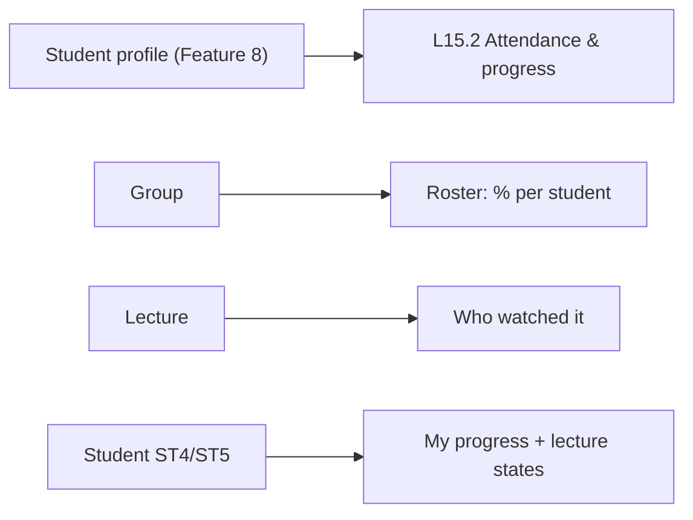

# Feature 19 — Student progress & attendance · Mobile integration guide

> For: mobile developers · API `v1` · technical reference: [feature-19-progress-attendance.md](../features/feature-19-progress-attendance.md) · QA guide: [feature-19-progress-attendance-qa.md](feature-19-progress-attendance-qa.md) · prerequisites: [Feature 11](feature-11-lecture-protection-conditions-mobile.md) (views), [Feature 18](feature-18-exam-attempts-results-mobile.md) (attempts)

Per student and course the server computes **الحضور العام** (attendance), **المحاضرات** (lectures) and **تقدّم الكورس** (course progress), plus a status per lecture and exam. **The app only displays the numbers** — never compute them on the device.

---

## 1. Common rules

* Base URL `{{host}}/api/v1`; teacher calls send **`X-Teacher-Id`**.
* Envelope `{code, message, errors, data}`; **branch on `error_code`**.
* Percentages are 0–100 with one decimal, or **`null`** = nothing assigned yet → show «لسه مفيش محتوى».
* `stale: true` = a recalculation is pending (usually seconds): show the numbers with a subtle "updating" hint.

---

## 2. Screens



---

## 3. API

| Action | Request | Success |
|---|---|---|
| One student (teacher) | `GET /teacher/course-enrollments/{enrollmentId}/progress` | 200 |
| Group roster | `GET /teacher/courses/{courseId}/groups/{groupId}/progress` | 200 |
| One lecture | `GET /teacher/courses/{courseId}/lectures/{lectureId}/progress?status=` | 200 |
| Recalculate now (support) | `POST /teacher/course-enrollments/{enrollmentId}/progress/recalculate` | 200 |
| My progress (student) | `GET /student/courses/{courseId}/progress` | 200 |
| Attendance CSV | Feature 8 export link ([guide](feature-08-student-profile-controls-mobile.md)) | 200 |

### 3.1 One student

```json
{
  "course_enrollment_id": "0199…",
  "summary": {
    "lectures_percentage": 50.0, "attendance_percentage": 75.0, "course_progress_percentage": 60.0,
    "counts": { "lectures_total": 4, "lectures_completed": 2, "lectures_viewed": 3, "exams_total": 1, "exams_attempted": 1, "exams_passed": 1 },
    "last_activity_at": "2026-10-24T19:10:00+00:00", "calculated_at": "2026-10-24T19:10:30+00:00", "stale": false
  },
  "categories": [
    { "category": { "id": "…", "name": "Supply", "color": "…" },
      "items": [
        { "type": "lecture", "id": "…", "number": 2, "title": "Chapter 1 · Part 1", "date": "2026-10-11", "status": "viewed_twice",
          "views_used": 2, "watched_seconds_total": 3900, "completed_at": "…", "last_viewed_at": "…",
          "related_exam": { "id": "…", "title": "امتحان الوحدة الأولى", "score": 14, "max_score": 20, "percentage": 70, "passed": true } },
        { "type": "exam", "id": "…", "number": 1, "title": "امتحان الوحدة الأولى", "date": "…", "status": "attempted",
          "score": 14, "max_score": 20, "percentage": 70, "passed": true, "submitted_at": "…", "lecture_id": "…" }
      ] },
    { "category": null, "items": [ "…uncategorized last…" ] }
  ]
}
```

| Lecture `status` | Show |
|---|---|
| `not_started` | «لسه» |
| `not_completed` | «مخلّصهاش» |
| `viewed_once` | «شافها مرة» |
| `viewed_twice` | «شافها مرتين» |

Exam `status`: `not_attempted` / `attempted` (+ `passed`). `related_exam` = the lecture's exam («14 / 20 · نجح»).

### 3.2 Group roster

`GET /teacher/courses/{courseId}/groups/{groupId}/progress?sort=course_progress&direction=asc&below=50&page=1`

| Parameter | Values |
|---|---|
| `sort` | `course_progress` · `attendance` · `lectures` · `last_activity` · `name` |
| `direction` | `asc` · `desc` |
| `below` | course progress under this % (or not calculated) |

Rows: `student {name, code}`, the three percentages, `last_activity_at`, `calculated_at`, `stale`.

### 3.3 One lecture

`GET …/lectures/{lectureId}/progress?status=viewed_twice` → per student `status, views_used, watched_seconds_total, completed_at, last_viewed_at` + `counts {all, not_started, not_completed, viewed_once, viewed_twice}` (the filter chips).

### 3.4 Student

`GET /student/courses/{courseId}/progress` → the same `summary` + `categories` for the signed-in student. Not enrolled → `404 COURSE_NOT_FOUND`; enrolled without access → `404 PROGRESS_NOT_AVAILABLE`.

---

## 4. Errors to handle

| `error_code` | HTTP | Show |
|---|---|---|
| `PROGRESS_NOT_AVAILABLE` | 404 | the subscription doesn't give access now |
| `COURSE_NOT_FOUND` | 404 | not enrolled |
| `ENROLLMENT_NOT_FOUND` / `GROUP_NOT_FOUND` / `LECTURE_NOT_FOUND` | 404 | refresh |

---

## 5. Checklist

- [ ] `null` percentages show «لسه مفيش محتوى», not 0 %.
- [ ] Numbers come from the API only.
- [ ] `stale` shows a light "updating" state (re-fetch after a few seconds if needed).
- [ ] Lecture status labels follow the table; exam results show score / max and pass.
- [ ] Roster sorting and the "below N %" filter use the query parameters.
