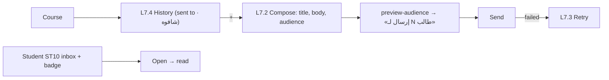

# Feature 20 — Course notifications & push · Mobile integration guide

> For: mobile developers · API `v1` · technical reference: [feature-20-notifications.md](../features/feature-20-notifications.md) · QA guide: [feature-20-notifications-qa.md](feature-20-notifications-qa.md) · prerequisites: [Feature 01](feature-01-authentication-mobile.md) (sign-in with `fcm_token`), [Feature 04](feature-04-groups-mobile.md) (groups)

The teacher (or a secretary) sends an announcement to **all students** or **selected groups** of a course. Every notification is **stored** (the student inbox, with «شافوه» counts) **and pushed with Firebase**. The app must register its FCM token and handle push taps.

---

## 1. Common rules

* Base URL `{{host}}/api/v1`; teacher calls send **`X-Teacher-Id`**.
* Envelope `{code, message, errors, data}`; **branch on `error_code`**.
* At most **10 sends per hour per course** (`429 NOTIFICATION_RATE_LIMITED` + `Retry-After`).

---

## 2. Firebase in the app

1. Get the FCM token (`FirebaseMessaging.instance.getToken()`) and send it **with the sign-in**: `fcm_token` + `platform` on `POST /auth/login`, `/auth/google` and `/auth/verify-email`.
2. When Firebase refreshes the token (`onTokenRefresh`), send it: `POST /me/push-tokens {token, platform}`.
3. **Do not subscribe to topics yourself**: the server subscribes the token to the right course / group topics and keeps them in sync.
4. On logout call `POST /auth/logout` (the server removes the token), then `FirebaseMessaging.instance.deleteToken()`.
5. Create the Android notification channel `darsly_default` (high importance).

Push payload `data` (strings) — route on `type`:

| `data.type` | Other keys | Open |
|---|---|---|
| `course_notification` | `notification_id`, `course_id`, `notification_type` | the inbox item, then call `…/read` |
| `private_message` | `message_id`, `thread_id`, `course_id` | the thread ([Feature 21](feature-21-private-messages-mobile.md)) |
| `platform_subscription` | `days_left` | teacher subscription screen ([Feature 23](feature-23-platform-subscription-mobile.md)) |

---

## 3. Screens



---

## 4. Teacher API

Base `/teacher/courses/{courseId}/notifications`:

| Action | Request | Success |
|---|---|---|
| History | `GET /` | 200 |
| Count recipients | `POST /preview-audience` | 200 |
| Send | `POST /` | **201** |
| Detail | `GET /{notificationId}` | 200 |
| Retry a failed send | `POST /{notificationId}/retry` | 200 |
| Delete | `DELETE /{notificationId}` | 200 |

### 4.1 Preview, then send

```json
POST /teacher/courses/{courseId}/notifications/preview-audience
{ "audience": "groups", "group_ids": ["019a…", "019a…"] }
→ { "recipients_count": 37, "per_group": [ { "id": "019a…", "name": "المجموعة A", "count": 25 }, { "id": "019a…", "name": "المجموعة المسائية", "count": 14 } ] }
```

```json
POST /teacher/courses/{courseId}/notifications
{
  "title": "تأجيل محاضرة السبت",
  "body": "محاضرة السبت اتأجلت لـ 7:30 م بدل 5:00 م. نفس المكان ونفس الرابط.",
  "audience": "groups",
  "group_ids": ["019a…", "019a…"]
}
```

| Field | Rule |
|---|---|
| `title` | 1–80 |
| `body` | 1–1000 |
| `audience` | `all` or `groups` |
| `group_ids` | required with `groups` (1–50 groups of the course), not allowed with `all` |

Recipients = students whose enrollment gives access **now**; a student in two selected groups gets it once. Response **201** with `status: sending` (the send continues in the background) — refresh the detail to see `sent` / `failed`.

### 4.2 History item

```json
{ "id": "019k…", "title": "تأجيل محاضرة السبت", "body": "…",
  "audience": { "type": "groups", "groups": [ { "id": "…", "name": "المجموعة A" } ] },
  "recipients_count": 37, "read_count": 27, "read_percentage": 73.0,
  "status": "sent", "failure_reason": null, "sent_at": "2026-10-25T10:00:00+00:00",
  "sent_by": { "name": "أحمد حسن", "role": "secretary" } }
```

No editing after send. `failed` → «إعادة المحاولة» (`POST …/retry`).

---

## 5. Student API

| Action | Request | Success |
|---|---|---|
| Inbox | `GET /student/notifications?course_id=&page=` | 200 |
| Unread badge | `GET /student/notifications/unread-count?course_id=` | 200 `{unread_count}` |
| Open (mark read) | `POST /student/notifications/{notificationId}/read` | 200 |
| Read all | `POST /student/notifications/read-all?course_id=` | 200 `{marked}` |

Inbox item: `{id, title, body, course {id, name}, sent_by {name, role}, sent_at, read_at}`. Reading is idempotent; it is what the teacher sees as «شافوه».

---

## 6. Errors to handle

| `error_code` | HTTP | Show |
|---|---|---|
| `NOTIFICATION_NO_RECIPIENTS` | 422 | nobody would receive it |
| `NOTIFICATION_RATE_LIMITED` | 429 | wait `Retry-After` |
| `NOTIFICATION_NOT_RETRYABLE` | 409 | only failed sends can be retried |
| `NOTIFICATION_NOT_FOUND` | 404 | deleted / not received |
| `INVALID_GROUP_ASSIGNMENT` | 422 | a group of another course |
| `VALIDATION_ERROR` | 422 | title / body length, `group_ids` with `all` |

---

## 7. Checklist

- [ ] FCM token sent on login / Google / verify-email and on refresh; never subscribe to topics in the app.
- [ ] Logout calls the API, then deletes the Firebase token.
- [ ] Push taps route on `data.type`; opening a course notification marks it read.
- [ ] Compose screen shows the recipients count from `preview-audience` and the 80 / 1000 counters.
- [ ] History shows «تم الإرسال لـ N · شافوه M».
- [ ] Badge from `unread-count`.
