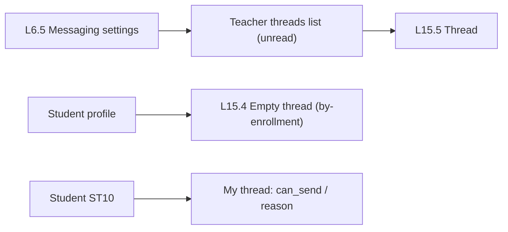

# Feature 21 — Private messages · Mobile integration guide

> For: mobile developers · API `v1` · technical reference: [feature-21-private-messages.md](../features/feature-21-private-messages.md) · QA guide: [feature-21-private-messages-qa.md](feature-21-private-messages-qa.md) · prerequisites: [Feature 08](feature-08-student-profile-controls-mobile.md) (per-student permission), [Feature 20](feature-20-notifications-mobile.md) (push)

One private conversation per **student × course** with the course staff (the teacher and the linked secretaries share it). Messages are **text**, **image** or **voice**. New messages, deletions and reads arrive **live over Pusher** while the app is open (§4.4); a Firebase push (`data.type: private_message`) reaches the other side when the app is in the background.

---

## 1. Common rules

* Base URL `{{host}}/api/v1`; teacher calls send **`X-Teacher-Id`**.
* Envelope `{code, message, errors, data}`; **branch on `error_code`** (`details` for media errors).
* Sending with a file is **multipart**. Media links are signed and expire after **5 minutes**: re-fetch the page to get fresh ones.
* Paging: `?before={messageId}` (older) and `?after={messageId}` (newer, after a realtime event). Items are oldest → newest.

---

## 2. Screens



---

## 3. Settings (teacher, L6.5)

```json
PATCH /teacher/courses/{courseId}/messaging-settings
{ "private_messages_enabled": true, "allow_non_subscribed": false, "allow_images": true, "allow_voice": true }
```

| Field | Default | Meaning |
|---|---|---|
| `private_messages_enabled` | false | students may write (the course default of the Feature 08 permission) |
| `allow_non_subscribed` | false | students without current access (expired / suspended) may still write |
| `allow_images` | true | image messages |
| `allow_voice` | true | voice messages |

Staff can always write to any enrolled student.

---

## 4. API

### Teacher (`/teacher/courses/{courseId}`)

| Action | Request | Success |
|---|---|---|
| Settings | `GET` / `PATCH /messaging-settings` | 200 |
| Threads | `GET /threads?unread=1&search=` | 200 `{unread_total, items, pagination}` |
| Thread of a student (creates it) | `GET /threads/by-enrollment/{enrollmentId}` | 200 |
| Messages (also **marks the thread read**) | `GET /threads/{threadId}/messages?before=&after=` | 200 |
| Send | `POST /threads/{threadId}/messages` | **201** |
| Mark read | `POST /threads/{threadId}/read` | 200 |
| Delete (any message) | `DELETE /threads/{threadId}/messages/{messageId}` | 200 |

### Student (`/student`)

| Action | Request | Success |
|---|---|---|
| My thread | `GET /courses/{courseId}/thread` | 200 |
| Messages | `GET /courses/{courseId}/thread/messages?before=&after=` | 200 |
| Send | `POST /courses/{courseId}/thread/messages` | **201** |
| Mark read | `POST /courses/{courseId}/thread/read` | 200 |
| Delete own (≤ 15 min) | `DELETE /courses/{courseId}/thread/messages/{messageId}` | 200 |
| Unread badge | `GET /messages/unread-count` | 200 |

### 4.1 Send — the three kinds

```
kind:text
body:هو امتحان الوحدة التانية إمتى؟
```

```
kind:image
file:<file: photo.jpg>                ← jpg / png / webp ≤ 10 MB
```

```
kind:voice
file:<file: note.m4a>                 ← m4a / aac / ogg / mp3 ≤ 5 MB
duration_seconds:18                   ← required, 1–300
```

Text alone can be sent as JSON: `{"kind": "text", "body": "…"}` (1–2000 characters).

### 4.2 Message object

```json
{ "id": "019m…", "kind": "voice", "body": null, "duration_seconds": 18,
  "media": { "url": "https://…/api/v1/message-media/019m…?u=…&expires=…&signature=…", "thumb_url": null, "expires_at": "…" },
  "sender": { "side": "staff", "name": "أحمد حسن", "role": "secretary" },
  "read_at": null, "created_at": "2026-10-25T10:00:00+00:00", "deleted": false }
```

* `sender.role: secretary` → show «بواسطة السكرتير».
* `deleted: true` → «الرسالة اتمسحت» (no body / media).
* Open `media.url` without the bearer token; images have `thumb_url`.

### 4.3 Student thread state

```json
{ "id": "019t…", "course_id": "019a…", "course_enrollment_id": "0199…", "last_message_at": "…", "last_message_preview": "…", "unread": 2,
  "can_send": false, "allowed_kinds": [], "reason": "subscription_required" }
```

`reason`: `disabled` (messages off for the course), `blocked` (this student is blocked), `subscription_required`. The thread stays readable in every case; hide the composer and explain the reason. `allowed_kinds` hides the camera / mic buttons.

---

### 4.4 Realtime (Pusher)

Pusher key / cluster come from the backend team (`PUSHER_APP_KEY`, `PUSHER_APP_CLUSTER`). Private channels are authorized by the API with the **bearer token**:

```
authEndpoint: {{host}}/api/v1/broadcasting/auth
headers:      Authorization: Bearer {token}, Accept: application/json
body (form):  socket_id, channel_name      → 200 {"auth": "key:signature"} · 403 not a participant · 401 no token
```

| Channel | Who may join | Use |
|---|---|---|
| `private-thread.{threadId}` | the thread's student, the course teacher, secretaries with an active link | the open thread screen |
| `private-user.{myUserId}` | only that user | thread list, unread badges |

| Event | Payload | App does |
|---|---|---|
| `message.sent` | `message_id, thread_id, course_id, sender_side, kind, preview, created_at` | fetch `…/messages?after={lastId}` (media URLs are not in the event); bump the list / badge |
| `message.deleted` | `message_id, thread_id, course_id, deleted_by_side` | remove the bubble; refresh the list preview |
| `thread.read` | `thread_id, course_id, reader_side, marked_count` | other side read → show read ticks; own side → clear the badge on this device |

Dedupe by `message_id` (your own send also comes back). On reconnect, fetch `?after=` once to catch up.

---

## 5. Errors to handle

| `error_code` | HTTP | Show |
|---|---|---|
| `MESSAGES_DISABLED` | 403 | the teacher closed private messages |
| `MESSAGES_BLOCKED_FOR_STUDENT` | 403 | you can't send messages in this course |
| `MESSAGES_SUBSCRIPTION_REQUIRED` | 403 | renew your subscription to send |
| `MESSAGE_KIND_NOT_ALLOWED` | 403 | images / voice are off |
| `INVALID_MEDIA` | 422 | `details.reason`: `file`, `size`, `type`, `duration` (+ `allowed_types`, `max_kilobytes`) |
| `MESSAGE_DELETE_WINDOW_PASSED` | 409 | more than 15 minutes |
| `MESSAGE_NOT_FOUND` / `THREAD_NOT_FOUND` | 404 | refresh |
| `TOO_MANY_REQUESTS` | 429 | slow down (student 30 / min, staff 60 / min) |

---

## 6. Checklist

- [ ] Composer follows `can_send` / `allowed_kinds`; the reason is explained.
- [ ] Voice notes send `duration_seconds`.
- [ ] Pusher: auth via `/broadcasting/auth` with the bearer; subscribe to `private-thread.{id}` on the open thread and `private-user.{me}` app-wide; fetch `after` on `message.sent` and on reconnect; push opens the thread when closed.
- [ ] Opening a thread: staff — loading its messages marks it read (no extra call); student — call `…/read`. Badges from the unread endpoints.
- [ ] Expired media links: reload the page of messages.
- [ ] Delete offered on own messages for 15 minutes (staff: any message).
